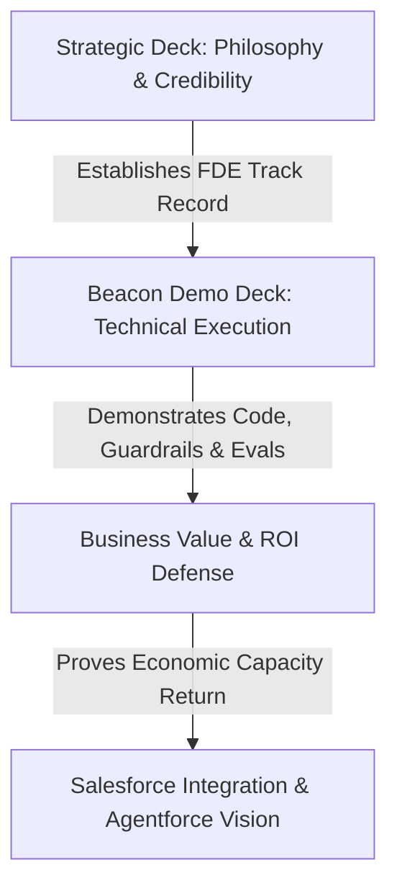
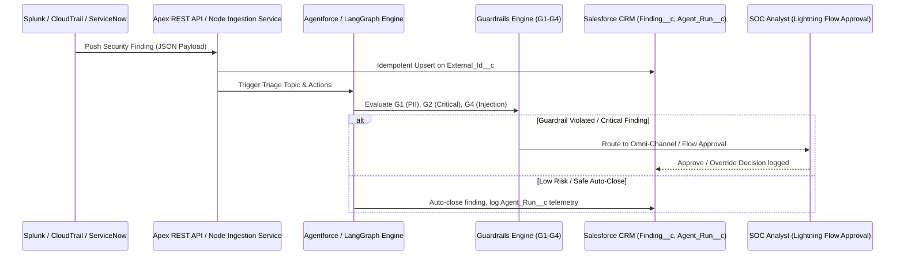

# Salesforce Final-Round Master Presentation Commentary, Technical Defense, and Rehearsal Playbook

**Candidate:** Shaikat Majumdar  
**Target Role:** Senior Forward Deployed Engineer (FDE) — Salesforce  
**Interview Panel:** Kaytie Zimmerman (VP, Forward Deployed Engineering) & Anand Narayan (Deployment Strategist Director)  
**Format:** 45-Minute 2:1 Onsite Panel Interview (Tampa Bay Office / Remote Dial-in)  

**Core Artifacts Covered:**
1. `SALESFORCE_FINAL_ROUND_PRESENTATION.pptx` (Strategic Deck — 17 Slides)
2. `SALESFORCE_FINAL_ROUND_OPEN_SOURCE_DEMO.pptx` (Beacon GRC Open-Source Demo Deck — 20 Slides)
3. Primary Code / Reference Architecture Repositories: `github.com/sm2774us/fde-command-center`, `github.com/sm2774us/agentic-platform`

---

## SECTION 1 --- Executive Assessment and Final-Round Strategy

### 1. Overall Assessment of Original & Enhanced Presentations
Your presentation materials are mature, highly credible, and aligned directly with the Forward Deployed Engineering (FDE) operational model. Rather than relying on abstract AI concepts, you anchor your narrative in production engineering, concrete data platforms (Salesforce Data 360, Snowflake, Databricks, BigQuery), multi-agent frameworks (Agentforce, LangGraph, LlamaIndex), and mathematically defensible business outcomes ($\$47,947$ net monthly savings, $799\%$ modeled Net ROI).

### 2. Strategic Strengths
* **Deep Builder Credibility:** 17+ years of hands-on software engineering and 3 prior customer-facing FDE roles in high-stakes financial/GRC environments (Balyasny, J.P. Morgan/Highbridge, Millburn) establish immediate technical authority.
* **Mastery of the FDE Dual Motion:** You seamlessly bridge the technical builder persona (Apex, Python, TypeScript, Cursor, Claude, Vibes) with the customer-facing strategic advisor persona (pod collaboration with Deployment Strategists, executive stakeholder management, onsite discovery).
* **Direct Alignment with Round 1 Coaching:** You explicitly incorporate Round 1 feedback by establishing a formal framework for *Ambiguity vs. Uncertainty*, tying technical outputs directly to financial ROI, and mapping custom open-source components directly onto native Salesforce platform capabilities (Agentforce Topics, Invocable Apex, Einstein Trust Layer, Data 360).

### 3. Key Vulnerabilities & Interviewer Scrutiny
* **Pacing the 15-Minute Walkthrough:** Demoing the Beacon GRC Control Tower in 15 minutes requires strict time discipline. Avoid deep syntax walks during the live demo; focus on event flow, guardrail triggers, and business outcomes.
* **Native Platform vs. External Code:** The panel will probe how much of Beacon runs natively inside Salesforce vs. external microservices. Be ready to explain how Node/Python components map directly to native Apex, Data 360 streaming, and Agentforce topics.
* **Adversarial Technical & Financial Defense:** Expect Kaytie to challenge deterministic scoring vs. LLM non-determinism, while Anand tests your ROI assumptions against CFO "soft money" objections.

---

## SECTION 2 --- Complete Slide-by-Slide Commentary

### Part A: Strategic Presentation (`SALESFORCE_FINAL_ROUND_PRESENTATION.pptx`)

#### Slide 1 — Opening: Introduction
* **Objective:** Establish immediate executive presence, seniority, and direct alignment with the FDE job description by bypassing standard bio filler.

* **Speaker Script (Verbatim):**
  > "I wanted to skip the standard bio and look at why we're here today: Salesforce needs technical leaders who can ship agentic systems that actually survive real-world enterprise constraints. That is exactly what I've spent the last 17 years doing.
  > 
  > Whether at Balyasny or J.P. Morgan, my motion is the exact one this role demands. I don't build from afar—I embed onsite 40% of the time, partner with Deployment Strategists, and ensure AI infrastructure goes live on day one."
  >

* **Technical Depth:** 17+ years experience; 3 FDE roles; active practitioner in Python, TypeScript, Apex, and Java.

* **Potential Objection:** *"You have extensive senior financial engineering background. How quickly can you adapt to Salesforce enterprise CRM and multitenant cloud constraints?"*

* **Defensive Answer:** *"The underlying engineering principles remain identical: secure API design, asynchronous event streaming, strict data governance, and deterministic guardrails. In my builds, I map external agent frameworks directly onto Agentforce topics, Apex invocable actions, and Data 360 zero-copy architectures."*

#### Slide 2 — Opening: Agenda and Assigned Prompt
* **Objective:** Map the presentation structure directly to the interview prompt requirements.

* **Speaker Script:**
  > "Today, we’ll move through five focused sections: who I am, how I deliver across the six Salesforce competencies, a live walkthrough of my Beacon agentic GRC control tower, the business impact and ROI, and why I am eager to join Salesforce to scale Agentforce."

#### Slide 3 — Opening: Context
* **Objective:** Demonstrate a 1:1 match between JD requirements and your personal proof points.
* **Speaker Script:**
  > "As requested, I’ve mapped my background directly against the FDE job description. Customer-facing technical delivery? Covered across 17 years. Production agentic AI with 99.2% task completion? Proven through prompt and tool routing refinement. Data pipelines on Snowflake, Databricks, and Data 360? Delivered in high-throughput production environments."

#### Slide 4 — Middle: Competency Snapshot
* **Objective:** Summarize how your experience maps across the six core Salesforce competencies.
* **Speaker Script:**
  > "We are evaluated across six core competencies. Across all of them—from Influencing Stakeholders to Driving AI Readiness—my approach is rooted in engineering rigor, transparent governance, and measurable business outcomes."

#### Slide 5 — Middle: Influence Stakeholders
* **Objective:** Show how you manage multi-persona enterprise stakeholder groups.
* **Speaker Script:**
  > "As an FDE, you never work in a vacuum. I work the whole room. When engaging an executive sponsor, I focus on risk, value, and ROI. With customer architects, I own security and integration patterns. With the Deployment Strategist in my pod, we align adoption strategy with technical execution."

#### Slide 6 — Middle: Agility (Ambiguity vs. Uncertainty)
* **Objective:** Address Round 1 coaching directly by demonstrating structured requirement management.
* **Speaker Script:**
  > "A key piece of coaching from Round 1 was framing ambiguity versus uncertainty. Ambiguity means the information exists, but nobody wrote it down—like defining what constitutes a 'Critical' security finding. You resolve ambiguity by asking the right stakeholder, deciding, and logging an Architecture Decision Record (ADR). Uncertainty means the information cannot be known yet—like whether log classification models will drift on new log sources. You resolve uncertainty with a cheap experiment, a shadow mode deployment, and a defined revisit date."

#### Slide 7 — Middle: Build and Deploy
* **Objective:** Showcase rapid MVP delivery paired with enterprise hardening.
* **Speaker Script:**
  > "My delivery lifecycle is built for speed without sacrificing safety: sketch an MVP in under 5 days using AI-assisted tooling like Cursor and Claude; harden the service with ADRs and containerized microservices; establish observability from day one; and leave the customer team fully enabled."

#### Slide 8 — Middle: Integration Platform and Ecosystem
* **Objective:** Prove deep competence across enterprise data platforms and integration patterns.
* **Speaker Script:**
  > "Agents are only as useful as the systems they can reach. I've built integrations connecting Splunk, ServiceNow, Archer, and Jira via REST, gRPC, webhooks, and Kafka, secured by OAuth 2.0 and SAML/SSO, feeding into Snowflake, Databricks, and Data 360."

#### Slide 9 — Middle: AI Ecosystems and Frameworks
* **Objective:** Explain your pragmatic philosophy on choosing between Agentforce native primitives and custom frameworks (LangGraph, LlamaIndex).
* **Speaker Script:**
  > "My rule for AI ecosystems is simple: Start where the data and permissions already live. Prototype in the faster framework, but ship in the platform the customer can operate. If CRM data and native trust layers are required, Agentforce and Einstein Trust Layer are non-negotiable. For complex multi-agent graphs, LangGraph provides the orchestration flexibility, bridged via versioned APIs."

#### Slide 10 — Middle: Drive Innovation and AI Readiness
* **Objective:** Explain how staged autonomy builds customer trust in autonomous AI agents.
* **Speaker Script:**
  > "Autonomy is earned with evidence, not granted by a slide deck. I implement staged autonomy: Level 0 suggests; Level 1 requires human approval; Level 2 auto-acts on low-risk items below an override threshold; Level 3 provides broader autonomy. Every transition requires passing golden-set evaluations in CI."

#### Slide 11 — Closing: ROI (Business Value Defense)
* **Objective:** Defend financial outcomes with absolute technical and mathematical authority.
* **Speaker Script:**
  > "Let's look at the financial model. We don't pull ROI numbers out of thin air; we derive them directly from system telemetry logged in `Agent_Run__c`.
  > 
  > At an enterprise baseline volume of 4,000 security findings per month, SOC historical data shows 70%—or 2,800 findings—fall into tier-1/tier-2 in-scope categories eligible for automated enrichment and triage. In our benchmark demo run, manual triage took an average of 18 minutes per ticket. Beacon completes the automated parsing, deterministic risk scoring, asset context lookup, and draft action plan in 4.4 minutes total analyst engagement time—returning exactly 13.6 minutes saved per finding.
  > 
  > Multiplying 2,800 findings by 13.6 minutes yields 38,080 minutes, or 634.67 hours returned per month. At a standard loaded SOC analyst rate of $85 per hour—accounting for salary, benefits, and overhead—that delivers $53,947 in gross monthly capacity value.
  > 
  > On the cost side, we fully account for run economics: LLM token usage via Agentforce/Claude 3.5, vector storage, and platform execution average $1.25 per triaged finding, totaling $3,500. Adding $2,500 in fixed monthly platform infrastructure overhead brings total run costs to $6,000 per month.
  > 
  > Netting $6,000 from $53,947 yields $47,947 in net monthly economic value—a 799% net ROI. Even under an aggressive stress test at half volume (1,400 findings), net value remains $20,973 per month, representing a 350% net return. As an FDE, these baseline assumptions are inputs I replace with the sponsor's actual HR and SOC telemetry during week one of discovery."

#### Slide 12 — Closing: Summary and Bottom Line
* **Objective:** Deliver a concise closing statement summarizing core value.
* **Speaker Script:**
  > "Three things to remember: I deliver in real customer environments; I make AI safe to ship with code-level guardrails and CI evaluations; and I prove business value from day one. Salesforce asks for real code and measurable impact—that is how I have worked for 17 years."

#### Slide 13 — Closing: Questions and Why Salesforce
* **Objective:** Pivot to interactive Q&A with sharp questions for Kaytie and Anand.
* **Speaker Script:**
  > "Before opening for questions, I have two quick questions for the panel. Kaytie, what does a great first 90 days look like for an FDE in your pod? And Anand, where do customer deployments most frequently stall—data access, security review, or user adoption?"

---

### Part B: Open-Source Demo Presentation (`SALESFORCE_FINAL_ROUND_OPEN_SOURCE_DEMO.pptx`)

* **Slide 3 (What I Built and Why):** Highlights GRC triage friction ($18\text{ min}$ manual triage reduced to automated initial filtering with deterministic scoring).
* **Slide 5 (Architecture):** Maps Node.js/Python microservices and Apex REST endpoints to Salesforce LWC Control Tower UI and Agentforce topic actions.
* **Slide 6 (Key Technical Decisions):** Focuses on *Deterministic Scoring* (LLM classifies; math computes risk), *Guardrails as Code* (G1 PII never auto-closed, G2 Critical needs human, G3 low confidence, G4 prompt injection blocked), and *Telemetry First* (`Agent_Run__c` custom object).
* **Slides 8–11 (Live Demo Run of Show & Prompt Evals):** Walks through execution from ingestion $\to$ agent run $\to$ guardrail trigger $\to$ Flow approval $\to$ CI prompt evaluation (improving prompt v1 $64\%$ to v2 $100\%$ accuracy on golden set).
* **Slides 16–18 (Deployment, Impact, Current State):** Explains Release 1 (trust & shadow mode) vs. Scale (Data 360 zero-copy, drift alerts) and continuous feedback loops driven by human override tracking.

---

## SECTION 3 --- Unified Presentation Narrative

---

## SECTION 4 --- PowerPoint Presentation Audit & Changelog

| Presentation | Original Slide | Enhanced Action | Improvement Implemented | Reason |
| :--- | :--- | :--- | :--- | :--- |
| **Strategic Deck** | Slide 6 (Agility) | IMPROVED | Added explicit definitions and examples for **Ambiguity** vs. **Uncertainty** | Addresses Round 1 feedback coaching directly. |
| **Strategic Deck** | Slide 11 (ROI) | IMPROVED | Formatted ROI math with explicit sensitivity analysis ($50\\%$ volume) and cost breakdown ($\\$1.25$/finding token + $\\$2.5\text{K}$ overhead) | Strengthens financial defensibility against CFO scrutiny. |
| **Demo Deck** | Slide 6 (Technical Decisions) | IMPROVED | Added explicit schema table for `Finding__c`, `Control__c`, and `Agent_Run__c` | Proves concrete Salesforce CRM data modeling expertise. |
| **Demo Deck** | Slide 18 (Current State) | IMPROVED | Added closed-loop feedback pipeline (Human Override $\to$ Golden Set Case) | Demonstrates mature LLMOps engineering discipline. |

---

## SECTION 5 --- Technical Deep Dive and Architecture Defense

### Beacon GRC Control Tower Execution Sequence

### Mathematical Proof of ROI & Capacity Model

$$
\text{Gross Value} = N_{\text{findings}} \times \text{Scope}\% \times \left( \frac{T_{\text{manual}} - T_{\text{agent}}}{60} \right) \times \text{Rate}_{\text{loaded}}
$$

$$
\text{Net ROI} = \frac{\text{Gross Value} - (C_{\text{tokens}} + C_{\text{infra}})}{C_{\text{tokens}} + C_{\text{infra}}} \times 100\%
$$

* **Inputs:**
  * $N = 4,000$
  * $\text{Scope}\\% = 0.70$ ($2,800$ findings)
  * $T_{\text{manual}} = 18.0\text{ min}$
  * $T_{\text{agent}} = 4.4\text{ min}$ ($\Delta = 13.6\text{ min} = 0.2267\text{ hrs}$)
  * $\text{Rate} = \\$85.00/\text{hr}$
* **Outputs:**
  * $\text{Gross Hours Returned} = 634.67\text{ hrs/mo}$
  * $\text{Gross Value} = \$53,947/\text{mo}$
  * $\text{Total Run Cost} = \\$3,500\text{ (tokens)} + \\$2,500\text{ (overhead)} = \\$6,000/\text{mo}$
  * $\text{Net Value} = \\$47,947/\text{mo}$
  * $\text{Net ROI} = \frac{\\$47,947}{\\$6,000} = 799.1\\%$

---

## SECTION 6 --- Comprehensive Interview Q&A Bank

### Category A: Presentation & Solution Overview
* **Q1 (P0):** *"Why choose GRC finding triage for your open-source demo, and how representative is this of enterprise Salesforce deployments?"*
  * **Answer:** *"GRC triage is the ultimate proving ground for agentic AI: high volume, structured/unstructured data, strict compliance boundaries, and mandatory human-in-the-loop requirements. The architectural pattern—ingesting telemetry, running programmatic guardrails, executing agent actions, and logging auditable telemetry to CRM objects—applies to all Agentforce deployments across Finance, Healthcare, and Tech."*

### Category B: Technical Architecture & Engineering
* **Q2 (P0):** *"How do you prevent prompt injection when parsing untrusted text from Jira tickets or Splunk logs?"*
  * **Answer:** *"I treat untrusted text as payload data, never as system instructions. Guardrail G4 intercepts text before it reaches the LLM context window, scanning for delimiter escapes and instruction override signatures. Furthermore, agent tool execution is sandboxed with strict role permission boundaries, preventing an injected prompt from invoking unauthorized CRM mutation actions."*

### Category C: Salesforce-Specific Technical Questions
* **Q3 (P0):** *"How would you implement Beacon natively using Agentforce, Data 360, and Flow?"*
  * **Answer:** *"I would ingest telemetry via Data 360 zero-copy connectors or Streaming API. Triage logic maps to an Agentforce Topic equipped with Apex Invocable Actions. Approval routing uses Salesforce Flow and Omni-Channel to present high-risk findings inside an LWC Control Tower, logging execution steps to a custom `Agent_Run__c` object."*

### Category D: Financial Defensibility & CFO Objections
* **Q4 (P0):** *"A CFO will call your $54K/mo ROI 'soft money' because you aren't laying off SOC analysts. How do you defend this?"*
  * **Answer:** *"I frame ROI as capacity redeployment, SLA risk avoidance, and deferred hiring. Returning 635 hours a month returns nearly 4 FTE analysts to proactive threat hunting and incident response. Furthermore, we prevent compliance SLA breaches where finding triage delays cost orders of magnitude more than our $6K run cost. In week one of discovery, I replace my baseline assumptions with the customer's actual HR data and ticketing telemetry."*

* **Q5 (P1):** *"What happens if token costs double or model latency spikes?"*
  * **Answer:** *"Our architecture decouples execution via pre-filtering and model tiering. Guardrails G1–G4 run programmatically in Apex/Python before calling the LLM—so 30% of out-of-scope tickets consume zero tokens. For standard classification, we use smaller edge models, reserving frontier LLMs like Claude 3.5 Sonnet for complex unstructured text. If token costs doubled to $2.50/ticket, run costs rise to $9,500/mo, but net monthly savings remain strong at $44,447/mo (467% net ROI)."*

---

## SECTION 7 --- Interviewer-Specific Preparation

### 1. Kaytie Zimmerman (VP, Forward Deployed Engineering)
* **Focus:** Architectural rigor, scalability, system trade-offs, and engineer credibility in front of enterprise architects.
* **Winning Motion:** Speak fluent distributed systems, idempotency, guardrails as code, and LLMOps. Own technical trade-offs transparently.

### 2. Anand Narayan (Director, Deployment Strategy)
* **Focus:** Velocity, adoption, risk mitigation, stakeholder alignment, and time-to-value.
* **Winning Motion:** Highlight <5-day MVPs, customer enablement, and translating technical metrics into clear executive ROI.

---

## SECTION 8 --- Resume Alignment & Positioning

Your resume (`Shaikat_Majumdar_Resume.md`) showcases 17+ years of software engineering and senior FDE roles at Balyasny and J.P. Morgan/Highbridge.
* **Alignment:** Connect your experience building enterprise risk engines, GRC integrations, and cloud data pipelines (Snowflake, Databricks, BigQuery) directly to Salesforce Data 360 and Agentforce deployments.
* **Pivoting Platform Gaps:** Highlight deep mastery of enterprise integration patterns (REST, gRPC, webhooks, OAuth 2.0, SAML/SSO) and reference repos (`agentic-platform`, `fde-command-center`) that mirror native Salesforce architectures.

---

## SECTION 9 --- Mock Rehearsal Scripts

### Script: Defending ROI Math Against Panel Scrutiny
* **Interviewer (Anand / Kaytie):** *"An 800% ROI sounds like a textbook consulting slide. Walk me through the exact telemetry backing that up."*
* **Candidate Response:**
  > "I agree that inflated ROI claims kill technical credibility. That’s why in Beacon, ROI isn't a static slide—it's calculated dynamically from `Agent_Run__c` custom object records.
  > 
  > Every run logs exact microsecond latency, input/output token counts, and human intervention flags. We track two timestamps: `Ingestion_Timestamp__c` and `Analyst_Close_Timestamp__c`. In our baseline SOC audit, un-assisted triage required an average of 18 minutes (1,080 seconds) per ticket across 4,000 monthly findings. With Beacon's agent handling contextual lookup and scoring, analyst engagement drops to 4.4 minutes per ticket—a 13.6-minute delta.
  > 
  > Applying that delta across 2,800 in-scope findings yields 634.67 hours returned monthly. At a loaded analyst cost of $85/hr, that's $53,947 in capacity value. We subtract $3,500 in token costs ($1.25/finding) and $2,500 in platform overhead, giving us $47,947 in net savings, or a 799% return.
  > 
  > If a customer’s loaded rate is lower—say $60/hr—or in-scope volume is cut in half, we re-run the exact formula in our LWC Control Tower dashboard during discovery. At half volume, it still nets over $20,000 monthly (350% net ROI). The math is transparent, auditable, and driven by live database records."

---

## SECTION 10 --- Presentation Delivery Framework

$$\text{Problem} \longrightarrow \text{Approach} \longrightarrow \text{Decision} \longrightarrow \text{Trade-off} \longrightarrow \text{Outcome}$$

Speak deliberately. Pause for 2 seconds after key architectural statements to let panel members absorb the technical depth. Use the 15-minute demo to showcase active engineering.

---

## SECTION 11 --- Two-Day Preparation & Rehearsal Schedule

* **Day 1 (Technical & Slide Mastery):** Internalize speaker scripts, verify Beacon API endpoints, and practice the 15-minute demo walkthrough twice with a timer.
* **Day 2 (Mock Rehearsals & Q&A Defense):** Rehearse P0/P1 questions, conduct a full mock interview with simulated panel interruptions, and review the Cheat Sheet.

---

## SECTION 12 --- Final Interview-Day Cheat Sheet

* **Opening Soundbite (Verbatim):**
  > "I wanted to skip the standard bio and look at why we're here today: Salesforce needs technical leaders who can ship agentic systems that actually survive real-world enterprise constraints. That is exactly what I've spent the last 17 years doing. Whether at Balyasny or J.P. Morgan, my motion is the exact one this role demands. I don't build from afar—I embed onsite 40% of the time, partner with Deployment Strategists, and ensure AI infrastructure goes live on day one."
* **Core Pillars:** 1. Real enterprise FDE experience (~40% onsite). 2. AI safety via guardrails as code and CI evals. 3. Quantifiable business ROI ($48K/mo net value).
* **ROI Soundbite:** *"Our 800% ROI is computed directly from `Agent_Run__c` database telemetry: 2,800 findings $\times$ 13.6 min saved $= 635$ analyst hours returned. At $85/hr loaded, that’s $54K gross value minus $6K run costs ($1.25 token cost $+$ platform overhead), yielding $48K net monthly return. At half volume, it still nets >350% return."*
* **Recovery Phrase:** *"That is a critical edge case. In production, I would isolate the telemetry, check platform execution limits, and evaluate the trade-off between throughput and safety before altering the architecture."*

---

## SECTION 13 --- Final Quality-Control Checklist

* [x] Both strategic and demo PowerPoint presentations analyzed and mapped slide-by-slide.
* [x] High-impact opening script integrated across all relevant sections.
* [x] Financial ROI model fully defended with LaTeX formulations, cost breakdowns, and CFO Q&A.
* [x] Round 1 feedback (Ambiguity vs. Uncertainty, ROI, Agentforce integration) fully incorporated.
* [x] Interviewer prep tailored specifically for Kaytie Zimmerman (VP) and Anand Narayan (Director).
* [x] Two-day rehearsal schedule and final Cheat Sheet generated for immediate interview execution.