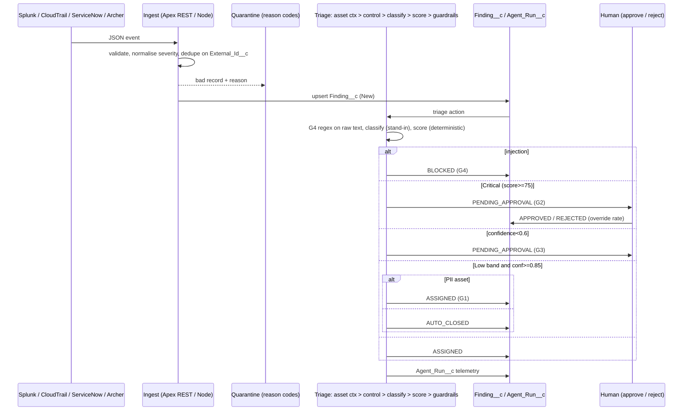

# 🚀 Salesforce Final Round: Master Rehearsal & Revision Guide (v2, D-Day Edition)

**Candidate:** Shaikat Majumdar · **Role:** Senior Forward Deployed Engineer (FDE), Salesforce
**Panel:** Kaytie Zimmerman (VP, Forward Deployed Engineering) · Anand Narayan (Deployment Strategist Director)
**Format:** 45-min 2:1 panel (Tampa Bay Office / Remote Dial-in) · **15 min presentation + live demo** · ~30 min Q&A

**Artifacts covered:** `SALESFORCE_FINAL_ROUND_PRESENTATION.pptx` (strategic deck) · `SALESFORCE_FINAL_ROUND_OPEN_SOURCE_DEMO.pptx` (Beacon demo deck, 20 slides) · `beacon.zip` (repo: Node local runtime + Salesforce DX package) · `UI_SCREENS.zip` (8 screenshots) · repos `github.com/sm2774us/fde-command-center`, `github.com/sm2774us/agentic-platform`

> **How to use this file.** Read §0 and §1 now. Do §3 fixes today. Rehearse §5 and §7 out loud. On the morning of, read only §14 (cheat sheet) and §15 (checklist).

---

## 📑 Contents
0. The 60-second version · 1. Executive assessment · 2. Reality audit · 3. Landmines to fix · 4. Deck-by-deck commentary · 5. The 15-minute run of show · 6. Architecture & guardrail cheat sheet · 7. **The Signature Question & Answer** · 8. ROI bulletproof sheet · 9. Q&A bank · 10. Interviewer-specific plays · 11. Story bank (STAR) · 12. Resume positioning · 13. Delivery, remote & recovery · 14. D-Day cheat sheet · 15. Checklists & schedule · 16. Changelog vs old README

---

## 0. THE 60-SECOND VERSION

1. **The demo is an audition for the FDE job**, not a product tour. Panel question: *"Would I put this person alone in front of a nervous CISO on Monday?"*
2. **Lead with their platform:** the Lightning Control Tower (real LWC on a real org), local console beside it for the tool trace.
3. **Say the uncomfortable truth in the first 40 seconds:** *"Synthetic data; the classifier is a deterministic stand-in; everything around it is real."* Owned early = seniority. Discovered late = gap.
4. **Show 7 moments, not 14 screens.** Flip the ratio: ~3 slides, ~8 live minutes.
5. **Fix before D-Day (§3):** ROI sequencing, quarantine badge bug, and the script lines describing features Beacon doesn't have.
6. **Plant the seam** at ~11:45 so they ask the Signature Question (§7), then land the answer.
7. **Your line:** ***"The model proposes. The platform disposes."***

---

## 1. EXECUTIVE ASSESSMENT (corrected)

**Strengths**
- **Credible builder + customer-facing record:** 17+ years, three forward-deployed-style roles in finance/GRC (Millburn, J.P. Morgan/Highbridge, Balyasny). Be ready to define "forward-deployed" for each (onsite %, customer, what you shipped).
- **Artifact on their platform:** 5 custom objects, Apex REST ingest, `@InvocableMethod` agent action, LWC dashboard + agent console, permission set, `WITH USER_MODE`; plus synced local console (LIVE badge, 5-s refresh).
- **Engineering rigor:** deterministic scoring, guardrail ladder in code, golden-set evals gated in CI (8 unit tests), telemetry schema, failure taxonomy (v1 = 9/14 = 64.3%).
- **Round-1 coaching absorbed:** ambiguity vs uncertainty, ROI, Salesforce tooling.
- **Honesty frame already in the deck** ("reference build, synthetic data, modelled value, AI tools disclosed"). Keep it.

**Vulnerabilities (and the pre-emption)**
| Risk | Pre-emption |
|---|---|
| "Is there a real LLM?" | No. Say so first (§0.3). Harness is real, model is a seam. |
| "Where's Agentforce?" | Playground has none. Deck rates platform fit **"Growing"**. Show mapping, state the day-one plan. |
| ROI looks like a consulting slide | Formula + sliders + ugly case still positive (§8). |
| Overclaiming | Never say "Flow approval", "Omni-Channel", "overrides become eval cases" as built (§3). |
| Pacing | 3 slides, 8 live minutes, finish ~13:30. |
| Native vs external | Org half is native Apex/LWC; Node half is a portable twin. In LIVE mode both use the Apex REST API. |

---

## 2. REALITY AUDIT: REAL vs SIMULATED

| Capability | Status | Say it as |
|---|---|---|
| Ingest: validate → normalise → dedupe → quarantine (18 in, 14 accepted, 4 quarantined) | ✅ Real (`pipeline.js`; Apex `BeaconIngestRest` idempotent upsert on `External_Id__c`) | "Real code, synthetic data." |
| Deterministic scoring: severity×10 + category bonus + control criticality + asset (Tier1 +15 / Tier2 +8, PII +10, internet +8), cap 100; bands ≥75 Critical, ≥50 High, ≥30 Medium | ✅ Real, identical in JS and Apex | "Auditable arithmetic; no model in the score." |
| Guardrails G1–G4 ordered ladder | ✅ Real, unit-tested | "Cannot be talked around: not in the prompt." |
| Human approve/reject, override rate (reject zeroes savings) | ✅ Real (LWC + Apex/Node) | "LWC + Apex today; Flow approvals is the path." |
| `Agent_Run__c` telemetry (Finding, Outcome, Latency_Ms, Tokens, Minutes_Saved, Guardrails_Triggered, Prompt_Version) | ✅ Real schema, ⚠️ modelled values | "Real record shape; modelled values." |
| Golden-set eval harness + CI gate (v2 ≥ 95%, v1 < v2) | ✅ Real harness (Node) | "Real harness grading a stand-in classifier." |
| `classify_llm` | ⚠️ Keyword rules (v1/v2 vocab + negation pre-check) | "Deterministic stand-in behind a versioned interface." |
| Latency (~644–660 ms), minutes saved (17.5/14/12/0), tokens (`len/4 + 380`) | ⚠️ Modelled constants | Say "modelled". |
| Confidence | ⚠️ Completeness heuristic (0.50 + control .15 + asset .15 + category .15 + dedupe .05), not calibrated | "Completeness heuristic." |
| Agentforce topic, Prompt Builder, Trust Layer, Data 360, Flow, Omni-Channel | ❌ Not built; documented mapping only | "Mapping I'd execute on day one." |
| Evals on Lightning | ❌ Node only (Apex hard-codes `Prompt_Version__c='v2'`; Apex tests not in CI) | Don't imply Lightning runs v1/v2. |

---

## 3. 💣 LANDMINES: FIX / DELETE BEFORE D-DAY

### 3.1 Claims that Beacon does not support (delete from memorised scripts)
| Old script said | Reality | Replace with |
|---|---|---|
| "Every run logs microsecond latency; `Ingestion_Timestamp__c` and `Analyst_Close_Timestamp__c`" | Fields don't exist; latency is simulated ms | "Schema carries the measured fields; week one I add ingestion and analyst-close timestamps so the 18-minute baseline becomes measured." |
| "Tokens via Agentforce/Claude 3.5 at $1.25/finding" | No LLM call; $1.25 is a modelled, padded all-in cost | "$1.25 is a deliberately padded placeholder; first thing I'd replace with metered usage." |
| "G1–G4 run before the LLM so 30% of tickets use zero tokens" | Only injection regex (G4) precedes classification; G1–G3 need category/score/confidence; 70% is a scope assumption | "G4 inspects raw text first. A cheap pre-filter is a Release-2 optimisation." |
| "Flow approval / Omni-Channel" | LWC buttons + Apex; Screen-Flow recipe documented in `NO_AGENTFORCE_PATH.md` | "LWC + Apex today; Flow Approvals/Omni-Channel is the production path." |
| "Every override becomes a new eval case" | Not implemented | "That's the loop I'd wire (override → candidate golden case, weekly review)." |
| "660 ms avg latency" | Simulated | "Modelled latency." |
| "Beacon implements Level 3 autonomy" | Levels 1 and 2 only | "Beacon implements L1 and L2; L3 is future, evidence-gated." |

### 3.2 ROI screen mismatch
Screenshot shows **653 h / $55,533 / $49,533 / 826%** (only E-1001 run → 14 min). After **Run agent on all**, average = 190 min ÷ 14 = **13.6 min** → **635 h / $53,947 / $47,947 / 799%**.
- **Rule:** open the ROI tab only after Run-all.
- **If 826% appears:** *"That's the live measured average, watch it settle at 13.6 once all 14 are in."* A bug becomes proof the number is computed.

### 3.3 Quarantine badge shows "fail" instead of reason codes
`local/public/index.html` (~line 53) `pill('fail').replace(...)` leaves the literal text. **Fix:** replace that `<td>` with `<td>${q.reason}</td>`. Reasons: `malformed_json`, `missing_required_field`, `invalid_severity`, `duplicate`. Verify in LIVE mode (reasons arrive via `Quarantine_Detail__c`). Fallback: read reasons aloud.

### 3.4 Reset before you start
Screens captured mid-run (E-1001 done, 1/14). Press **Reset demo** at T-10 min; confirm 14 × New and zeroed KPIs on **both** screens.

### 3.5 Known weaknesses: prepare, don't hide
| Weakness | Prepared answer |
|---|---|
| Injection regex has 3 patterns; "disregard your guidelines" passes | "Regex is the floor. The model has no authority: it proposes a category, never a close. Production adds Trust Layer, output validation, content isolation, a classifier." **Never invite live red-teaming.** |
| Attacker text containing "false positive" routes to `benign` (−25) and can lower band | "Attacker-controlled text must not vouch for itself: negation only from trusted fields, never auto-close Tier-1, sample auto-closes for human audit." |
| 14-item golden set written beside the rules (100% partly by construction) | "The loop is the deliverable: measure, fix, gate. Production needs a SOC-authored held-out set + shadow mode." |
| Node/Apex parity gaps (evals Node-only, Apex ingest stricter on malformed envelope, no Apex tests in CI) | "Known. Fix: shared golden fixture run by both suites so drift fails CI." |
| E-1002 appears in quarantine and queue | "Malformed duplicate (trailing comma) quarantined; good record accepted." |
| Local server: no auth, in-memory state | "Laptop demo; org side uses `with sharing`, `WITH USER_MODE`, permission set." |
| Approvals lack separation-of-duties/expiry | "Known gap; production adds approver identity, SoD, expiry." |

### 3.6 Verify names/prices (they move)
Re-check current names: Agentforce (agents/topics/actions), Prompt Builder, Einstein Trust Layer, Data 360, Agentforce testing tools, Flow/Omni-Channel, and the **current Agentforce pricing model**. If unsure say: *"the current name is X; I'd confirm the SKU with the account team."*

### 3.7 Deck integrity checks
- Slide numbering in the old README (17-slide strategic deck, "Slide 12/13" summary and questions) doesn't match the extracted strategic deck (ends at the ROI slide as slide 15). **Open your .pptx and confirm the closing/summary/"why Salesforce" slides exist**; if not, use demo-deck slide 20 and §5 closing.
- Slide 3 of the demo deck says "13.6 min saved per finding in the demo run": label as **modelled**.
- Confirm Anand's title with the recruiter (Deployment Strategist Director vs FDE).

---

## 4. DECK-BY-DECK COMMENTARY (use / skip decisions)

### 4A. Strategic deck (`SALESFORCE_FINAL_ROUND_PRESENTATION.pptx`)
| # | Slide | Use in 15 min? | Key line | Likely probe → answer |
|---|---|---|---|---|
| 1 | Title | Skip (speak over) | "Shipping agentic AI into real enterprises" | |
| 2 | 17 yrs · 3 FDE roles · 25–40% onsite · 5 repos | Cut first if long | "I put software where customers live." | *Finance → CRM platform?* "Same principles: secure APIs, async event flow, governance, deterministic guardrails. I map frameworks onto topics, invocable actions, Data 360." |
| 3 | Agenda + restated prompt | Skip | Prompt: what/approach/challenges/collab/deployment/current state | |
| 4 | JD fit table (Strong ×4, Growing ×1, Ready) | Q&A reference | Salesforce/Agentforce rated "Growing": own it | *"Growing?"* "Honest: I've built on the platform (Apex/LWC/REST); Agentforce depth is what I'd accelerate in 90 days." |
| 5 | Arc: data/integration → orchestration → agents in production | Q&A | | |
| 7 | Six competencies snapshot | Q&A | | |
| 8 | Influence: whole-room map + ledger/ADR/demos | Verbal 1 line | "Every open item has a type, owner, revisit date." | |
| 9 | Ambiguity vs Uncertainty | **Say verbally** | "Ambiguity is a question. Uncertainty is an experiment." | |
| 10 | Build & deploy (<5 days MVP, 50% faster, 99.2%) | Q&A | **Define 99.2% precisely** | *Measured how?* numerator/denominator/window/failure definition |
| 11 | Integration (idempotent upsert, DLQ, headless API) | Q&A | | |
| 12 | Frameworks vs platform table | Q&A | "Start where data and permissions live; prototype fast; ship in what the customer can operate." | |
| 13 | Staged autonomy L0–L3 + gates | Verbal | "Autonomy is earned with evidence." | |
| 15 | ROI (635 h, $54K, $48K, ~800%) | Replace with live ROI tab | | |

### 4B. Demo deck (`SALESFORCE_FINAL_ROUND_OPEN_SOURCE_DEMO.pptx`, 20 slides)
| # | Slide | Use? | Notes |
|---|---|---|---|
| 2 | Agenda + **honest framing** | Keep content as the opening | Reference build, modelled value, AI tools disclosed |
| 3 | 18-min problem, success criteria | Merge into one framing beat | 0 criticals acted on without a human; 100% decisions logged |
| 4 | First conversation: ambiguity/uncertainty table | Q&A reference | Critical = score ≥75 (asked CISO, ADR); auto-close = Low band + conf ≥0.85 + no PII (SOC workshop) |
| **5** | **Architecture mapped to Salesforce** | **USE** | Ingest → validate/quarantine → triage → G1–G4 + approval → objects → telemetry → LWC |
| 6 | 3 decisions + schema | Q&A | Deterministic scoring, guardrails as code, telemetry first |
| 7–8 | Demo divider + run of show | Skip (go live) | |
| 9–11 | Pipeline / outcomes / evals (screens) | Replace with live | Slide 11: 4 failure causes |
| 13–14 | Challenges; collaboration | One verbal line | "Bring evidence, make the tradeoff visible, let staged autonomy settle trust." |
| **16** | **Release 1 vs Scale** | **USE** | Shadow mode → gated auto-close; Apex REST → Data 360 |
| 17–18 | ROI; current state | Replace with live ROI | Label 660 ms/3.17 h as modelled |
| **19** | **How this lands on Salesforce** | **USE** | The mapping slide |
| 20 | Summary | Close | |

---

## 5. THE 15-MINUTE RUN OF SHOW

| Time | Screen | Say | Salesforce hook | If it breaks |
|---|---|---|---|---|
| **0:00–0:45** | Title / none | *"I'll skip the bio. Beacon is a reference build: synthetic data, patterns from real engagements, and a deterministic classifier stand-in so I can run offline and reproduce failures. Judge everything around the model."* | | |
| **0:45–2:00** | Demo slide 5 | *"18 min per finding, mostly noise. Success agreed with the CISO: hours returned, no critical acted on without a human, every decision auditable. Three decisions: deterministic scoring, guardrails as code, telemetry first. The model proposes. The platform disposes."* | Objects, Apex REST, `@InvocableMethod` | |
| **2:00–2:30** | **Act 0:** Lightning (left) + console LIVE (right), 14 × New | *"Same data, two screens. Watch them agree."* | LWC on App Page | Local-only: skip sync beat |
| **2:30–3:15** | **Act 1:** Data Pipeline | *"18 in, 14 accepted, 4 quarantined: malformed JSON, missing id, invalid severity, duplicate. Nothing silently dropped. Webhook retries never duplicate."* | Apex REST upsert on `External_Id__c`; Data 360 later | Badge "fail"? read reasons |
| **3:15–4:15** | **Act 2:** Run agent on all → open **E-1001** | *"Five tool calls: asset context, control lookup, classify, score, guardrail. Impossible travel, MFA off, payroll DB: score 73, assigned to Identity. I won't narrate all 14: 4 auto-closed, 6 assigned, 3 awaiting a human, 1 blocked."* | Agent actions = Apex invocable | `run-cli-demo.bat` |
| **4:15–5:30** | **Act 3:** **E-1002** public S3 → **Approve** → glance at Lightning | *"Critical, internet-facing, PII. G2: agent cannot act alone. I approve… (≤5 s) same decision on the platform. Rejections zero the savings and raise override rate: my trust metric."* | Approval path (Flow target) | Lightning lag: keep talking |
| **5:30–6:30** | **Act 4:** **E-1010** | *"Hidden instruction in a ticket comment. G4 blocks before routing. Ticket text is data, never instructions. And even if a cleverer string passed, the model has no authority to close anything."* | Trust Layer + Apex policy | Don't invite attacks |
| **6:30–7:00** | **Act 5:** **E-1009** | *"Low risk but PII asset: G1, never auto-closed. Safety is a property of the code path, not prompt wording."* | | Cut if long |
| **7:00–8:00** | **Act 6:** Prompt Evals | *"v1: 9/14 = 64%. Vocabulary gap (`public-read`, `0.0.0.0/0`), negation blindness, missing identity class. v2: 14/14. Caveat: golden set written beside the rules, so partly by construction. The deliverable is the loop: measure, fix, gate in CI."* | Testing/golden set in CI | |
| **8:00–9:00** | **Act 7:** ROI (after Run-all) | *"Capacity returned, not headcount cut. 4,000 × 70% × 13.6 min × $85, minus $6K. These are my placeholders."* Drag rate to $60, volume to half: *"Still positive. Week one, your numbers replace mine."* | `Agent_Run__c` reports | 826%: §3.2 line |
| **9:00–10:30** | Demo slide 16 | *"Release 1 earns trust: shadow mode, suggest/approve, 95% gate, rollback switch. Scale earns savings: auto-close low risk once override rate clears the agreed threshold; Data 360 history; back-pressure; SLOs. I'd run it with the Deployment Strategist: they own adoption, I own the system."* | | |
| **10:30–11:45** | Demo slide 19 | *"Mapping for day one: topic, Apex actions as tools, Prompt Builder for the versioned classifier, Trust Layer for masking and audit, Flow approvals, Data 360 for history."* | Whole slide | |
| **11:45–13:00** | Any Beacon screen | **PLANT:** *"The part I most want your read on is the seam: `classify` is a stub. Everything else is the harness a real model must earn its autonomy through. Push there."* | | |
| **13:00–15:00** | Close | 3-point summary; **stop at ~13:30**, hand over the floor | | |

### ✅ SHOW
Lightning Control Tower · Two screens one truth · Pipeline 18→14+4 · E-1002 G2 human approve · E-1010 G4 · E-1009 G1 · Evals 64%→100% with caveat · ROI sliders.

### 🚫 DON'T SHOW
Code walkthroughs (keep repo in a tab) · Ambiguity/Uncertainty tab (say it) · Architecture & Mapping tabs (use slides) · all 14 traces (show one) · CLI (fallback) · Reset mid-demo · ROI before Run-all · live red-teaming · deploy scripts/login screens · v1/v2 toggle on Lightning · any claim beyond §2.

---

## 6. ARCHITECTURE & GUARDRAIL CHEAT SHEET

**Ladder order (first match wins):** G4 injection → G2 Critical → G3 low confidence → (Low band ∧ conf ≥ 0.85: G1 PII → Assigned, else Auto-Closed) → Assigned.
**Minutes saved (modelled):** Auto-closed 17.5 · Assigned 14 · Pending 12 · Blocked 0 · Rejected → 0.
**Full run (14 findings):** 4 auto-closed / 6 assigned / 3 pending / 1 blocked · 5 guardrails fired · 3.17 h saved (190 min ÷ 14 = 13.6) · ~660 ms avg (modelled).
**Worked rows:** E-1001 identity, score 73 High, conf 1.00, Assigned · E-1002 exposure, score 89 Critical, Pending (G2) · E-1003 "no evidence of malware" → benign, score 1, Auto-Closed.
**Salesforce map:** triage topic+instructions → Agentforce topic · tools → Apex invocable/Flow · classify prompt v1→v2 → Prompt Builder (versioned) · guardrails → Apex policy + Trust Layer · ingest → Apex REST / Data 360 · approvals → Flow/Omni-Channel · UI → LWC · evals → agent testing + golden set in CI.
**Security posture in repo:** `with sharing`, `WITH USER_MODE`, `as user` DML, dedicated permission set, bulk-safe action (3 SOQL + 2 DML per call; `triageNew` caps at 200).

---

## 7. 🔥 THE SIGNATURE QUESTION & ANSWER

### ❓ Question
> *"Beacon's classifier is a keyword stub, the savings are modelled, and your playground has no Agentforce. Convince us, specifically, that you can take this pattern into a **regulated customer's production Agentforce deployment**, and tell us what you'd actually do in your first 90 days."*

**Structure: O-T-S-P-L-L** (Own · Transfers · Swap · Prove · Land · Learn). Target 3:45.

**O: Own (20 s)**
> "Fair challenge, and all three statements are true. The classifier is a stand-in, the numbers are modelled, and my Playground has no Agentforce. I built it that way so I could run it offline and reproduce failures. Let me separate what I'm not asking you to trust from what I am."

**T: Transfers (40 s)**
> "I'm not asking you to trust my classifier. I'm asking you to trust the harness that makes any classifier earn its autonomy. Five things are real and carry over unchanged: an idempotent ingest that quarantines instead of dropping; deterministic scoring so the model never touches the risk math; guardrails as an ordered code ladder; a telemetry record per decision; and a golden-set eval gate in CI with a failure taxonomy. My own v1 scored 64% and I can tell you exactly why."

**S: Swap (70 s)**
> "On Agentforce the seam is one function. Triage becomes a topic with instructions scoped to findings. My tools (asset context, control lookup, score) are already invocable Apex, which is how an agent consumes them. `classify` becomes a Prompt Builder template with a closed output set, grounded in Finding, Asset and Control records, versioned. Masking and audit move onto the Trust Layer, but I keep my Apex guardrails: the Trust Layer is defence in depth, not a replacement for deterministic policy. Approvals go from my LWC buttons to Flow approvals and Omni-Channel. History scales into Data 360, or stays on Apex REST if the customer isn't ready. Evals map to agent testing plus the same golden set in CI. And the design property I'd insist on: the model can only propose a category. A model failure degrades to 'other', low confidence, a human."

**P: Prove (50 s)**
> "Trust is staged. Release 1 is shadow mode: the agent runs beside analysts, suggests only, and we measure agreement. The held-out set is written by the customer's SOC leads, not me, because a set I wrote beside my own rules is over-fit by construction. We move to approve-then-act when the gate clears 95% and the override rate is under a threshold the CISO agreed. Auto-close for low risk comes last, never for Tier-1 assets, with a human-audited sample and one switch back to the previous level."

**L: Land the 90 days (60 s)**
> "With the Deployment Strategist from day one. **Days 1–30: discover and baseline.** Sit with the SOC, time real triage, add ingestion and analyst-close timestamps so my 18-minute assumption becomes measured, and type every open question as ambiguity (ask, decide, ADR) or uncertainty (cheap experiment, revisit date). **Days 31–60: Release 1 in shadow mode** in the customer's sandbox: ingest, topic, actions, Trust Layer config, eval gate, LWC telemetry dashboard; the Strategist drives who the first analysts are and what they need to see to trust a suggestion. **Days 61–90: gated autonomy and handover:** low-risk class moves from suggest to approve; runbook, on-call and rollback published; their engineers own prompt and eval changes without me. The ROI case is rebuilt from their telemetry as a range with named assumptions, framed as capacity redeployed."

**L: Learn/ask (20 s)**
> "Platform gaps become reproducible examples for product. That's Beacon in miniature. I'd like to do it on Agentforce for your customers, and I'd welcome you pushing on where it breaks."

**Quotable lines (they'll repeat them in the debrief):** *"The model proposes. The platform disposes."* · *"Trust the harness that makes any classifier earn its autonomy."* · *"Autonomy is earned with evidence, not granted by a slide."*

### Follow-ups
| Follow-up | Answer |
|---|---|
| Real critical labelled benign? | Score is asset-aware (Tier-1 PII rarely lands Low); auto-close needs Low band ∧ conf ≥ 0.85 ∧ no PII; auto-closes are human-sampled. Residual risk: attacker text vouching for itself → negation only from trusted fields, never auto-close Tier-1. |
| Why not everything native? | I would, where data and permissions live. LangGraph earns its place for multi-agent graphs; bridge with a versioned API. |
| Platform cost? | $1.25/finding is a padded placeholder; replace with metered usage in month one. At 2× ($2.50), run cost $9.5K, net ≈ $44.4K (468%). *(Verify current Agentforce pricing.)* |
| How did you use AI to build it? | Claude/Cursor for scaffolding, tests, Apex boilerplate; I wrote guardrails and the eval set by hand and reviewed every scoring rule. |
| How was 99.2% measured? | **Prepare exact definition** (numerator, denominator, window, what counts as failure). If undefendable, soften. |
| Time you pushed back on a sponsor? | Use a **real engagement** from your resume; Beacon S3/S4 as illustration only. |

---

## 8. ROI BULLETPROOF SHEET

**Formula:** `Net = N × scope% × (T_manual − T_agent)/60 × rate − (tokens + overhead)`
**Base:** N = 4,000 · scope 70% → 2,800 · 18.0 − 4.4 = 13.6 min (0.2267 h) · $85/h · tokens $3,500 ($1.25 × 2,800) · overhead $2,500.
**Chain:** 2,800 × 0.2267 = **634.67 h** → × $85 = **$53,947** → − $6,000 = **$47,947** → ÷ $6,000 = **799%** · payback ≈ **3.3 days** · ≈ **4 FTE** of capacity.

| Scenario | In scope | Run cost | Net / mo | ROI |
|---|---|---|---|---|
| Base | 2,800 | $6,000 | **$47,947** | **799%** |
| Half volume, cost held at $6K (deck figure) | 1,400 | $6,000 | $20,973 | 350% |
| Half volume, tokens scale | 1,400 | $4,250 | $22,723 | 535% |
| Tokens double ($2.50) | 2,800 | $9,500 | $44,447 | 468% |
| Rate $60/h | 2,800 | $6,000 | $32,080 | 535% |
| **Ugly:** half volume + $60/h + 50% redeployed | 1,400 | $4,250 | **$5,270** | **124%** |

**Break-even:** per-finding value $19.27, net of tokens $18.02 → $2,500 ÷ $18.02 ≈ **139 findings/month**.
**Measured vs assumed:** baseline 18 min = assumption; minutes saved = modelled constants; volume/rate/cost = sponsor inputs. Say: *"The formula is the deliverable; the numbers are placeholders."*
**CFO "soft money":** capacity redeployed to threat hunting/IR, deferred hiring, SLA-breach avoidance, audit readiness; ugly case still positive; week-one telemetry replaces assumptions.

---

## 9. Q&A BANK (P0 = must rehearse)

### A. Solution & framing
- **P0 Why GRC triage; how representative?** "High volume, mixed structured/unstructured data, hard compliance boundaries, mandatory human gates. The pattern (ingest → guardrails → action → auditable telemetry) is the Agentforce deployment pattern across finance, health, tech."
- **P0 Is there real AI?** §0.3 / §7 "Own".
- **Why two runtimes?** Local = portable, deterministic; Salesforce = real platform; LIVE mode shares one API source of truth. Don't imply always synced.
- **What would you do with one more week?** Real model behind the same gate with rules fallback; SOC held-out eval set; Flow approvals; Data 360; measured timestamps.

### B. Architecture & engineering
- **P0 Prompt injection?** Untrusted text = data. G4 scans before routing; model has no authority; role-scoped actions; production adds Trust Layer + output validation + isolation. Admit regex is a floor.
- **P0 Evaluate non-deterministic output?** Closed output set, versioned prompt, golden set + failure taxonomy, CI gate ≥95%, shadow mode, drift alerts, held-out SOC set, override rate as live signal.
- **Walk me through a prompt that failed.** v1 9/14: vocabulary gap (E-1002, E-1007, E-1011), negation (E-1003 "no evidence of malware" → malware, +10 vs −25 = 35-pt swing), missing identity class (E-1001). Fix v2; gate in CI; caveat on over-fit.
- **Idempotency?** Upsert on `External_Id__c`; retries can't duplicate; malformed → quarantine with reason.
- **100× volume?** Synchronous single process, per-request KPI recompute, governor limits. Queue + back-pressure, incremental counters, model tiering, bulk-safe action (3 SOQL + 2 DML per call).
- **Apex governor limits?** Bulk-safe action, `triageNew` caps 200, `WITH USER_MODE`, no SOQL/DML in the pure rules class.
- **Data 360 vs Snowflake vs Databricks?** Data 360 when CRM context and activation matter; Snowflake/Databricks for large history and ML; zero-copy to avoid moving data.
- **RAG and how it fails?** Stale/ungrounded retrieval, permission leakage, chunking errors; mitigate with permission-aware retrieval, eval on retrieval separately, citations.
- **Agent vs workflow?** Use a deterministic workflow where steps are known; agent where input is open-ended; keep authority in code.

### C. Salesforce-specific
- **P0 Implement Beacon natively?** Ingest via Apex REST or Data 360; triage topic with Apex invocable actions; Prompt Builder classifier; Trust Layer masking/audit; Flow approvals/Omni-Channel; LWC dashboard; `Agent_Run__c` reporting. *(Verify names.)*
- **How does an FDE use Agentforce?** Discover workflow → model data in platform → topic + actions on customer's objects/APIs → golden-set tests → deploy with guardrails → measure telemetry → feed gaps to product.
- **Agentforce vs LangGraph?** Start where data/permissions live; prototype in the faster tool; ship in the one the customer can operate; bridge via versioned API.
- **Platform gaps you'd feed to product?** Eval tooling parity across environments, approval SoD/expiry, richer trace export. Always with a reproducible example.

### D. Value & CFO
- **P0 "Soft money" objection?** §8 CFO line.
- **P0 "800% sounds like consulting."** "Agreed, so it isn't a slide: formula on screen, sliders for your inputs, first action is instrumenting real timestamps. Even my ugly case (half volume, $60/h, 50% redeployed) is +124%."
- **Token costs double / latency spikes?** Run cost $9.5K, net ≈ $44.4K; model tiering and pre-filter are Release-2 levers; latency is irrelevant to correctness because humans gate criticals.

### E. Stakeholders & adoption (Anand)
- **P0 First conversation with a sponsor?** "What decision do analysts make 400 times a week, and what does a wrong auto-decision cost?" That made autonomy staged.
- **P0 Ambiguity vs uncertainty.** Ambiguity: info exists, nobody wrote it down → ask, decide, ADR (e.g. Critical = score ≥75, asked the CISO). Uncertainty: can't be known yet → cheap experiment, reversible decision, revisit trigger (e.g. new log sources: shadow mode + drift alert).
- **Analysts don't trust the agent.** Visible tool trace, human gate, override-rate metric, start in suggest mode, let evidence settle it.
- **Scope changes mid-build.** Requirements ledger + ADR reviewed weekly with the Strategist; every item typed, owned, dated; deviations surface early.
- **Sponsor wants something unwise ("auto-close everything").** Replay last month's criticals under that policy; agree a staged path with reversible switch.
- **Customer insists on another LLM/tool.** Evaluate on the golden set; decide by evidence; abstract behind the prompt-template interface.
- **Security review/architects.** Bring the data-flow diagram, permission model, ADRs, guardrail tests; pre-wire architects before the formal review.
- **<5 days MVP: what do you cut, what never?** Cut UI polish, scale paths, breadth of categories. Never cut guardrails, telemetry, quarantine, or the eval gate.
- **Working with the Deployment Strategist; disagreements?** Strategist owns adoption/scope; I own the system. Disagree with evidence (eval numbers, trace), make the tradeoff visible in an ADR.

### F. Pressure & composure
- **Demo fails live:** "Switching to the terminal run, same trace." → `run-cli-demo.bat` → PNG appendix. Max 20 s debugging aloud.
- **Agent misbehaves in production, exec on the phone:** (1) flip rollback switch to previous autonomy level; (2) pull `Agent_Run__c` for affected window; (3) classify: prompt regression, data drift, or injection; (4) replay on golden set; (5) fix, gate, redeploy; (6) written postmortem + new eval case.
- **Recovery phrase:** *"That's a critical edge case. I'd isolate the telemetry, check platform limits, and weigh throughput against safety before changing the architecture."*

---

## 10. INTERVIEWER-SPECIFIC PLAYS

| | **Kaytie (VP FDE)** | **Anand (Deployment Strategy Director)** |
|---|---|---|
| Underlying question | "Credible in front of customer architects?" | "Faster time-to-value; will customers adopt?" |
| Speak | Idempotency, guardrails as code, failure taxonomy, evals as release gate, honest limits | Stakeholder map, staged rollout, adoption levers, <5-day MVP, ROI from telemetry |
| Win moments | G4 + "model has no authority"; v1 64% story; over-fit caveat | 18-min baseline; sliders; override-rate; Release 1 vs Scale |
| Avoid | Overclaiming; hand-waving LLM failures | Tech-first answers; defending the ROI number |
| Your question for them | "When an FDE hits an Agentforce gap, what's the path from field repro to roadmap? Example that changed the product?" | "Where do deployments stall (data access, security review, adoption) and what's the earliest signal?" |
| Shared | "What does a great first 90 days look like in this pod, and what makes you say 'right hire' at day 90?" | |

---

## 11. STORY BANK (STAR; fill with real engagement facts)

Prepare 6 stories from **real roles** (Beacon is illustration only). Each: **S**ituation (customer, stakes) · **T**ask · **A**ction (your decision, trade-off) · **R**esult (number you can defend) · **L**esson.
1. **Shipped fast under ambiguity** (<5-day MVP; what you cut/never cut).
2. **Pushed back on a sponsor** (evidence, ADR, outcome).
3. **An AI failure you diagnosed** (prompt regression/drift; how fixed; gate added).
4. **Won over a skeptical architect/security reviewer.**
5. **Enabled a customer team to own it** (handover artifacts).
6. **Scope change mid-build** (ledger, surfaced early).
**Beacon mini-stories (30 s each):** 18-minute finding · prompt that scored 64% · comment that tried to close everything (G4) · public bucket that needed a human (G2) · eighteen in, fourteen out (quarantine) · two screens, one truth.

---

## 12. RESUME POSITIONING

- Link your **risk engines, GRC integrations and cloud data pipelines** (Snowflake, Databricks, BigQuery, Kafka) to Data 360 and Agentforce deployments.
- **Pivot gaps** with integration mastery (REST, gRPC, webhooks, OAuth 2.0, SAML/SSO) and the repos that mirror native architecture.
- **Forward-deployed claim:** for each role, be ready with onsite %, customer type, one shipped outcome, one metric you can defend.
- **Defend every number** on slides (17+ yrs, 3 FDE roles, 25–40% onsite, 99.2%, 50% faster, <5-day MVP). Anything undefendable: soften before D-Day.

---

## 13. DELIVERY, REMOTE & RECOVERY

- **Framework per answer:** Problem → Approach → Decision → Trade-off → Outcome. 90 seconds max, then stop.
- **Pause 2 s** after key claims. Answer first sentence = the answer.
- **Remote dial-in:** share the **whole screen** (not a tab) with both windows side by side; zoom 110–125%; test with a friend; keep a second device logged into the org; wired network.
- **Onsite:** bring HDMI/USB-C adapter; local copy of deck as PDF; printed one-page cheat sheet (§14).
- **Never** debug aloud >20 s; switch to fallback (CLI → PNGs).
- **If you don't know:** "I don't know that specific detail; here's how I'd find out and what I'd assume meanwhile."

---

## 14. D-DAY CHEAT SHEET

**Opening:** *"I'll skip the bio… reference build, synthetic data, deterministic stand-in classifier. Judge everything around the model."*
**Thesis:** *The model proposes. The platform disposes.*
**Numbers:** 18 → 14 accepted + 4 quarantined · 14 findings: 4 auto-closed / 6 assigned / 3 pending / 1 blocked · 5 guardrails · v1 64.3% (9/14) → v2 100% (14/14, over-fit caveat) · 13.6 min saved · 634.67 h · $53,947 gross · $47,947 net · 799% · half volume 350% (fixed cost) · ugly case 124% · break-even ≈139 findings/mo · payback ≈3.3 days.
**Guardrails:** G1 PII never auto-closed · G2 Critical needs human (≥75) · G3 confidence <0.6 needs human · G4 injection blocked. Auto-close = Low band ∧ conf ≥0.85 ∧ no PII.
**Honesty lines:** stand-in classifier · modelled numbers · no Agentforce in Playground ("Growing") · golden set over-fit · regex is a floor.
**Ambiguity/Uncertainty:** *Ambiguity is a question. Uncertainty is an experiment.*
**Autonomy:** L0 suggest · L1 approve · L2 auto-act low risk · L3 broader (future). Gates: ≥95% golden set in CI, override rate under threshold, guardrails as code, one-switch rollback.
**Plant:** *"The part I most want your read on is the seam. Push there."*
**Close:** *"I build in the customer's environment and leave their team able to run it; I make AI safe to ship; I prove value from their telemetry. I'd love to do it on Agentforce for your customers."*
**Recovery:** *"Critical edge case. I'd isolate telemetry, check platform limits, weigh throughput against safety."*
**Questions to ask:** gap-to-roadmap path · where deployments stall · first-90-days success.

---

## 15. CHECKLISTS & SCHEDULE

### Schedule
| When | Do |
|---|---|
| **T-48h** | Apply §3 fixes; run `run-tests.bat` (`# pass 8`); deploy/log in to Playground; confirm slides exist (§3.7) |
| **T-24h** | 15-min run ×2 timed, with PNG fallback; record once; cut overruns; define 99.2% |
| **T-12h** | §7 aloud to 3:45; rehearse follow-ups and §9 P0s; re-verify Salesforce names/pricing |
| **T-1h** | Reset demo; both screens green LIVE; zoom 110–125%; notifications off |
| **T-0** | Slow down; pause after claims; finish ~13:30 |

### Final QC
- [ ] ROI tab opened only after Run-all (635 h / $53,947 / $47,947 / 799%)
- [ ] Quarantine reasons visible (or read aloud)
- [ ] Demo reset: 14 × New, KPIs 0, LIVE green
- [ ] Deleted: timestamp-field, Claude 3.5/Agentforce-token, zero-token 30% claims
- [ ] Flow/Omni-Channel/override-to-eval phrased as path/design
- [ ] Honesty frame in first 40 s; seam planted ~11:45; §7 rehearsed
- [ ] 99.2% definition ready; real-engagement stories ready
- [ ] `UI_SCREENS` PNGs packaged as fallback; CLI demo tested
- [ ] Salesforce names/pricing re-verified; Anand's title confirmed
- [ ] Two-screen sync tested (approve → Lightning updates ≤5 s)

---

## 16. CHANGELOG: v2 vs old README

| Area | Old | v2 |
|---|---|---|
| Slide numbering | Assumed 17-slide strategic deck with summary/Q slides | Matches extracted decks; flags missing closing slides (§3.7) |
| LLM claims | "Agentforce/Claude 3.5", zero-token pre-filter | Removed; stand-in classifier owned up front |
| Telemetry claims | Microsecond latency, timestamp fields | Removed; presented as week-one instrumentation |
| ROI | Single number; half-volume 350% unexplained | Full sensitivity incl. variable-cost, $60/h, ugly case, break-even; on-screen mismatch explained (§3.2) |
| Demo | 5 min inside 10 min of slides | ~8 live minutes, 3 slides, 7 moments, show/don't-show |
| Salesforce claims | Flow/Omni-Channel implied built | Path vs built clearly separated |
| Guardrails | Regulatory essay on G-series | Ladder order, thresholds, known weaknesses and answers |
| Q&A | 5 questions | Bank by category + Signature Q&A + follow-ups |
| Bugs/risks | None listed | Quarantine badge fix, reset, parity gaps, injection/negation gaming |
| Rehearsal | Generic 2-day plan | T-48 → T-0 schedule, remote logistics, one-page cheat sheet |

> **Final word.** Finals are lost by overclaiming and won by being the calmest person in the room about what's real. You have a working artifact on their platform, a failure story with numbers, and the discipline to state your limits first. Show less. Say it slower. Plant the seam. Let them ask. 🚀
