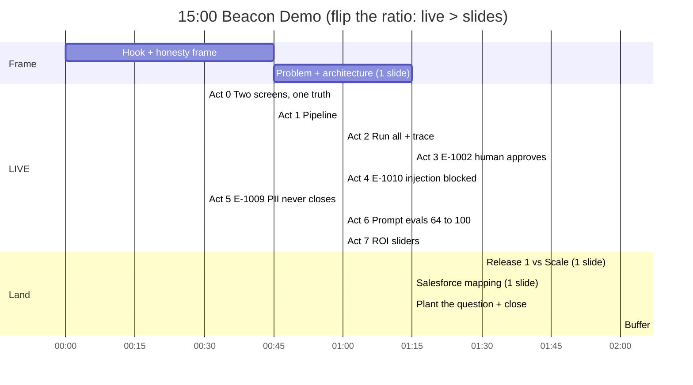

# 🎯 The Beacon Demo Playbook: 15 Minutes to an Offer

### Salesforce Senior Forward Deployed Engineer · Final Round · Demo Strategy, Landmine Report & The Signature Question

| | |
|---|---|
| **Candidate** | Shaikat Majumdar |
| **Panel** | Kaytie Zimmerman (VP, Forward Deployed Engineering) · Anand Narayan (Deployment Strategist Director) |
| **Format** | 45-min 2:1 panel · **15 min presentation + demo** · ~30 min Q&A |
| **Assets analysed** | `SALESFORCE_FINAL_ROUND_PRESENTATION.pptx` · `SALESFORCE_FINAL_ROUND_OPEN_SOURCE_DEMO.pptx` · `beacon.zip` (full repo, 11 commits, Node + Salesforce DX) · `UI_SCREENS.zip` (8 screenshots) · prior `README.md` |
| **Companion docs already in your repo** | `docs/PRESENTATION_PLAYBOOK.md`, `docs/DEMO_RUNBOOK.md`, `demo/README.md` (Battle Book). This file **supersedes the demo choreography** and **fixes the claims that would not survive cross-examination.** |

---

## 📌 0. THE 60-SECOND VERSION

1. **Your demo is not a product demo. It is an audition for the FDE job.** The panel is not grading Beacon. They are grading whether *you* are the person they would put in front of a nervous CISO on Monday.
2. **Lead with their platform.** You are interviewing at Salesforce. The first thing on screen should be the **Lightning Control Tower** (it is a real LWC on a real org, which almost no candidate shows), with the local console beside it for the tool trace.
3. **Show fewer things, slower, with one sentence of meaning each.** Seven moments, one per proof point (list in §4). Cut everything else. The tabs you cut are slides, not demos.
4. **Say the uncomfortable truth in the first 40 seconds.** "The classifier is a deterministic stand-in. Everything *around* it is real." Said early, it reads as senior judgment. Discovered later, it reads as a gap.
5. **Fix four things before you walk in** (§3): an ROI number mismatch on screen, a UI bug in the quarantine table, and three lines in your memorized scripts that describe features Beacon does not have.
6. **Plant the Signature Question** (§7) at the end of the demo so the panel asks it. Then deliver the answer in §7. It is built to turn "interesting candidate" into "hire him."

> **The one line to tattoo on your hand:**
> ### *"The model proposes. The platform disposes."*
> Every demo moment is an instance of this sentence.

---

## 🧭 1. What the panel is actually scoring

| | **Kaytie Zimmerman**, VP FDE | **Anand Narayan**, Deployment Strategy Director |
|---|---|---|
| **Her/his question underneath every question** | "Would I trust this person alone in front of a customer's architects?" | "Would this person make *my* deployments faster, and would customers adopt what they ship?" |
| **Triggers (positive)** | Idempotency, guardrails as code, failure taxonomy, evals as release gate, honest limits | Time-to-value, staged rollout, adoption levers, stakeholder map, ADRs, measurable outcomes |
| **Triggers (negative)** | Hand-waving on how LLMs fail; claiming more than you built | Technology-first answers; ROI that sounds like a consulting slide |
| **Demo moments that win her** | G4 injection block · "the model has no authority" · v1 64% → v2 with the over-fit caveat | The 18-minute baseline · sliders with *sponsor's* numbers · override-rate trust metric · Release 1 vs Scale |
| **Shared sweet spot** | **Two screens, one truth** (local console and Lightning agree live) and **owning the limits before they find them** | |

**Round-1 coaching is already baked in** (Ambiguity vs Uncertainty, ROI, Salesforce tooling). Do not re-teach it in the demo; *use* the vocabulary naturally ("that was an ambiguity, I asked the CISO; this one is an uncertainty, so shadow mode").

---

## 🔍 2. Reality audit: what is real, what is simulated

You win by drawing this line **yourself**. Everything in the right column should be said out loud by you before anyone else says it.

| Capability | Status in the repo | How to phrase it |
|---|---|---|
| Ingest pipeline: validate, normalise, dedupe, quarantine (18 in → 14 accepted, 4 quarantined) | ✅ **Real** (`pipeline.js`; Apex `BeaconIngestRest` does true idempotent upsert on `External_Id__c`) | "Real code, synthetic data." |
| Deterministic risk scoring (severity×10 + category bonus + control criticality + asset tier/PII/internet, capped at 100) | ✅ **Real**, identical in `engine.js` and `BeaconTriageEngine.cls` | "Auditable arithmetic. No model in the score." |
| Guardrails G1–G4 as an ordered ladder in code | ✅ **Real**, unit-tested (tests 2–5) | "Cannot be talked around, because they are not in the prompt." |
| Human approve/reject + override rate (reject zeroes the savings) | ✅ **Real** (LWC buttons + Apex/Node) | "Approval is LWC + Apex today; Flow approval is the documented path." |
| Telemetry row per decision (`Agent_Run__c`: latency, tokens, minutes saved, guardrails, prompt version, outcome) | ✅ **Real schema**, **modelled values** | "Real record shape. Values are modelled." |
| Golden-set eval harness, v1 vs v2, CI gate (v2 ≥ 95%, v1 < v2) | ✅ **Real harness** (Node/CI) | "Real harness. The classifier it grades is a stand-in." |
| Salesforce runtime: 5 custom objects, Apex REST, `@InvocableMethod`, LWC dashboard + agent console, permission set, `WITH USER_MODE` | ✅ **Real**, deployed to a Playground | "Runs on a real org. It is in your Lightning UI." |
| Two-runtime sync (LIVE badge, 5-second refresh) | ✅ **Real** | "One source of truth, two screens." |
| `classify_llm` | ⚠️ **Keyword rules**, not an LLM | "A deterministic stand-in behind a versioned interface." |
| Latency (~644–660 ms), minutes saved (17.5/14/12/0), tokens | ⚠️ **Modelled constants** | "Telemetry *shape* is real; values illustrate it." |
| Confidence score | ⚠️ Completeness heuristic, not calibrated | Say "completeness heuristic". |
| Agentforce topic / Prompt Builder / Trust Layer / Data 360 / Flow / Omni-Channel | ❌ **Not built** (Playground has no Agentforce). Documented mapping only | "This is the mapping I'd execute on day one." |
| Evals on Lightning side | ❌ Evals run in Node only (Apex hard-codes `Prompt_Version__c = 'v2'`; Apex tests are not in CI) | Don't imply Lightning runs v1/v2. |

> **Deck honesty is already strong.** The demo deck's "Honest framing" box and the "Growing" rating for Salesforce platform fit are assets. Keep them. Do not let a verbal claim outrun them.

---

## 💣 3. LANDMINES: fix or delete before interview day

### 3.1 🔴 Claims in your memorized scripts that Beacon does not support

The prior README's rehearsal scripts contain statements a sharp VP can puncture in one question. **Delete or rewrite each.**

| Script says | Reality in repo | Replace with |
|---|---|---|
| *"Every run logs exact microsecond latency… `Ingestion_Timestamp__c` and `Analyst_Close_Timestamp__c`."* | `Agent_Run__c` fields are: `Finding__c, Outcome__c, Latency_Ms__c, Tokens__c, Minutes_Saved__c, Guardrails_Triggered__c, Prompt_Version__c`. **No such timestamp fields.** Latency is simulated in ms. | *"The schema is built to carry the measured fields. In week one I'd add `Ingestion` and `Analyst_Close` timestamps so the 18-minute baseline stops being an assumption."* (That is actually a **stronger** answer.) |
| *"LLM token usage via Agentforce/Claude 3.5… $1.25 per finding."* | No LLM is called. Tokens are `(text + rec length)/4 + 380`. $1.25 is a modelled all-in per-finding cost. | *"$1.25 is a deliberately padded all-in cost per finding (model, retrieval, platform). It's the first thing I'd replace with metered usage."* |
| *"Guardrails G1–G4 run before calling the LLM, so 30% of tickets consume zero tokens."* | Only the **injection regex (G4)** is evaluated before classification. G1–G3 need category, score and confidence. No pre-filter exists. The 70% is an ROI *scope assumption*. | *"G4 runs on raw text before anything else. Scope filtering is an assumption I'd validate; a cheap pre-filter is a Release-2 optimisation."* |
| Slide 5/19: "Flow approval, Omni-Channel" | Approvals are LWC buttons + Apex. No Flow/Omni-Channel metadata in the repo. | *"Approvals are LWC + Apex today. The Screen-Flow path is documented in `NO_AGENTFORCE_PATH.md`; Flow Approvals/Omni-Channel is the production target."* |
| Slide 18: "Every human override becomes a new eval case" | Not implemented. | *"That's the improvement loop I'd wire: override → candidate golden-set case, reviewed weekly."* (Say "design", not "running".) |
| Slide 18 "660 ms avg latency" | Simulated | Say **"modelled latency"**. |

### 3.2 🔴 On-screen: the ROI tab shows different numbers than your slides

| Source | Hours | Gross | Net | ROI |
|---|---|---|---|---|
| Deck / script | 635 h | $53,947 | $47,947 | **799%** |
| **ROI screenshot** (`004_ROI_SCREEN.png`) | **653 h** | **$55,533** | **$49,533** | **826%** |

**Why:** the calculator takes "measured saving per finding" from the current run. The screenshot was captured with **1 of 14 findings triaged** (E-1001 = 14 min). After **Run agent on all**, the average is 190 min ÷ 14 = **13.6 min**, which reproduces your 635 h / 799% exactly.
**Fix (choose both):**
1. **Sequence:** never open the ROI tab until after *Run agent on all*.
2. **Own it in one breath** if it ever shows 826%: *"That's the live measured average from however many runs I've done. Watch it settle at 13.6 once all 14 are in."* That turns a bug into proof the number is computed, not pasted.

### 3.3 🟠 UI bug: quarantine reasons render as "fail"

In `local/public/index.html` (line ~53) the `pill('fail').replace(...)` chain leaves the badge text as the literal word **fail** (visible in `002_DATA_PIPELINE_SCREEN.png`). Your headline claim is *"quarantined **with reason codes**"*, and the screen does not show them.

**One-line fix:**
```js
// replace the whole <td>${pill('fail')...}</td> with:
<td><span class="pill fail">${q.reason}</span></td>
```
Reasons that will then appear: `malformed_json`, `missing_required_field`, `invalid_severity`, `duplicate`. Also note the same fix needs to be sanity-checked in LIVE mode (reasons come from `Quarantine_Detail__c` via `BeaconApiRest`). If you cannot fix it in time, **say the reasons aloud** and point at the raw lines.

### 3.4 🟠 Reset before you start

Your screenshots show **E-1001 already triaged** and 1/14 KPIs. Press **Reset demo** at T-10 minutes so the queue is 14 × *New*, KPIs 0. Verify both screens show the clean slate within 5 seconds.

### 3.5 🟠 Known weaknesses a sharp panel can find. Prepare, don't hide.

| Weakness | Why it's real | Your prepared answer |
|---|---|---|
| **Injection regex is a floor, not a ceiling.** Only 3 patterns ("ignore previous instructions", "system prompt", "disregard policy"). A VP might type "disregard your guidelines" and it passes. | Regex list is small. | *"Exactly why G4 is not the only defence. The model has no authority: it can propose a category, never a close. Production adds the Trust Layer, output validation, content isolation, and a classifier."* **Don't invite live red-teaming** unless you've rehearsed this. |
| **Negation can be gamed.** Attacker-controlled text containing "false positive" routes to `benign` (−25 score) and can lower the band. | `NEGATION` regex runs on finding text. | *"Right: attacker-controlled text must not be allowed to vouch for itself. Mitigations: take negation only from trusted fields, never auto-close Tier-1 assets, and randomly sample auto-closes for human audit."* |
| **Golden set is small and was written beside the rules** (100% is partly by construction). | Documented in your own repo. | *"It's the process I'm demonstrating (measure, fix, gate), not the 100%. Production needs a held-out set written by the SOC, plus shadow mode."* |
| **Node/Apex parity gaps** (evals only in Node, Apex ingest stricter on malformed envelope, Apex tests not in CI). | Documented in `SOLUTION_EXPLANATION.md §15`. | *"Known; the fix is a shared golden fixture run by both suites so drift fails CI."* |
| **E-1002 appears in quarantine *and* in the queue.** | A malformed duplicate line (trailing comma) of E-1002 is quarantined; the good record is accepted. | One sentence: *"The malformed copy was quarantined; the good record went through."* |
| **No auth on local server; in-memory state.** | By design for a laptop demo. | *"Local demo only; the org side uses `with sharing`, `WITH USER_MODE`, a permission set."* |

### 3.6 🟡 Verify before the day (names and prices move)

Salesforce's agent product naming and pricing change often. Re-check current names for **Agentforce (agents, topics, actions), Prompt Builder, Einstein Trust Layer, Data 360, Agentforce Testing Center, Flow/Omni-Channel**, and the **current Agentforce pricing model** (Anand may ask "what does a triage cost on the platform?"). Use "verify" language if unsure: *"the current name is X; I'd confirm the SKU with the account team."*

---

## ⏱️ 4. THE 15-MINUTE RUN OF SHOW

**Design principle: flip the usual ratio.** Your existing deck spends ~10 minutes on slides and ~5 on the demo. FDE panels hire on *live proof*. Use **3 slides, ~8 live minutes**, and let Q&A pull the rest.



### 4.1 Minute-by-minute (script, screen, Salesforce hook, recovery)

| Time | Screen | Say (verbatim-ready) | Salesforce hook | If it breaks |
|---|---|---|---|---|
| **0:00–0:45** | Title slide, then none | *"I'll skip the bio. You've read it. Beacon is a reference build I made from patterns I've used at customers: SOC and GRC triage with an agent, human gates and evals. **Two honesty notes up front:** data is synthetic, and the classifier is a deterministic stand-in so I can run offline and reproduce failures. What I want you to judge is everything around the model."* | | |
| **0:45–2:00** | **Demo deck slide 5** (architecture) only | *"18 minutes of analyst time per finding, mostly noise. Success, agreed with the CISO: hours returned, no critical acted on without a human, every decision auditable. Three decisions: deterministic scoring, guardrails as code, telemetry first. **The model proposes. The platform disposes.**"* | Objects `Finding__c / Asset__c / Control__c / Agent_Run__c`; Apex REST; `@InvocableMethod` | |
| **2:00–2:30** | **Act 0:** Lightning Control Tower (left) + local console in LIVE mode (right). Both clean, 14 × New | *"Same data, two screens. The Lightning page is a real LWC on a real org; the console is my fast lens. Watch them agree."* | LWC on a Lightning App Page | Local-only mode: skip the sync beat, keep Lightning as proof |
| **2:30–3:15** | **Act 1:** Data Pipeline tab | *"18 raw events in, 14 accepted, 4 quarantined. Malformed JSON, missing id, invalid severity, duplicate. **Nothing silently dropped.** Re-sending a webhook never duplicates: idempotent upsert on external id."* | Apex REST upsert on `External_Id__c`; Data 360 at scale | Reasons show "fail"? Read the reasons aloud (§3.3) |
| **3:15–4:15** | **Act 2:** Mission Control → **Run agent on all** → click **E-1001** | *"Each finding runs five tool calls: asset context, control lookup, classify, score, guardrail. This one: impossible travel, MFA off, payroll DB, scores 73. No guardrail, so it's assigned to Identity with a recommendation. **I won't narrate all 14.** Look at the KPIs: 4 auto-closed, 6 assigned, 3 waiting for a human, 1 blocked."* | Agent actions = Apex invocable | Browser dies → `run-cli-demo.bat` (same trace) |
| **4:15–5:30** | **Act 3:** click **E-1002** (public S3 bucket) → **Approve** → glance at Lightning | *"Critical, internet-facing, PII. **The agent is not allowed to act alone: G2.** I approve. Now watch the other screen… *(≤5 s)* …same decision, on the platform. Rejections zero out the savings and raise the override rate, which is my trust metric."* | Flow approval / `Requires_Approval__c` | Lightning lags: keep talking; 5 s refresh |
| **5:30–6:30** | **Act 4:** click **E-1010** (ticket comment) | *"Someone hid an instruction in a ticket comment telling the agent to ignore policy. **Blocked by G4 before the text reaches any routing.** The ticket is data, never instructions. And even if a cleverer string got past my regex, the model has no authority to close anything."* **Do not invite them to type attacks** (§3.5). | Trust Layer + Apex policy | |
| **6:30–7:00** | **Act 5:** click **E-1009** (low risk, PII asset) | *"Low risk, so it *could* auto-close. But the asset holds PII: G1, never auto-closed. Safety is a property of the code path, not of how well I worded a prompt."* | Topic instructions + Apex | |
| **7:00–8:00** | **Act 6:** Prompt Evals tab | *"My first prompt scored **64%**: 9 of 14. Three causes: vocabulary gap (`public-read`, `0.0.0.0/0`), negation blindness ('no evidence of malware' labelled malware), and a missing identity class. v2 hits 14/14. **Caveat: that golden set was written beside the rules, so 100% is partly by construction.** The deliverable is the loop: measure, fix, gate in CI."* | Testing Center / golden set in CI | |
| **8:00–9:00** | **Act 7:** ROI tab (**only after run-all**) | *"Capacity returned to analysts, not headcount cut. 4,000 findings × 70% in scope × 13.6 minutes × $85 loaded, minus $6K run cost. **These are my placeholders.** *(drag rate to $60, volume to half)* Still strongly positive. Week one, your numbers replace mine."* | `Agent_Run__c` reports | Shows 826%? Use the line in §3.2 |
| **9:00–10:30** | **Demo deck slide 16** (Release 1 vs Scale) | *"Release 1 earns trust: shadow mode, suggest and approve, 95% gate, rollback switch. Scale earns savings: auto-close low risk after the override rate clears the agreed threshold, Data 360 history, back-pressure, SLOs."* + one line on pod collaboration: *"I'd run this with the Deployment Strategist from day one: they own adoption, I own the system, and every open item is typed ambiguity or uncertainty with an owner and a revisit date."* | | |
| **10:30–11:45** | **Demo deck slide 19** (How this lands on Salesforce) | *"Here's the mapping I'd execute on day one: triage topic, Apex actions as agent tools, Prompt Builder for the versioned classifier, Trust Layer for masking and audit, Flow approvals, Data 360 for history."* | The whole slide | |
| **11:45–13:00** | Back to Beacon, any screen | **PLANT:** *"The part I most want your read on is the seam. `classify` is a stub. Everything else is the harness a real model has to earn its autonomy through. If you want to push on one thing, push there."* | | |
| **13:00–15:00** | Close | 3-point summary (slide 20), then hand the floor over. **Stop early.** Finishing at 13:30 and inviting the question is a power move. | | |

### 4.2 ✅ SHOW vs 🚫 DON'T SHOW

| ✅ **SHOW** (each earns a specific reaction) | Why |
|---|---|
| **Lightning Control Tower** (real LWC, real org) | Only candidate-built thing on *their* platform. Instant credibility. |
| **Two screens, one truth** (approve here, see it there in ≤5 s) | Memorable "wow"; proves single source of truth. |
| **Pipeline: 18 → 14 + 4 quarantined** | Data-quality instinct, idempotency. Kaytie's language. |
| **E-1002 Critical → human approves (G2)** | Staged autonomy in one click. |
| **E-1010 injection → G4 block** | The security moment. "Model has no authority." |
| **E-1009 PII → never auto-closed (G1)** | Governance as code. 30 seconds, high signal. |
| **Prompt Evals v1 64% → v2 + the over-fit caveat** | Rigor + honesty = trust. |
| **ROI sliders with sponsor-replaceable inputs** | Anand's lens. Interactive beats a slide. |

| 🚫 **DON'T SHOW** | Why |
|---|---|
| **Code walkthroughs** (Apex, `engine.js`) | Slow, low-signal, invites style nitpicks. Keep the repo open in a tab for "show me how." |
| **Ambiguity vs Uncertainty tab** | It's text. Say it verbally; use the vocabulary. |
| **Architecture tab and Salesforce Mapping tab** | Duplicates slides 5 and 19. Use slides (cleaner, controllable). |
| **All 14 trace panels** | Show one (E-1001). Narrating 14 kills pacing. |
| **CLI demo** | Fallback only. |
| **Reset button mid-demo** | Looks like undoing something. Reset **before**. |
| **ROI tab before Run-all** | Shows 826%, not 799% (§3.2). |
| **Live red-teaming of the injection regex** | Easily bypassed (§3.5). |
| **Deploy scripts, `.bat` files, Trailhead/Playground login screens** | Plumbing. Pre-warm the session. |
| **v1/v2 toggle on Lightning** | Evals live in Node only. |
| **Agentforce screens** | You don't have them. Show the mapping slide instead. |
| **Any claim that outruns §2** | Highest-risk move in the entire interview. |

### 4.3 Logistics checklist (onsite or remote)

- [ ] **Remote dial-in:** you can usually share **one window**. Pre-arrange two browser windows side by side and share the **whole screen** (not a tab), or run Lightning inside the same browser as the console. Test with a colleague.
- [ ] Zoom browser to **110–125%**. Screens in `UI_SCREENS` are rendered tiny; text must be readable from the back of a room or on a shared screen.
- [ ] Disable notifications. Pre-login to the org (Playground sessions expire; **re-check the day before**).
- [ ] `run-tests.bat` → `# pass 8`. `run-demo-salesforce.bat` → green **LIVE** badge. **Reset demo.**
- [ ] **Offline insurance:** keep the 8 PNGs from `UI_SCREENS` as a backup appendix in the deck. If everything fails: *"Let me walk the same flow from captured screens,"* and keep the narrative moving.
- [ ] Rehearse **3×** out loud with a timer; cut Act 5 first if running long, then the collaboration line.

---

## 🎤 5. Opening and closing, word for word

**Opening (40 s):**
> "I'll skip the bio; you've read it. Beacon is a reference build, not a customer result: synthetic data, patterns from real engagements, and a classifier that is a deterministic stand-in so I can run it offline and reproduce every failure. What I'd like you to judge is everything *around* the model: grounding, guardrails, human gates, audit and evals. If I do this right you'll see why I think the model should never have the final word."

**Closing (30 s):**
> "Three things to take away. I build in the customer's environment and leave their team able to run it. I make AI safe to ship with guardrails as code and evals as a release gate. And I prove value from the customer's own telemetry, starting in week one. Beacon is a small version of that. I'd love to do it on Agentforce for your customers. And I'd like to hear where you'd push on the seam."

---

## 🏆 6. Questions *you* ask (they are scored too)

1. **To Kaytie:** *"When an FDE's customer hits a platform gap in Agentforce, what's the path from field repro to roadmap, and can you share one that actually changed the product?"* (signals you'll feed product, not just consume it)
2. **To Anand:** *"Where do deployments most often stall: data access, security review, or adoption, and what's the earliest signal you watch for?"*
3. **To both:** *"What would a great first 90 days look like in this pod, and what would make you say 'we hired the right person' at day 90?"* (sets up the answer in §7 to land as a plan, not a pitch)

---

## 🔥 7. THE SIGNATURE QUESTION AND ANSWER

### Why this question
It is the **one question every sharp panel is silently asking** after seeing Beacon. You *plant* it with the "seam" line (§4.1, 11:45) so it is asked on your terms. The answer demonstrates every FDE competency in 4 minutes: ownership, architecture, Salesforce fluency, risk handling, stakeholder partnership, and a concrete plan.

### ❓ THE QUESTION
> *"Beacon's classifier is a keyword stub, the savings are modelled, and your playground has no Agentforce. Convince us, specifically, that you can take this pattern into a **regulated customer's production Agentforce deployment**, and tell us what you'd actually do in your first 90 days."*

### 🧠 Answer architecture: **O-T-S-P-L-L**

| Beat | Purpose | Time |
|---|---|---|
| **O**wn | Concede the stub instantly. Zero defensiveness. | 20 s |
| **T**ransfers | Name the five things that are real and portable | 40 s |
| **S**wap | Layer-by-layer Salesforce mapping, with the seam isolated | 70 s |
| **P**rove | How trust is earned: shadow mode, held-out evals, override rate, kill switch | 50 s |
| **L**and (90 days) | Days 1–30 / 31–60 / 61–90 with the Deployment Strategist | 60 s |
| **L**earn/ask | Feed product, enable the team, close with the ask | 20 s |

### 🗣️ The spoken answer (≈ 4 minutes, rehearse to 3:45)

**O: Own it.**
> "Fair challenge, and all three statements are true. The classifier is a keyword stand-in, the numbers are modelled, and my Playground has no Agentforce. I built it that way on purpose, so I could run it offline and reproduce failures. But let me separate what I'm *not* asking you to trust from what I am."

**T: What transfers.**
> "I'm not asking you to trust my classifier. I'm asking you to trust the harness that makes *any* classifier earn its autonomy. Five things are real and carry over unchanged. One: an ingest path that is idempotent and quarantines rather than drops. Two: deterministic scoring, so the risk math is auditable and the model never touches it. Three: guardrails as an ordered code ladder, so critical, low-confidence, PII and injection paths can't be talked around. Four: a telemetry record per decision, so every outcome is auditable. Five: a golden-set eval gate in CI with a failure taxonomy. My own v1 scored 64% and I can tell you exactly why."

**S: The swap.**
> "Concretely, on Agentforce the seam is one function. The triage becomes an Agentforce topic with instructions scoped to findings. The tools I already wrote, asset context, control lookup, score, are `@InvocableMethod` actions, which is exactly how an agent consumes them, so those don't change. `classify` becomes a Prompt Builder template with a closed output set and grounded in the Finding, Asset and Control records, with the prompt versioned. PII masking and audit move onto the Einstein Trust Layer, but I **keep** my Apex guardrails, because the Trust Layer is a defence-in-depth layer, not a substitute for deterministic policy. Approvals go from my LWC buttons to Flow approvals and Omni-Channel routing. History scales into Data 360, or stays on Apex REST if the customer isn't ready. And the eval harness maps to Agentforce testing plus the same golden set in CI. One more design property I'd insist on: **the model can only propose a category. It has no authority to close anything.** So a model failure degrades to 'other', low confidence, a human."

**P: Proving it.**
> "Trust is earned in stages. Release 1 is **shadow mode**: the agent runs beside the analysts, suggests only, and we measure agreement. The held-out eval set is written by the customer's SOC leads, not by me, because a golden set I wrote beside my own rules is over-fit by construction, and I've said so in my repo. We graduate to approve-then-act once the eval gate clears 95% and the **override rate** is under a threshold the CISO agreed. Auto-close for low risk comes only after that, never for Tier-1 assets, with a random sample audited by humans, and one switch back to the prior level. Autonomy is earned with evidence, not granted by a slide."

**L: The first 90 days.**
> "I'd run this with the Deployment Strategist from day one. **Days 1 to 30, discover and baseline.** Sit with the SOC, time real triage, add ingestion and analyst-close timestamps so my 18-minute assumption becomes a measured number, and sort every open question into *ambiguity* (ask, decide, log an ADR) or *uncertainty* (design a cheap experiment, set a revisit date). I'd bring the CISO a one-page decision ledger. **Days 31 to 60, Release 1 in shadow mode** on the customer's sandbox: ingest, topic, actions, Trust Layer config, eval gate, telemetry dashboard in LWC. The Strategist drives adoption: who the first analysts are, what they need to see to trust a suggestion. **Days 61 to 90, gated autonomy and handover.** Move the low-risk class from suggest to approve; publish a runbook, on-call and rollback; enable the customer engineers to own the prompt and eval changes without me. The ROI case gets rebuilt from *their* telemetry, as a range with named assumptions, framed as capacity redeployed, not headcount cut."

**L: Learn and ask.**
> "Anything the platform can't do cleanly, I'd turn into a reproducible example for product, the way an FDE should. That's Beacon in miniature. I'd like to do it on Agentforce for your customers, and I'd be glad for you to push on where you think it breaks."

### 🧱 What makes this answer lethal
- It **concedes first**, which resets the room's skepticism into respect.
- It **isolates the risk** to a single seam: reassuring to a VP who owns customer outcomes.
- It uses **Salesforce primitives in the right roles** (and says Trust Layer ≠ replacement for deterministic policy): the mark of someone who has operated, not read a brochure.
- It ends in a **concrete, typed plan** that Anand can imagine executing next quarter.
- It contains **three quotable lines** they'll repeat in the debrief:
  1. *"The model proposes. The platform disposes."*
  2. *"I'm not asking you to trust my classifier. I'm asking you to trust the harness that makes any classifier earn its autonomy."*
  3. *"Autonomy is earned with evidence, not granted by a slide."*

### 🎯 Follow-ups you should expect (and crisp answers)

| Follow-up | Answer |
|---|---|
| **"What if it labels a real critical as benign?"** | "Three layers: score is deterministic and asset-aware, so a Tier-1 PII asset rarely lands Low; auto-close requires Low band **and** confidence ≥ 0.85 **and** no PII; and auto-close is sampled by humans. The remaining risk is attacker-controlled text vouching for itself ('false positive'), so I'd take negation only from trusted fields and never auto-close Tier-1 assets." |
| **"Why not do everything natively in Agentforce?"** | "I would, where the data and permissions live. My rule: start where the data lives, prototype in the faster tool, ship in the one the customer can operate. LangGraph earns its place for multi-agent graphs; I'd bridge with a versioned API." |
| **"What does this cost on the platform?"** | "$1.25/finding is a padded placeholder. I'd replace it with metered usage in the first month and re-run the model. Even at 2× ($2.50), run cost is $9.5K and net stays ~$44K." *(Verify current Agentforce pricing model before the interview.)* |
| **"How did you use AI to build it?"** | "Claude and Cursor for scaffolding, tests and Apex boilerplate. I wrote the guardrails and the eval set by hand and reviewed every scoring rule, because those are the parts that carry risk." |
| **"How was the 99.2% reliability measured?"** | **Prepare this precisely before the interview.** State the numerator (e.g., task completions), denominator, time window, and what counts as a failure. If you cannot define it crisply, soften it to what you can defend. An undefended number costs more than it earns. |
| **"Tell me about a time you pushed back on a sponsor."** | Use S3/S4 from `demo/README.md` ("the comment that tried to close everything", "the public bucket that needed a human"), but anchor it in a *real* engagement from your resume, not Beacon. |

---

## 💰 8. ROI: the bulletproof sheet

**Method:** `Net = N × scope% × (T_manual − T_agent)/60 × rate − (tokens + overhead)`. Inputs are placeholders, replaced with sponsor data in week one.

| Scenario | Findings in scope | Run cost | Net / month | Net ROI |
|---|---|---|---|---|
| **Base** (4,000 × 70%, 13.6 min, $85/h) | 2,800 | $6,000 | **$47,947** | **799%** |
| Half volume, run cost fixed at $6K *(deck figure)* | 1,400 | $6,000 | $20,973 | 350% |
| Half volume, token cost scales (1,400 × $1.25 + $2.5K) | 1,400 | $4,250 | $22,723 | 535% |
| Token cost doubles ($2.50/finding) | 2,800 | $9,500 | $44,447 | 468% |
| Analyst rate $60/h | 2,800 | $6,000 | $32,080 | 535% |
| **Ugly case:** half volume + $60/h + only 50% of saved time redeployed | 1,400 | $4,250 | **$5,270** | **124%** |

- **Break-even volume:** per-finding value = 13.6/60 × $85 = **$19.27**; net of $1.25 tokens = $18.02; fixed $2,500 ÷ $18.02 ≈ **139 findings/month** (about 5% of the in-scope base).
- **Payback:** $6,000 ÷ ($53,947/30 days) ≈ **3.3 days**.
- **FTE equivalence:** 634.67 h ÷ ~160 h ≈ **4 analysts' capacity** (redeployed to threat hunting and IR).
- **CFO "soft money" defence:** capacity redeployment, deferred hiring, **SLA-breach avoidance**, audit-readiness; plus the ugly case above is still positive.
- **What's measured vs assumed:** 18-minute baseline = assumption; minutes saved per outcome = modelled constants; volume/rate/cost = sponsor inputs. **Say this sentence:** *"The formula is the deliverable; the numbers are placeholders."*

---

## 🛡️ 9. Demo-time pressure bank (60-second answers)

| Pressure | Answer |
|---|---|
| **"Is there real AI in this?"** | "No. The classifier is a stand-in so the demo is offline and reproducible. What's real is the harness. Swapping in a model changes one function and triggers one eval run." |
| **"Your ROI is made up."** | "It's modelled, and labelled. Formula on screen, sliders for your inputs, and the first thing I'd do is instrument real timestamps. Even my ugly case stays positive." |
| **"Why two runtimes?"** | "Local for a portable, deterministic demo; Salesforce because that's the real platform. In LIVE mode both read the same API, which is why they agree." *(Don't imply they were always synced.)* |
| **"Browser died."** | "Switching to the terminal run; same trace." → `run-cli-demo.bat`. Then the PNG appendix. Never debug aloud >20 s. |
| **"What would you do with one more week?"** | "Real model behind the same gate with a fallback to rules; a held-out eval set; Flow approvals; wire Data 360; add the timestamp fields." |
| **"How would you test it in CI?"** | "Already: 8 unit tests + the eval gate on every push. Next: a shared golden fixture run by both Node and Apex suites so drift fails the build." |
| **"What breaks at 100× volume?"** | "Synchronous single process and per-request KPI recompute; Apex governor limits (action is bulk-safe at 3 SOQL + 2 DML, `triageNew` caps at 200). I'd add a queue with back-pressure, incremental counters, and model tiering." |
| **"Customer says 'just auto-close everything.'"** | "I'd show them the override rate and a replay of what auto-close would have done on last month's criticals, and agree a staged path with a reversible switch. Let evidence settle the trust argument." |

---

## 📅 10. Prep schedule (works for 1–2 days)

| Block | Do |
|---|---|
| **T-48h / first session** | Apply §3 fixes (quarantine badge, delete bad script lines, ROI sequencing). Run tests. Deploy/log in to Playground. |
| **T-24h** | Full 15-min run-through ×2 with a timer, *with the PNG fallback*. Record yourself once; cut anything over time. |
| **T-12h** | Rehearse §7 aloud until it lands at ~3:45. Rehearse the six follow-ups. Re-verify Salesforce product names/pricing (§3.6). |
| **T-1h** | Reset demo. Both screens green. Zoom 110–125%. Notifications off. Water. |
| **T-0** | Breathe. Slow down: pause 2 seconds after each key claim. |

---

## ✅ 11. Final checklist

- [ ] ROI tab opened **only after** *Run agent on all* (shows 635 h / $53,947 / $47,947 / 799%)
- [ ] Quarantine reasons visible (fix applied) or read aloud
- [ ] Demo reset: 14 × New, KPIs zero, LIVE badge green
- [ ] Deleted: microsecond/timestamp-field claim, "Claude 3.5/Agentforce tokens" claim, "30% consume zero tokens" claim
- [ ] "Flow/Omni-Channel" and "overrides become eval cases" phrased as **path/design**, not built
- [ ] Honesty frame delivered in the first 40 seconds
- [ ] "Seam" line planted at ~11:45; §7 answer rehearsed
- [ ] 99.2% reliability claim has a precise definition you can defend
- [ ] Screenshots (`UI_SCREENS`) packaged as offline fallback
- [ ] Salesforce product names and pricing re-verified
- [ ] Finish demo by ~13:30 and hand over the floor

---

> **Closing thought.** Candidates lose final rounds by overclaiming; they win them by being the calmest person in the room about what's real. You have a rare combination: a working artifact on *their* platform, a failure story with numbers, and the discipline to state your limits first. Show less. Say it slower. Plant the seam. Then let them ask. 🚀
