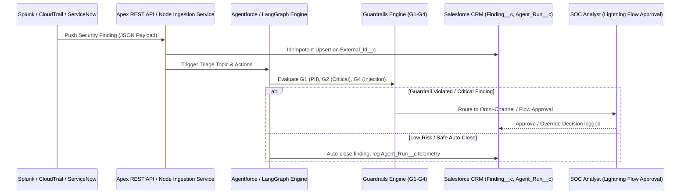

# Presentation Slide Rehearsal

**Candidate:** Shaikat Majumdar, Senior Forward Deployed Engineer candidate
**Interview:** Salesforce final round, 45 minutes, 2:1, Google Meet (candidate at the Salesforce NYC office, both interviewers remote)
**Interviewers:** Kaytie Zimmerman (VP, Forward Deployed Engineering) and Anand Narayan (Deployment Strategist Director)

---

## Table of Contents

1. [Presentation Files](#presentation-files)
2. [Interview Context and Overall Strategy](#interview-context-and-overall-strategy)
3. [Presentation 1 — `SALESFORCE_FINAL_ROUND_PRESENTATION.pptx`](#presentation-1--salesforce_final_round_presentationpptx-use-presentation-2-for-the-interview-and-fallback-on-this-only-if-needed)
4. **[Presentation 2 — `SALESFORCE_FINAL_ROUND_OPEN_SOURCE_DEMO.pptx` (MAIN SLIDE)](#presentation-2--salesforce_final_round_open_source_demopptx)**
5. [Consolidated Interview Q&A](#consolidated-interview-qa)
6. [Presentation Timing and Rehearsal Strategy](#presentation-timing-and-rehearsal-strategy-salesforce_final_round_open_source_demopptx)
7. [Final Cross-Presentation Interview Preparation](#final-cross-presentation-interview-preparation)
8. [Technical Deep Dive and Architecture Defense](#technical-deep-dive-and-architecture-defense)
9. [Deep-Dive Interview Q&A Bank](#deep-dive-interview-qa-bank)
10. [Role 1: Millburn Ridgefield Corporation (Apr 2008 – Feb 2022)](#role-1-millburn-ridgefield-corporation-apr-2008--feb-2022)
11. [Role 2: J.P. Morgan Asset Management / Highbridge (Feb 2022 – May 2025)](#role-2-jp-morgan-asset-management--highbridge-feb-2022--may-2025)
12. [Role 3: Balyasny Asset Management LP (May 2025 – Present)](#role-3-balyasny-asset-management-lp-may-2025--present)
13. [Rehearsal Quick Reference Table (For Final Round Prep)](#rehearsal-quick-reference-table-for-final-round-prep)
14. [💡 Interview Scripting Tip](#-interview-scripting-tip)
15. [Final Round 2:1 Panel Interview Preparation: Top Questions & Story Mapping](#final-round-21-panel-interview-preparation-top-questions--story-mapping)
16. [Beacon: "Run all v1, then Run all v2" and "v1 vs v2" explained](#beacon-run-all-v1-then-run-all-v2-and-v1-vs-v2-explained)
  - 16.1. [1. What happens when you click "Run agent on all (v1)"](#1-what-happens-when-you-click-run-agent-on-all-v1)
  - 16.2. [2. Then you click "Run agent on all (v2)"](#2-then-you-click-run-agent-on-all-v2)
  - 16.3. [3. What stays the same, by design](#3-what-stays-the-same-by-design)
  - 16.4. [v1 vs v2: what is actually different](#v1-vs-v2-what-is-actually-different)
  - 16.5. [How to read this honestly (say it in the room)](#how-to-read-this-honestly-say-it-in-the-room)
  - 16.6. [Demo script (about 60 seconds, no reset)](#demo-script-about-60-seconds-no-reset)

[⬆️ Back to top](#table-of-contents)

---

## Presentation Files

**Slide references used below:** `P1-S#` = slide # of `SALESFORCE_FINAL_ROUND_PRESENTATION`; `P2-S#` = slide # of `SALESFORCE_FINAL_ROUND_OPEN_SOURCE_DEMO`.

[⬆️ Back to top](#table-of-contents)

---

## Interview Context and Overall Strategy

### The room

Two remote interviewers, one candidate in a Salesforce office. Everything you say has to survive a webcam and a screen share. That means:

- **Camera:** sit so the camera is at eye level and your face fills the top third. Talk to the lens for opening, closing and every key claim. Glance at the screen for diagrams, then return to the lens.
- **Audio:** use the headset you tested in that room, not laptop speakers. Mute notifications. Speak 10% slower than feels natural; remote audio compresses fast speech.
- **Screen share:** share one window, not the entire screen. Keep three windows ready and in this order: (1) Beacon in the browser, (2) `SALESFORCE_FINAL_ROUND_OPEN_SOURCE_DEMO_ENHANCED.pptx`, (3) `SALESFORCE_FINAL_ROUND_PRESENTATION_ENHANCED.pptx`. Also have `run-cli-demo.bat` open in a terminal as the demo fallback, and pre-click "Run agent on all" state knowledge (see the ROI trap in P2-S9).
- **Signposting:** because they cannot see where you point, always name the thing: "top-left box, the Ingest API", "the second row of the table". Never say "this one here".
- **Notes:** keep this document on a second device or printed, not on the shared screen.

### Objectives

1. Prove you are a builder who can sit in a customer environment (Kaytie's lens: rigor, architecture, judgment).
2. Prove you can turn ambiguity into a plan a customer adopts, and tie it to value (Anand's lens: deployment, adoption, time to value).
3. Be unmistakably honest about what Beacon is: a **reference build** with synthetic data, a keyword-stub classifier, simulated latency and modelled ROI. Honesty here is your biggest credibility asset because the evidence-boundary slide (P2-S22) lets you volunteer it before they find it.
4. Own the Agentforce gap in one sentence and show a concrete plan to close it (P1-S7, P1-S17).

### Delivery order (this differs from file order)

You present **P2 (the Beacon deck) first**, because it is the assigned-prompt answer. **P1 is the Q&A bank** that you open when a question lands on a competency or on the job description.

### 45-minute plan

| Clock | Minutes | Segment | What is on screen |
|-------|---------|---------|-------------------|
| 0:00–2:00 | 2:00 | Greetings, restate the plan, confirm they can see and hear | P1-S1 for ≤20 s, then switch to P2 |
| 2:00–16:00 | ~14:10 | **Beacon walkthrough** (P2-S1 to S18, live demo inside it) | P2, with Beacon in the browser for S8–S9 |
| 16:00–37:00 | 21:00 | **Discussion and Q&A**, led by the interviewers | P2 backup (S19–S22) or P1 slides on demand |
| 37:00–42:00 | 5:00 | **Your questions** to Kaytie and Anand | P2-S18 (or P1-S18) |
| 42:00–45:00 | 3:00 | Close, thanks, next steps; also the buffer | camera only |

Rules: if you reach 6:30 and have not started the demo, cut P2-S5 to 40 seconds and skip P2-S9. If the demo fails at any point, switch to the CLI demo, and failing that, to P2-S20/S21 (they are built for this). Never spend more than 60 seconds troubleshooting live.

### Narrative spine (say it the same way in every answer)

> *I deliver in customer environments. I make AI safe to ship. I prove value.*

Every answer should land on one of those three, with one concrete example from Beacon or from the resume items on the slides.

### What you may and may not claim

- **May claim** (it is on your slides and resume): 17+ years; Millburn Ridgefield 2008-22, J.P. Morgan/Highbridge 2022-25, Balyasny 2025-now; 25-40% onsite; under-5-day MVPs; ADR-governed, containerized services on EKS/AKS; 99.2% task-completion reliability after prompt/context/tool-routing fixes; ServiceNow and Archer headless integrations; LangChain, LlamaIndex, LangGraph; Beacon as a reference build.
- **May not claim:** that Beacon ran at a customer; that the 13.6 minutes or the $48K are measured outcomes; that the classifier is an LLM; that Agentforce is a deep strength (say "ramping"); anything about a customer's metrics that is not on a slide.
- **When asked about something not on a slide**, use this pattern: *"What I've done is X. What I would do here is Y, and here is how I'd validate it."* This separates fact from proposal without sounding weak.

[⬆️ Back to top](#table-of-contents)

---

## Presentation 1 — `SALESFORCE_FINAL_ROUND_PRESENTATION.pptx` (use Presentation 2 for the interview and fallback on this only if needed)

### 1. Presentation Overview

An 18-slide **competency-led deck and Q&A bank**. Slides 1-5 introduce you and map your background to the job description. Slides 6-13 walk the six competencies Salesforce assesses (influence stakeholders, drive innovation and AI readiness, agility, build and deploy, integration platform, AI ecosystems), each cross-referenced to the Beacon deck. Slides 14-18 close on business value, a summary, a proposed first 90 days, and your questions. Its central message: **"I have real evidence for five of six competencies and a concrete plan for the sixth (Agentforce depth)."** Its most important feature is P1-S7, an honest evidence table that separates "resume: delivered", "Beacon", and "ramping".

### 2. Recommended Presentation Strategy

- **Do not present it front to back.** The notes on P1-S1 say it explicitly: the Beacon deck is the main event and this deck is the Q&A bank. Open P1-S1 for 20 seconds, then go to P2.
- **Use it reactively.** Map likely questions to slides: "tell me about yourself" → S2/S5; "why should we hire you vs. a Salesforce specialist" → S4/S7/S12; "how do you handle ambiguity" → S9; "how do you ship AI safely" → S13; "what is your ROI story" → S15; "what will you do in your first quarter" → S17.
- **Deliver quickly:** S2, S3, S5, S10 (these repeat or support the Beacon deck). **Deliver deliberately:** S7 (honesty and Agentforce ramp), S9 (the ambiguity/uncertainty frame, which was explicit Round 1 coaching), S12 (framework vs platform judgment), S13 (staged autonomy), S15 (ROI, careful wording), S17 (first 90 days).
- **Pause points:** after S7 (invite them to probe Agentforce), after S13 (invite safety questions), after S15 (invite the ROI challenge).

### 3. Slide-by-Slide Rehearsal

#### Slide 1 — Forward Deployed Engineer | Final Round: *Shipping Agentic AI Into Real Enterprises*

**Purpose.** Set a warm, confident tone, state the plan, and hand off to the Beacon deck. This slide earns trust, not information.

**Recommended delivery time.** 0:20 (inside the 2-minute opening).

**Verbatim-ready speaking script**

> "Kaytie, Anand, thank you for making the time. I'm looking forward to this. Here's how I'd like to use our 45 minutes. I'll take about fifteen minutes to walk you through one project, Beacon, including a live demo, because it answers the prompt you gave me. Then I'd love to spend most of the remaining time in conversation, with your questions first and mine at the end. I have a second deck behind this one organized around the competencies you assess, and I'll pull it up if a question lands there. Does that work for you?"

**Delivery and emphasis cues**
- Look at the camera for "thank you." Smile; do not rush.
- Pause after "Does that work for you?" and wait for a nod or a yes. This also confirms audio and video.
- Switch windows *before* you start talking about Beacon so there is no dead air.

**Likely interviewer questions**
1. "Before the project, can you give us the 30-second version of who you are?"
2. "Why this role, rather than staying in finance?"

**Suggested answers**
1. "I'm a senior engineer with seventeen years of customer-facing delivery, most of it in New York finance and governance, risk and compliance. Each role moved me closer to putting AI agents into production inside customer environments, and that's what I want to do on Agentforce."
2. "The part of my work I value most is sitting with a customer, finding the real problem, and shipping something their team can run. Finance gave me hard constraints: audit, security, uptime. Salesforce gives me that same discipline at much greater scale and breadth, across many industries and a platform built for it."

**Transition.** "So let's start with the project."

---

#### Slide 2 — Opening | Introduction: *17 years of putting software where customers live*

**Purpose.** Establish the through-line (customer-facing delivery, closer to agents each time) in under 75 seconds. Duplicates P2-S2, so use it only if you are running the competency path.

**Recommended delivery time.** 1:00–1:15 (skip if P2-S2 was already presented).

**Verbatim-ready speaking script**

> "The short version: seventeen-plus years, and the through-line is customer-facing delivery. Fourteen of those years were at Millburn Ridgefield, where I built data and integration systems for institutional partner accounts and wrote reusable SDK starter kits. Then three years at J.P. Morgan and Highbridge, where I moved into agent orchestration inside client environments, hardening tools into containerized, audit-ready services. And now Balyasny, where I'm embedding with pods and putting agents into production, with working prototypes in the customer's environment in under five days.
>
> Across those three roles I've been onsite with customers about twenty-five to forty percent of the time, which fits the roughly twenty-five percent this role asks for. And what I actually do day to day is three things. I design the intelligence of the agent: prompts, reasoning, tool calls and the guardrails around them. I own components end to end, from architecture through to something deployed, validated and observable in production. And I co-build with the customer, because the measure of a good engagement is that their team is more capable when I leave."

**Delivery and emphasis cues**
- Emphasize "customer-facing delivery" once; it is the through-line.
- Say "under five days" slowly; it is a differentiator.
- Look at the camera for the last sentence.

**Likely interviewer questions**
1. "You say 25-40% onsite. What does onsite mean for a finance engineer?"
2. "Which of the three roles taught you the most about customer deployment?"
3. "The donut chart shows 14 years at one firm. What did you do to avoid stagnating?"

**Suggested answers**
1. "Working inside the client's or business's own environment: their network, their change control, their stakeholders, not shipping from a distance. In practice that meant sitting with traders, risk teams, architects and sponsors to understand the workflow, then deploying into their environment."
2. "J.P. Morgan and Highbridge, because the environments were the most constrained. Security review, audit and change control force you to make decisions explicit, which is where I started writing ADRs for every trade-off. I carry that habit into every engagement."
3. "The scope kept changing. Early on it was data pipelines and integrations in Python and Java; later BigQuery and Snowflake, Kafka, and SDK starter kits for other teams. The tenure gave me depth on how systems age in production, which matters when you hand a deployment to a customer and need it to last."

**Transition.** "That's who I am. Let me show you what I'm going to cover."

---

#### Slide 3 — Opening | Agenda and Assigned Prompt: *Agenda: answer the prompt, show it live, tie it to value*

**Purpose.** Show you understood the assigned prompt and have a disciplined plan. Restating the prompt in your own words is the signal.

**Recommended delivery time.** 0:20–0:30.

**Verbatim-ready speaking script**

> "You asked me to walk through a project: what I built and why, how I approached it from the first sponsor conversation to architecture, what broke and how I fixed it, who I worked with, how I took it from a first release to scale, and how it's monitored and improved today. I've organized fifteen minutes around exactly that: one and a half minutes on me, three and a half on the problem and approach, five on the live demo and evals, one on challenges and collaboration, and three on impact. I've left a minute of buffer. I've also planned two pauses for you, one after the architecture and one after the demo."

**Delivery and emphasis cues**
- Do not read the agenda strip. Look at the camera when you restate the prompt.
- Slow down at "two pauses for you" and mean it.

**Likely interviewer questions**
1. "Is Beacon a real customer project?"
2. "Why did you pick this project for the prompt?"

**Suggested answers**
1. "No, and I want to be clear up front. Beacon is a reference build I made from patterns I've used in customer work. It uses synthetic data, and the savings are modelled assumptions I'd replace with the sponsor's numbers. I chose that framing so I can show you everything, including the code, without exposing a client's data."
2. "Because it exercises exactly what the role does: ambiguous discovery, an agent with guardrails, a data pipeline, evals, telemetry, and a business case. And it maps directly to Agentforce, which let me do the homework on your platform."

**Transition.** "Let me first show you how I read the role."

---

#### Slide 4 — Opening | Context: *The role asks for six things. I bring evidence for each.*

**Purpose.** Show you read the job description and are not reciting a resume. The "Fit" column is deliberately honest (one "Growing").

**Recommended delivery time.** 0:45 (can be cut to 0:20).

**Verbatim-ready speaking script**

> "I went through the job description and boiled it down to six requirements, and I'd rather show you evidence than adjectives. Customer-facing technical delivery is the required one, and that's seventeen years across three firms. Production agentic AI, with prompts and evals: at Balyasny I took task-completion reliability to ninety-nine point two percent by refining prompts, context and tool routing. Data pipelines, with Data 360, Snowflake and Databricks in mind: I've built ingestion pipelines and executive dashboards at J.P. Morgan and Balyasny. APIs and integration: REST, gRPC, webhooks, Kafka, plus headless integrations to ServiceNow and Archer.
>
> The one I've marked 'Growing' is the Salesforce platform and Agentforce. I've worked with Agentforce and Apex and I built Beacon on the platform, but I won't claim the depth of someone who's lived in it for years. I'll tell you exactly how I'm closing that gap when we get to the first ninety days."

**Delivery and emphasis cues**
- Slow down and look at the camera on "Growing." Naming it first removes its sting.
- Do not read every row; pick three.

**Likely interviewers' questions**
1. "How was the 99.2% measured?"
2. "What exactly have you done with Agentforce?"
3. "You marked Travel as 'Ready'. Is 25% really workable?"

**Suggested answers**
1. "It's task-completion reliability for the agent workflow: the share of tasks that completed correctly end to end. The improvement came from three things: tighter prompts, better context assembly and fixing tool-routing errors. I'd want to be careful to describe the denominator precisely: the specific task set and period. [**Prep note:** know this denominator cold before the interview. If you cannot state it, say 'on the task set we tracked at Balyasny' and do not elaborate.]"
2. "[**Prep note:** this slide says 'Agentforce deployments' while P1-S7 says 'Agentforce: ramping'. Reconcile them before the interview.] The safest, strongest answer: say exactly what you did (for example, which agent, which topics and actions, in which kind of environment), then say 'my depth is in orchestration and guardrails, and I'm ramping on the platform-native pieces: Prompt Builder, the Trust Layer and Testing Center.' Do not describe features you have not touched."
3. "Yes. I've been onsite thirty to forty percent of the time in every forward-deployed role I've held, so twenty-five percent is a comfortable number."

**Transition.** "Let me show how those roles built on each other."

---

#### Slide 5 — Opening | Context: *Each role moved closer to agents in production*

**Purpose.** Give the career a narrative arc: data and integration → agent orchestration → agents in production.

**Recommended delivery time.** 0:45 (or skip).

**Verbatim-ready speaking script**

> "I think about my career as three steps, each one closer to agents running in production. At Millburn, from 2008 to 2022, it was data and integration: Python and Java pipelines, BigQuery, Snowflake, Kafka, and SDK starter kits that other teams could adopt. That's the plumbing every agent depends on. At J.P. Morgan, from 2022 to 2025, it was agent orchestration: LangChain, LlamaIndex, custom engines, headless APIs into ServiceNow and Archer, and ADR-governed hardening. And at Balyasny, from 2025, it's agents in production: Agentforce, LangGraph, GRC and SOC actions, dashboards, and MVPs in under five days.
>
> The bars show my approximate onsite share per role, about thirty, forty and thirty-five percent. They're approximations from my resume, so please take them as a range, not a measurement."

**Delivery and emphasis cues**
- Trace the arrow left to right verbally: "first, second, third."
- Say "approximations" clearly; it prevents a trap.

**Likely interviewer questions**
1. "Why did agents come so late in your career?"
2. "What did the earlier data work teach you that helps with agents?"

**Suggested answers**
1. "The tooling matured late. LLM agents that could call tools reliably only became practical recently, and I moved when they did. The earlier years weren't wasted: nearly every agent failure I see in production is a data, integration or permissions failure, not a model failure."
2. "Idempotency, schema discipline, and observability. If an ingest isn't idempotent, an agent retry duplicates work. If the data contract is loose, the agent hallucinates around gaps. Those habits are why Beacon starts with a quarantine and an upsert before it ever calls a model."

**Transition.** "Now, the part that matters most: how I deliver. I've organized it around the six competencies you assess."

---

#### Slide 6 — Middle (divider): *How I deliver. Mapped to the six competencies you assess*

**Purpose.** Reset attention and signal a shift from background to substance.

**Recommended delivery time.** 0:05.

**Verbatim-ready speaking script**

> "Let me move from who I am to how I deliver, organized around the six competencies you assess."

**Delivery and emphasis cues.** One breath. Do not elaborate.

**Likely interviewer questions**
1. "Where do you think you're strongest of the six?"

**Suggested answers**
1. "Build and deploy, and integration. Those are where I have the longest track record, with delivered work I can show. Where I'm still ramping is the Agentforce-specific layer, and I'll be explicit about that on the next slide."

**Transition.** "Here's the evidence map."

---

#### Slide 7 — Middle | Competency Snapshot: *Where the evidence lives, and where I am still ramping*

**Purpose.** This is the credibility slide. It shows you can assess yourself honestly, and it pre-empts the Agentforce gap.

**Recommended delivery time.** 1:30. Do not rush.

**Verbatim-ready speaking script**

> "This is the slide I'd most like you to hold me to. For each of the six competencies, I've listed the proof and the level of evidence: whether it's delivered work from my resume, shown in Beacon, or still in progress.
>
> On influencing stakeholders, I held the room with architects and sponsors, about forty percent onsite at J.P. Morgan and Highbridge. On innovation and AI readiness, the evidence is staged autonomy, where a golden-set eval gates every prompt change. On agility, it's getting from sketch to a customer environment in under five days, and how I separate ambiguity from uncertainty, which I'll show on a later slide. On build and deploy, it's containerized, audit-ready services on EKS and AKS with architecture decision records. On integration, REST, gRPC, webhooks, Kafka, SSO and SAML, with idempotent ingest.
>
> The last row is the honest one. I've delivered with LangGraph, LangChain and LlamaIndex. On Agentforce I'm ramping. And I want to be specific about how: I'm working in a developer org, I've mapped Beacon onto Agentforce topics, actions, the Trust Layer, Prompt Builder and the testing tools, and I'd close the rest by building, not reading. I haven't given myself numeric scores, because evidence is better than self-ratings."

**Delivery and emphasis cues**
- Slow down for the last row. Look at the camera for "I'm ramping."
- Pause 2 seconds after "evidence is better than self-ratings." Let them react.

**Likely interviewer questions**
1. "How will you close the Agentforce gap, concretely?"
2. "Why should we hire someone who's ramping on our core platform?"
3. "Give me one example of 'Influence stakeholders' where you changed someone's mind."
4. "Which of these claims is weakest?"

**Suggested answers**
1. "Three steps in my first thirty days: map Beacon's pieces onto Agentforce (the triage topic and instructions, Apex invocable actions, Prompt Builder for the classification prompt, Flow for approvals), build the eval gate using the platform's testing tooling, and shadow a Deployment Strategist's discovery sessions. The mapping already exists on P2-S18; the first 30 days make it real in a customer-shaped org."
2. "Because the hard part of forward-deployed work isn't the product surface; it's discovery, integration, guardrails, evals and getting a customer to adopt. Product features I can learn in weeks. Those other skills take years, and I have them. I'd also bring a cross-framework view: when LangGraph or custom orchestration is the right tool and when it isn't, which is on P1-S12."
3. "I'd rather use a pattern than invent a story: when sponsors and SOC analysts disagree about trust in auto-close, I don't argue; I propose a staged-autonomy rollout where the override rate decides. That moves the argument from opinion to data. [**Prep note:** have one real, specific stakeholder story from J.P. Morgan or Balyasny ready, with no confidential names or numbers.]"
4. "The Agentforce row, which is why I've labelled it. The second weakest is Beacon's evidence, which is a reference build rather than a customer result, and that's labelled too."

**Transition.** "Let me take the competencies in turn, starting with influence."

---

#### Slide 8 — Middle | Influence Stakeholders: *I work the whole room, not just the keyboard*

**Purpose.** Show you navigate multiple stakeholders and give both interviewers something specific: outcomes and repeatability for Kaytie, adoption and strategy for Anand.

**Recommended delivery time.** 1:00.

**Verbatim-ready speaking script**

> "In a deployment there are at least seven audiences, and each one needs something different from me. The executive sponsor cares about value and risk. The customer's architects care about integration and security. The Deployment Strategist cares about adoption and scope. Sales or the solutions engineer cares about expectations, and I want to keep what we've promised and what we can build in sync. Customer engineers care about enablement, because they'll own it after me. And the product team cares about getting field feedback they can act on.
>
> My job is to be the builder and the translator in the middle. Three mechanisms keep everyone aligned: a weekly requirements ledger, an architecture decision record for every meaningful trade-off, and customer-facing demos early and often, so disagreement shows up in week two, not week ten."

**Delivery and emphasis cues**
- Name the two roles in the room by title ("a Deployment Strategist like Anand's team") only if it feels natural; do not flatter.
- Emphasize "week two, not week ten."

**Likely interviewer questions**
1. "What do you do when the sponsor and the customer architect disagree?"
2. "How do you split the work with a Deployment Strategist?"
3. "How do you handle a sales promise that engineering can't deliver?"

**Suggested answers**
1. "Make the trade-off visible. I write it up as an ADR: the options, the cost, the reversibility and my recommendation, and put it in front of both. Sponsors usually care about risk and timeline; architects about security and operability. An ADR lets both see their concern was priced, and it makes the decision reversible if we're wrong."
2. "The Deployment Strategist owns adoption, scope and the commercial relationship; I own the components, the integrations and the technical truth. Discovery is shared: they lead the business conversation, I lead the technical probing, and we compare notes against the weekly requirements ledger."
3. "Early, and in the customer's presence if appropriate, not behind their back. I'd show what the prototype does, name the gap, and offer a path: de-scope, phase, or an alternative. I'd then take the gap to the Deployment Strategist and product so it doesn't repeat."

**Transition.** "Underneath all that is how I handle the unknown, which is agility."

---

#### Slide 9 — Middle | Agility: *Ambiguity is a question. Uncertainty is an experiment.*

**Purpose.** Deliver the single most important mental model in the deck (explicit Round 1 coaching). Make it memorable and concrete.

**Recommended delivery time.** 1:30. Do not rush.

**Verbatim-ready speaking script**

> "The most useful distinction I've learned in discovery is between ambiguity and uncertainty, because they need opposite responses.
>
> Ambiguity means the information exists. Somebody knows; nobody wrote it down. The right response is to ask, decide, and document it in an ADR. In Beacon, the question 'what counts as Critical?' was ambiguity. The CISO knew, I asked, and it became a score of seventy-five or more, logged in an ADR.
>
> Uncertainty means it can't be known yet. No meeting will answer it; you need evidence. The right response is a cheap experiment, a reversible decision, and a trigger to revisit. In Beacon, 'will classification hold on new log sources?' was uncertainty. So we shipped with golden-set evals, shadow mode and a drift alert, rather than debating it.
>
> And that's the loop at the bottom: name it, classify it, ask or experiment, log it in the ADR, review weekly. Deviations surface early, because every open item has a type, an owner, and a revisit date."

**Delivery and emphasis cues**
- Hold up two beats: "ambiguity... uncertainty." Pause between them.
- Slow down at "a cheap experiment, a reversible decision, and a trigger to revisit."
- Look at the camera at the final sentence.

**Likely interviewer questions**
1. "Give me an example where you misclassified one as the other."
2. "How do you stop endless discovery?"
3. "What if the customer won't commit to a decision?"

**Suggested answers**
1. "A classic one: treating 'what is the SLA for this feed?' as uncertainty and building monitoring for a threshold that actually existed in a contract nobody had read. Asking first would have been cheaper. I now ask the 'does anyone know?' question before I design an experiment. [**Prep note:** only use this if it matches something you did; otherwise say 'the reverse mistake is more common, and it looks like this' and give the hypothetical clearly.]"
2. "Time-box it. Every open item gets an owner and a revisit date; if a question has been ambiguous for two weeks, it's escalated to the sponsor as a decision, not a discovery task."
3. "I make the default explicit and reversible. 'Unless you tell me otherwise by Friday, we'll use seventy-five as the Critical threshold, and we can change it with one config change.' Silence then becomes a decision, with a paper trail."

**Transition.** "Agility means getting to something real quickly, so let me talk about build and deploy."

---

#### Slide 10 — Middle | Build and Deploy: *Ship in days, harden in weeks, hand over cleanly*

**Purpose.** Show a repeatable delivery rhythm and the habit of documenting trade-offs.

**Recommended delivery time.** 1:00.

**Verbatim-ready speaking script**

> "My rhythm is discover, sketch an MVP, harden, observe, enable. The first goal is speed to something real: at Balyasny I've gone from a sketch to a working MVP in the customer's environment in under five days. That speed matters because a running prototype surfaces the real requirements faster than any document. Using Cursor and Claude in the workflow has made production delivery roughly fifty percent faster for me.
>
> But speed is only half. At J.P. Morgan I took field tools and hardened them into containerized, audit-ready microservices on EKS and AKS, with an ADR for every trade-off, so that a risk reviewer could see why each decision was made. And at Millburn I built reusable SDK starter kits, which is how you scale one engagement into many.
>
> One caution on the chart: those phase durations are illustrative of my typical pace, not measured figures, so please don't read them as data."

**Delivery and emphasis cues**
- Say "illustrative, not measured" clearly and without apology.
- Emphasize "enable"; it is the handover.

**Likely interviewer questions**
1. "Fifty percent faster than what, and how did you measure it?"
2. "What do you cut to ship in five days?"
3. "How do you stop an MVP becoming production by accident?"

**Suggested answers**
1. "It's my estimate of time-to-production on comparable work before and after adopting AI-assisted development. It's an estimate, not a controlled study, and I'd describe it that way. [**Prep note:** be ready to name the comparison; if you cannot, say 'my own before-and-after estimate'.]"
2. "Breadth, not safety. I cut features, polish and secondary integrations, never authentication, audit logging or guardrails. The MVP is narrow but it is already safe to put in front of a user."
3. "An explicit hardening phase with exit criteria, agreed with the customer before the MVP ships: evals in CI, observability, runbook, rollback. If those aren't done, it's still a prototype, and we label it as such."

**Transition.** "Fast delivery only helps if the agent can reach the customer's systems, which is integration."

---

#### Slide 11 — Middle | Integration Platform and Ecosystem: *Agents are only as useful as the systems they can reach*

**Purpose.** Show you design integrations (not just consume them) and know the reliability patterns.

**Recommended delivery time.** 1:15.

**Verbatim-ready speaking script**

> "Left to right: on the left are the systems of record the customer already has: Splunk, ServiceNow, Archer, Jira. They connect through a standard integration layer, REST, gRPC, webhooks or Kafka, with OAuth 2.0 and SAML single sign-on. In the middle is the agent layer, Agentforce or LangGraph. On the right are the destinations: Data 360, Snowflake, Databricks or BigQuery for history and analytics, and Salesforce apps such as Lightning Web Component dashboards and Flow approvals.
>
> The three patterns in the table are the ones that bite in production. First, idempotent upsert on an external ID: webhooks retry, and a retry must never create a duplicate. Second, dead-letter quarantine: bad data is kept, with a reason, never silently dropped. Third, a headless API layer, so the same action can be called by an agent, a Flow or a human UI. On Salesforce those map to Apex REST, Platform Events, Data 360 connectors and MuleSoft where the customer already has it."

**Delivery and emphasis cues**
- Narrate the diagram left to right; name each cluster.
- Slow down on "retry must never create a duplicate."

**Likely interviewer questions**
1. "What happens when a downstream system is down?"
2. "Why a headless API layer rather than calling tools directly from the agent?"
3. "How do you handle auth between the agent and a non-Salesforce system?"

**Suggested answers**
1. "Retries with backoff for transient errors, a queue so we apply back-pressure instead of dropping, a dead-letter path for poison messages, and a visible status so users know the action is pending. For anything irreversible, I fail closed: no action, escalate to a human."
2. "One governed action surface means one place to enforce permissions, validation and audit, and any caller (agent, Flow, UI, a different agent framework) gets identical behavior. It also lets us swap the agent layer without rewriting integrations."
3. "OAuth 2.0 with scoped credentials and least privilege, secrets in a vault, short-lived tokens, and the agent never holding long-lived credentials directly. On Salesforce I'd use Named Credentials, which keep secrets out of code."

**Transition.** "So which tool do I reach for: platform or framework? That's the next slide."

---

#### Slide 12 — Middle | AI Ecosystems and Frameworks: *Right tool for the job: framework or platform*

**Purpose.** Demonstrate judgment, not tribal loyalty. Probably the best slide for Kaytie.

**Recommended delivery time.** 1:15. Do not rush.

**Verbatim-ready speaking script**

> "People ask me 'LangChain or Agentforce?' as if it's a loyalty test. It isn't. It's a question about where the data lives, who operates it and how fast you need to learn.
>
> When the work lives in Salesforce data and needs governed access, masking, audit, and admin-owned change, Agentforce is the natural choice: those are built in, and a LangGraph build would make me re-create them. When I need custom multi-agent graphs, non-Salesforce systems, or fast research iteration, LangGraph or LlamaIndex is faster to experiment with.
>
> So my rule is four steps. Start where the data and permissions already live. Prototype in the faster tool. Ship in the one the customer can operate. And join the two with a versioned API. That last part is what makes the choice reversible."

**Delivery and emphasis cues**
- Say the four-step rule slowly, counting on the camera if natural.
- Pause after "Ship in the one the customer can operate."

**Likely interviewer questions**
1. "When would you choose LangGraph in a Salesforce shop?"
2. "Why does 'admin-owned' matter so much?"
3. "Is the Trust Layer something you can replicate?"

**Suggested answers**
1. "When the workflow spans several non-Salesforce systems with complex branching and loops, or when we need to test retrieval strategies quickly. Then I'd front it with a versioned API and, if the customer wants it inside Salesforce long term, port the proven pattern to Agentforce topics and actions."
2. "Because a deployment's success is decided after I leave. If only an engineer can change a prompt or a threshold, the customer is dependent on me. Admin-owned means the customer's team can adjust and operate it."
3. "You can replicate pieces: masking, logging and policy checks. But doing it per project is expensive, and getting it audit-grade is harder than it looks. Where the platform provides it, I'd use it and spend my time on what's unique to the customer. [**Prep note:** check the current Trust Layer feature list before the interview.]"

**Transition.** "Whichever tool you choose, the next question is how much autonomy the agent gets."

---

#### Slide 13 — Middle | Drive Innovation and AI Readiness: *Autonomy is earned with evidence, not granted by a slide*

**Purpose.** Show a concrete, defensible framework for safe AI rollout.

**Recommended delivery time.** 1:30. Do not rush.

**Verbatim-ready speaking script**

> "I don't ask a customer to trust an agent; I let the agent earn it. Autonomy moves in four levels. Level zero, the agent suggests. Level one, a human approves. Level two, it acts on its own for low-risk cases. Level three is broader autonomy.
>
> You move up only by passing gates. First, an eval gate: at least ninety-five percent on the golden set, run in CI. Second, a trust metric: the human override rate has to be below a threshold the sponsor agreed to in advance. Third, safety: guardrails are code, not prompt text, because prompts can be talked around. Fourth, rollback: one switch takes you back to the previous level.
>
> The chart shows the first step in Beacon: prompt version one passed sixty-four percent of a fourteen-case golden set, and version two passed all of them. The point isn't the numbers; it's that we can measure a change before it ships."

**Delivery and emphasis cues**
- Count the four levels on your fingers only if your camera frames your hands; otherwise count verbally.
- Emphasize "guardrails are code, not prompt text."

**Likely interviewer questions**
1. "Why 95%? Where does that number come from?"
2. "A 14-case golden set is tiny. Why should I trust it?"
3. "Who decides the override-rate threshold?"

**Suggested answers**
1. "It's a starting default, not a law. The right gate depends on the cost of an error. A threshold for auto-closing low-risk items can be looser than one for anything touching customer data. I'd set it with the sponsor in the first workshop. Note too that on fourteen cases a ninety-five percent gate means all fourteen must pass, since thirteen of fourteen is 92.9%."
2. "You shouldn't, as a measure of real-world accuracy. If all fourteen pass, the statistics only support a true pass rate of roughly 77% or better at 95% confidence (the exact lower bound is $0.025^{1/14} \approx 0.77$). It's a regression gate, a tripwire, not an accuracy claim. In a deployment I'd grow it from production overrides and hold out cases the prompt was never written against."
3. "The sponsor and the SOC lead, with data. I'd show the override rate trend at each review and let them set the line. It's their risk appetite, not mine."

**Transition.** "That's the how. Now what it's worth, which is the business value."

---

#### Slide 14 — Closing (divider): *Business value: Outcomes the sponsor can take to a CFO*

**Purpose.** Signal a shift from engineering to economics. Frame: numbers a CFO could challenge.

**Recommended delivery time.** 0:10.

**Verbatim-ready speaking script**

> "Engineering only matters if it produces something the sponsor can defend to a CFO, so let me put numbers on Beacon, with the assumptions on the table."

**Delivery and emphasis cues.** Say "assumptions on the table" with emphasis; it sets up the honesty on the next slide.

**Likely interviewer questions**
1. "Do you think in business terms by default?"

**Suggested answers**
1. "I try to. In discovery the second question after 'what's the problem?' is 'what is it costing, and how would we know it's fixed?' Without that, there's nothing to measure and no way to show value."

**Transition.** "Here's the model."

---

#### Slide 15 — Closing | ROI: *Capacity returned to analysts, with the cost on the table*

**Purpose.** Present the ROI with total honesty about inputs and sensitivity. This slide is where the careless candidate loses credibility.

**Recommended delivery time.** 1:15.

**Verbatim-ready speaking script**

> "Here's the model. Four thousand findings a month, seventy percent in scope, so twenty-eight hundred. Each in-scope finding saves about thirteen point six minutes of an eighteen-minute baseline. At eighty-five dollars an hour loaded, that's about six hundred thirty-five hours and fifty-four thousand dollars of capacity a month. Subtract a six-thousand-dollar monthly run cost, and the net is about forty-eight thousand dollars, a modelled ROI of about eight hundred percent, which I define as net value divided by run cost.
>
> Now the part I most want you to hear: these are assumptions, not facts. The eighteen minutes is a baseline I'd confirm in discovery, and the thirteen point six is modelled in Beacon from assumed analyst minutes per outcome, not stopwatch-measured. I'd replace every input with the sponsor's numbers in the first workshop. At half the volume, the case is still about three hundred fifty percent. And I frame it as capacity redeployed to higher-risk work, not headcount cut."

**Delivery and emphasis cues**
- Slow down for each number. Round aloud (say "about").
- Make eye contact on "assumptions, not facts."
- If screen-sharing the app, **click "Run agent on all" first** or the ROI tab shows 14 min / 653 h / 826% (see trap below).

**Likely interviewer questions**
1. "Why is half the volume 350% and not 400%?"
2. "How would you validate the 18-minute baseline?"
3. "Isn't 'capacity redeployed' just a euphemism for layoffs?"
4. "What would make this ROI wrong?"

**Suggested answers**
1. "The run cost doesn't halve. Gross at half volume is $26,973; subtract the same $6,000 and net is $20,973; divided by $6,000 that's 349.6%. Fixed costs make ROI non-linear in volume, which is why I show the sensitivity."
2. "Time-and-motion on a sample: sit with analysts, record real triage time per finding by type, and compare to the ticketing system's timestamps. I'd also separate time to first touch from time to resolution."
3. "It's a fair challenge. The honest answer is that it depends on the sponsor's choices. In the security case, analyst capacity is chronically short, so the realistic benefit is less backlog and more time on high-risk findings. I'd write the redeployment plan into the success criteria with the sponsor so we measure it."
4. "Volume lower than assumed, in-scope rate lower, the baseline overstated, override rate high enough that humans redo the agent's work, or run cost higher once evals, monitoring and review time are included. Each is a named input I'd stress-test."

**Technical math, if asked to derive**

$$
\text{Gross}=N\,p\,\frac{s}{60}\,w,\qquad \text{Net}=\text{Gross}-C,\qquad \text{ROI}=\frac{\text{Net}}{C}
$$

with $N=4000$, $p=0.7$, $s=13.6$ min, $w=\$85$, $C=\$6000$: gross $=2800\times\frac{13.6}{60}\times 85\approx\$53{,}947$, net $\approx\$47{,}947$, ROI $\approx 7.99=799\%$. Payback on run cost is about $6000/53947\times 30\approx 3.3$ days of a month.

**Transition.** "Let me pull it together."

---

#### Slide 16 — Closing | Summary and Bottom Line: *Three points to remember*

**Purpose.** Land three memorable claims and tie to the job description.

**Recommended delivery time.** 0:45.

**Verbatim-ready speaking script**

> "Three things I'd like you to remember. One: I deliver in customer environments. Seventeen years, twenty-five to forty percent onsite, MVPs in under five days. Two: I make AI safe to ship: guardrails as code, evals in CI, staged autonomy. Three: I prove value: telemetry from day one and an ROI the sponsor can defend.
>
> Your job description asks for real code, real environments and measurable business impact. That is how I've worked for seventeen years, and Agentforce is the platform where I want to do it next."

**Delivery and emphasis cues.** Camera, steady pace, pause after each numbered point. Don't read the box text.

**Likely interviewer questions**
1. "What's the one thing you'd want us to remember?"
2. "What worries you about this role?"

**Suggested answers**
1. "That I'll be useful in the first week and leave the customer more capable than I found them."
2. "Breadth. The product surface moves quickly and every customer environment is different. My answer is to build early in a developer org and let the real customer constraints teach me."

**Transition.** "Let me show how I'd spend my first ninety days."

---

#### Slide 17 — Closing | First 90 Days (Proposed): *How I would earn trust in the first 90 days*

**Purpose.** Show a concrete, humble plan, labelled as a proposal. Answers Kaytie's "great first 90 days" question.

**Recommended delivery time.** 0:30 (up to 1:00 if asked).

**Verbatim-ready speaking script**

> "This is a proposal for us to tailor together. In the first thirty days I learn the pod and the platform: shadow Deployment Strategist discovery sessions and map Agentforce topics, actions, the Trust Layer and Prompt Builder onto Beacon in a developer org. By day sixty I own a component: ship one scoped piece in a live deployment, stand up its eval gate and telemetry, and send the first field insight to product, with a reproduction. By day ninety I lead and multiply: co-lead a customer workshop with the Deployment Strategist, turn a repeated pattern into a reusable starter kit, and leave the customer team able to run it without me. Success is customer outcomes, reusable assets, and a team that can operate the solution. And I'll name Agentforce depth as my ramp area and close it by building, not reading."

**Delivery and emphasis cues.** Emphasize "proposed" and "tailor together." Keep it to three beats.

**Likely interviewer questions**
1. "What if you're dropped into a customer in week two?"
2. "How would you measure success at 90 days?"

**Suggested answers**
1. "Then I learn on the job, paired with someone experienced, and I'd take the component with the most familiar shape, like integration or evals, so I'm contributing while ramping on the platform."
2. "One component in production with an eval gate and telemetry, one field insight accepted by product, a reusable asset others used, and a customer who says they can run it. I'd agree these with Kaytie in week one."

**Transition.** "I'd love to hear from you, so let me turn it around."

---

#### Slide 18 — Closing | Questions and Why Salesforce: *Why I want this role, and what I would like to learn from you*

**Purpose.** Show curiosity; ask sharp questions; then stop talking.

**Recommended delivery time.** 2:00–5:00 (this is your question block at ~37:00).

**Verbatim-ready speaking script**

> "Kaytie, one thing I'd love to understand: what does a great first ninety days look like for an FDE in this pod, and how do you measure FDE impact: outcomes, reusable assets, or both?
>
> Anand, from the deployment side: where do deployments tend to stall most, data access, security review or adoption? And what separates the pods that scale from the ones that stay one-offs?
>
> And if there's time: how does field feedback reach the Agentforce product teams, and is there an example that changed the roadmap?"

**Delivery and emphasis cues.** Ask one question, then stop and listen. Take notes visibly. Do not fill silences. Thank them by name.

**Likely interviewer questions**
1. "Why Salesforce rather than another AI company?"
2. "Why now?"

**Suggested answers**
1. "Because of the combination: real customers with real data and permissions, a platform that already carries the governance (identity, audit, trust) that most AI projects have to build, and an FDE role that is explicitly about code in customer environments."
2. "Agents are crossing from demos to production, and the hard part has shifted to deployment, guardrails and adoption, which is the work I've spent seventeen years on."

**Transition.** "Thank you. I'd love to build this with you."

---

### 4. Consolidated Interview Q&A (Presentation 1)

**Q1. How do you handle ambiguous requirements from a customer?** *(Why: core FDE competence; Round 1 coaching.)*
Answer: "I separate ambiguity from uncertainty. Ambiguity means someone knows: I ask, decide and write it in an ADR. Uncertainty means it can't be known yet: I run the cheapest experiment, keep the decision reversible and set a trigger to revisit. Every open item has a type, an owner and a revisit date, so deviations surface early." *If probed:* give the "What counts as Critical?" (ambiguity → score ≥75, ADR) versus "will classification hold on new log sources?" (uncertainty → golden set, shadow mode, drift alert) pair from P2-S5.

**Q2. How do you decide between Agentforce and LangGraph?** *(Why: judgment, platform fit.)*
Answer: P1-S12 rule: start where data and permissions live, prototype in the faster tool, ship in the one the customer can operate, join them with a versioned API. *If probed:* governance (Trust Layer, masking, audit) and admin ownership favor Agentforce; non-Salesforce systems, custom multi-agent graphs and research velocity favor LangGraph.

**Q3. What's your actual Agentforce experience?** *(Why: the visible gap.)*
Answer: say precisely what you built and where; then: "My depth is orchestration, guardrails and evals; I'm ramping on Prompt Builder, the Trust Layer and Testing Center, and I've mapped Beacon onto each." *If probed:* walk P2-S18 row by row. Never claim a feature you haven't touched. **Reconcile P1-S4 "Agentforce deployments" with P1-S7 "ramping" in advance.**

**Q4. How do you keep an agent from doing something harmful?** *(Why: safety and governance.)*
Answer: "Defense in depth. Deterministic scoring the LLM can't change; guardrails as code (G1 PII never auto-closed, G2 Critical needs a human, G3 low confidence needs a human, G4 injection blocked); staged autonomy; rollback switch; full telemetry." *If probed:* explain why prompt-only defenses fail (the model can be talked around) and that no defense against injection is perfect, hence least privilege and human approval for irreversible actions.

**Q5. Walk me through how you'd show ROI to a CFO.** *(Why: Anand's lens.)*
Answer: P1-S15 model, stressing inputs as assumptions, sensitivity, and "capacity redeployed." *If probed:* derive the half-volume 349.6% and explain fixed run cost.

**Q6. How do you collaborate with a Deployment Strategist?** *(Why: pod fit.)*
Answer: "They own adoption, scope and the commercial relationship; I own components, integration and technical truth. We run discovery together and reconcile against a weekly requirements ledger." *If probed:* give how you would escalate a scope conflict (ADR, reversible default, sponsor decision).

**Q7. Tell me about a time something failed in production.** *(Why: ownership.)*
Answer: use the 99.2% story (prompt/context/tool-routing fixes) or P2-S11's prompt v1 failure, stating clearly which is real work and which is Beacon. *If probed:* root cause, detection, fix, regression test, and what changed in process.

**Q8. What would you do differently on Beacon?** *(Why: reflection.)*
Answer: "Replace the keyword stub with a real LLM behind the same interface, build the golden set from real analyst decisions with a held-out split, and measure analyst minutes by stopwatch rather than assume them." *If probed:* explain why the current v2 is effectively a training set (P2-S10 caveat).

### 5. Presentation Timing and Rehearsal Strategy (Presentation 1)

| Slide | Role in live interview | Time if used |
|---|---|---|
| S1 | Opening hand-off | 0:20 |
| S2, S3 | Skip if P2 already presented | 1:00 / 0:20 |
| S4 | JD fit, on demand | 0:45 |
| S5 | On demand | 0:45 |
| S6 | Divider, 5 s | 0:05 |
| S7 | Deliberate, honest | 1:30 |
| S8 | Stakeholders | 1:00 |
| S9 | Ambiguity vs uncertainty | 1:30 |
| S10 | Build/deploy | 1:00 |
| S11 | Integration | 1:15 |
| S12 | Framework vs platform | 1:15 |
| S13 | Staged autonomy | 1:30 |
| S14 | Divider | 0:10 |
| S15 | ROI | 1:15 |
| S16 | Summary | 0:45 |
| S17 | First 90 days | 0:30–1:00 |
| S18 | Questions | 2:00–5:00 |

Full front-to-back would total about 17–19 minutes, which does **not** fit; it is a bank. If forced into a 10-minute competency-led path: S1, S7, S9, S12, S13, S15, S17 (≈9:30). **Shorten first:** S2, S3, S5, S10. **Never rush:** S7, S9, S13, S15.

Rehearsal plan: (1) read S7, S9, S12, S13, S15 aloud twice; (2) record yourself on camera for each and check eye line and pace; (3) have a partner challenge you with the Q&A above, with no notes; (4) time the 10-minute path.

### 6. Final Presentation Readiness Assessment (Presentation 1)

**Strengths:** the evidence-level column on S7 is rare and credible; S9 and S13 are crisp, reusable mental models; S12 shows judgment over loyalty; ROI on S15 is now honestly labelled "modelled."
**Risks to prepare:** (1) Agentforce claim consistency between S4 and S7; (2) the 99.2% and "50% faster" figures need defined denominators/comparisons; (3) onsite percentages are approximations; (4) one real stakeholder story is needed for S7/S8; (5) S10's phase chart is illustrative.
**Readiness:** high on structure and content; moderate until the two items above are rehearsed with specifics.

[⬆️ Back to top](#table-of-contents)

---

## **Presentation 2 — `SALESFORCE_FINAL_ROUND_OPEN_SOURCE_DEMO.pptx`**

*Enhanced-copy change specific to this deck beyond the table above: on P2-S3 the "AI tools used" line was removed from the "Honest framing" box and from that slide's notes, as requested. Slide count and numbering are unchanged.*

### 1. Presentation Overview

A 22-slide deck: an 18-slide **core path (about 14 minutes, with a 5-minute live demo)** and a 4-slide **appendix** (S19 divider, S20 data pipeline, S21 agent outcomes, S22 evidence boundary) for questions or demo failure. It walks **Beacon**, an agentic governance-risk-compliance "control tower": findings from sources such as Splunk, CloudTrail, ServiceNow and Archer are ingested idempotently, scored deterministically, triaged by an agent with four code-level guardrails, logged as telemetry, and evaluated with a golden set and a modelled ROI. Central message: **"Real code, real guardrails, measurable value, and I'm honest about what's built versus designed."**

Facts to hold in your head: 18 events in, 14 accepted, 4 quarantined (duplicate, invalid severity, missing required field, malformed JSON). Of 14 findings: 4 auto-closed, 6 assigned, 3 held for approval, 1 blocked. Guardrails fired 5 times (G1 ×1, G2 ×2, G3 ×1, G4 ×1). Prompt v1 64.3% (9/14) → v2 100% on the 14-case golden set. 660 ms average latency (simulated). 3.17 hours saved. ROI inputs: 4,000 findings/month, 70% in scope, 13.6 min saved, $85/h, $6,000 run cost.

### 2. Recommended Presentation Strategy

- **Say the framing in the first minute:** reference build, synthetic data, modelled value (P2-S1/S3). Then they can't "catch" you later.
- **Spend your time where the signal is:** S5 (first conversation), S6 (architecture), S7 (decisions), the demo, S10 (why prompt v1 failed). Deliver S1, S3, S9, S12, S15, S19 fast.
- **Pauses:** Pause 1 after S6 ("any questions on the architecture before I show it running?"); Pause 2 after S10 (the demo and evals). Wait at least 4 seconds at each.
- **Dashed boxes** on S6 are the target Salesforce mapping, not run live. Say this before they ask.
- **ROI tab trap:** click **Run agent on all** before opening the ROI tab (fully run: 13.6 min, 635 h, $53,947, $47,947, 799%; if only one finding triaged: 14 min, 653 h, $55,533, $49,533, 826%).
- **Demo failure plan:** run `run-cli-demo.bat`; if that fails, go to S20/S21 and narrate.
- **Be ready for the stub question:** the classifier is a keyword stub standing in for an LLM; latency is simulated. Say it in one sentence, then redirect to what Beacon proves: the surrounding system (pipeline, guardrails, evals, telemetry) is what is hard, and it is model-agnostic.

### 3. Slide-by-Slide Rehearsal

#### Slide 1 — 15-Minute Walkthrough | Open Source Repo: *Beacon: An Agentic GRC Control Tower*

**Purpose.** Frame Beacon honestly in one breath and establish what you'll show.

**Recommended delivery time.** 0:10–0:15.

**Verbatim-ready speaking script**

> "Beacon is a reference build I made from patterns I've used in customer work. It's open source on my GitHub, it uses synthetic data, and the savings I'll show are modelled assumptions. It's an agent that triages security and compliance findings, with guardrails, a data pipeline, evals and an ROI model, and it runs locally on a laptop and maps onto a Salesforce org. Let me start with who I am."

**Delivery and emphasis cues.** Camera. Say "reference build," "synthetic," "modelled" with a small emphasis each, without apologizing.

**Likely interviewer questions**
1. "Is this running on Salesforce right now?"
2. "Why GRC?"

**Suggested answers**
1. "The demo you'll see runs locally with a Node server and a web UI. The repo also contains the Salesforce mapping: Apex REST ingest, an invocable action, an LWC. The Salesforce pieces are the target mapping and, as the dashed boxes show, aren't run live in this demo. [**Prep note:** be precise about which Apex/LWC artifacts exist in the repo; P2-S22 lists 'Agentforce topic as the runtime in a customer org' as designed, not shown.]"
2. "Because it's a domain I know from client work: high alert volume, inconsistent triage, audit pressure, and a high cost of a wrong automatic decision. That makes guardrails and evidence non-negotiable, which is exactly where forward-deployed judgment matters."

**Transition.** "First, a minute on me."

---

#### Slide 2 — Opening | Introduction: *17 years of putting software where customers live*

**Purpose.** Introduction with the three-role arc, then bridge to Beacon.

**Recommended delivery time.** 1:00.

**Verbatim-ready speaking script**

> "Thank you, Kaytie and Anand. I'm Shaikat. Seventeen-plus years, three forward-deployed roles in New York finance and governance, risk and compliance. At Millburn Ridgefield, 2008 to 2022, I built data and integration systems: Python and Java pipelines, BigQuery, Snowflake, Kafka and reusable SDK starter kits. At J.P. Morgan and Highbridge, 2022 to 2025, I moved to agent orchestration, with LangChain, LlamaIndex, and headless APIs into ServiceNow and Archer, hardening everything into audit-ready services on EKS and AKS. At Balyasny, since 2025, it's agents in production: Agentforce, LangGraph, GRC and SOC actions, dashboards, and MVPs in under five days. I've been onsite with customers twenty-five to forty percent of the time.
>
> What I do is design the agent's intelligence, own components end to end, and co-build with the customer so their team is more capable when I leave. Beacon is a reference build of those patterns."

**Delivery and emphasis cues.** Don't recite dates; hit the three verbs: data, orchestration, production. Camera for the last sentence.

**Likely interviewer questions**
1. "What's one thing from those roles that shaped how you built Beacon?"
2. "What's the most difficult customer you've worked with?"

**Suggested answers**
1. "Audit. In J.P. Morgan and Highbridge settings, every decision had to be explainable later. That's why Beacon's scoring is deterministic, guardrails are code, and every run writes a telemetry record."
2. "[**Prep note:** choose a real example without confidential details.] Pattern: a sponsor whose expectations were ahead of the data. I'd bring a working prototype within days, show the data gaps honestly, and re-scope with them rather than argue."

**Transition.** "Let me restate what you asked me to cover and how I'll use the time."

---

#### Slide 3 — Opening | Agenda, Assigned Prompt: *Fourteen minutes of content, one minute of buffer*

**Purpose.** Prove you understood the prompt; commit to a time plan.

**Recommended delivery time.** 0:20.

**Verbatim-ready speaking script**

> "You asked what I built and why, my approach and key decisions, the challenges, the collaboration, the deployment and impact, and the current state. I'll take about a minute and a half on me, three and a half on the problem and approach, five on a live demo with evals, a minute on challenges and collaboration, and three on impact, with a minute of buffer. I've also been plain about the framing: this is a reference build with synthetic data, and the value is modelled, with assumptions I'd replace with the sponsor's numbers."

**Delivery and emphasis cues.** Don't read the chevrons. Camera on the framing sentence.

**Likely interviewer questions**
1. "Did you use AI tools to build this?"
2. "How much of Beacon did you write yourself?"

**Suggested answers**
1. "Yes. I use AI-assisted tools in my normal workflow, and I think a modern FDE should. I'm accountable for the design, the guardrail logic, the evals and every line I ship. I can walk through any of it. [**Prep note:** the 'AI tools used' line was removed from this slide. Decide your exact, truthful wording in advance and stick to it; do not claim more or less than is true.]"
2. "I can explain and defend every component: the scoring function, the four guardrails, the pipeline and the eval harness. If you pick any file in the repo, I'll walk you through it."

**Transition.** "So, the problem."

---

#### Slide 4 — Opening | What I Built and Why: *Analysts spend 18 minutes on every finding. Most are noise.*

**Purpose.** Establish the problem, the agreed success criteria, and the headline numbers, carefully labelled as assumed or modelled.

**Recommended delivery time.** 0:50.

**Verbatim-ready speaking script**

> "The sponsor in this scenario is a CISO or GRC lead. The pain is familiar: alert volume, inconsistent triage, and audit pressure. In the baseline I've assumed, an analyst spends about eighteen minutes on every finding, and most of them are noise. I'd confirm that eighteen in discovery.
>
> Before writing any code I'd agree what success means with the sponsor: hours returned to analysts, no critical finding acted on without a human, and every decision auditable. Those three are on the left. In the demo run, the model has the agent saving about thirteen point six minutes per finding, and zero critical findings were acted on without a human. And every decision is logged as an Agent_Run record.
>
> The bar chart shows why that number is what it is: analyst minutes by outcome. An auto-closed finding costs about half a minute, an assigned one about four, one waiting for approval about six, and a blocked one gets the full eighteen. Those are modelled minutes, so the thirteen point six is a modelled saving, not a stopwatch measurement."

**Delivery and emphasis cues.** Pause after "Most are noise." Slow on "modelled." Point out the chart bars by name.

**Likely interviewer questions**
1. "Where does 13.6 come from?"
2. "Why is a blocked finding 18 minutes, the same as baseline?"
3. "How would you validate the baseline with the customer?"

**Suggested answers**
1. "It's the weighted average. Across 14 findings: four auto-closed at 0.5, six assigned at 4, three pending approval at 6, one blocked at 18, which is 62 minutes, about 4.4 per finding. Eighteen minus 4.4 is about 13.6. [**Prep note:** I reconstructed the per-outcome minutes from the chart; confirm them in the repo.]" 
   $$\bar m=\frac{4(0.5)+6(4)+3(6)+1(18)}{14}=\frac{62}{14}\approx 4.43,\quad 18-4.43\approx 13.57$$
2. "A blocked finding was an injection attempt, so I assume a human handles it fully, with no time saved. It's a conservative assumption."
3. "A time-and-motion sample with real analysts, comparing ticket timestamps by finding type, before I'd put any number in front of a CFO."

**Transition.** "Now, how I approached it. I started with decisions, not technology."

---

#### Slide 5 — Middle | Approach: The First Conversation: *I started with decisions, not technology*

**Purpose.** Show discovery skill: separating ambiguity from uncertainty and turning each into a decision or an experiment.

**Recommended delivery time.** 1:10. Do not rush.

**Verbatim-ready speaking script**

> "The first conversation with the CISO and the SOC lead wasn't about models. It was: what decision do analysts make hundreds of times a week, and what does a wrong automatic decision cost? That question drove the whole design.
>
> Then I sorted every open question into two types. Three were ambiguity, meaning somebody knows the answer. What counts as Critical? I asked the CISO: a score of seventy-five or more, written into an ADR. Which findings may auto-close? A SOC workshop answered it: low band, confidence at least zero point eight five, no personal data. Which systems hold personal data? Pulled from the data catalog into the Asset object.
>
> Three were uncertainty, where no meeting can answer. Will classification hold on log sources it hasn't seen? We use golden-set evals, shadow mode and a drift alert. Will analysts trust auto-close? Staged autonomy, tracking the override rate. How does it behave in a real incident surge? A queue with back-pressure, and only reversible decisions. And every deviation surfaces in a weekly requirements ledger I review with the Deployment Strategist."

**Delivery and emphasis cues.** Group in threes: "three ambiguities, three uncertainties." Slow down for the Critical threshold. Eye contact on "what does a wrong automatic decision cost?"

**Likely interviewer questions**
1. "Why 75 for Critical and 0.85 for auto-close? Where did those come from?"
2. "What if the CISO and SOC lead disagree?"
3. "How does shadow mode work?"

**Suggested answers**
1. "In Beacon they're configurable defaults standing in for what the sponsor would decide. In a real engagement I'd calibrate them against historical findings with the SOC lead and revisit them with override data. The ADR records who decided and why, so it's auditable."
2. "I take it as a trade-off: write the options with cost and reversibility, and show the data. Often it's resolved by staging: the stricter rule first, loosen once the override rate says it's safe."
3. "The agent runs on live traffic and records what it would have done, but takes no action. We compare against analyst decisions to estimate agreement and error cost before granting any autonomy."

**Transition.** "Here's how those decisions turned into an architecture."

---

#### Slide 6 — Middle | Architecture: *Architecture, mapped to the Salesforce platform* (PAUSE 1)

**Purpose.** Demonstrate architectural ownership: data flow, boundaries, idempotency, guardrails and telemetry. Say the dashed-box caveat.

**Recommended delivery time.** 1:00 plus the pause (up to 2:00 if they ask questions).

**Verbatim-ready speaking script**

> "I'll walk it left to right, and one caveat first: the dashed boxes are the target mapping on Salesforce, not what runs live in the demo.
>
> On the far left are the sources: Splunk or CloudTrail for security events, ServiceNow or Archer for tickets and controls. They post into an ingest API, which on Salesforce is Apex REST, and it upserts on an external ID, so a retried webhook can never create a duplicate. Next a validation step dedupes and quarantines bad records, keeping them with a reason. Good records land as Finding objects, enriched with Control and Asset context.
>
> The triage agent, an Agentforce topic with actions on the platform, calls tools to fetch that context and compute the score. Between its recommendation and any action sit guardrails G1 to G4 and, where needed, a human approval through Flow. Every run writes an Agent_Run record: telemetry. The Control Tower UI, a Lightning Web Component, reads Findings and Agent_Runs to show KPIs and ROI. Underneath, an eval harness runs the golden set in CI, and at scale Data 360 or Snowflake holds history.
>
> Regulators and frameworks—such as the NIST AI Risk Management Framework and the **EU AI Act** — mandate that enterprise software must implement "Risk Tiering" or a "Chain of Responsibility".

> Engineers adapt these regulatory buckets into systematic "G-Series" code exceptions to handle them programmatically:
>   * **G1 (Compliance Gate):** Checks basic legal/privacy baselines (e.g., GDPR/HIPAA compliance via **PII masking**).
>   * **G2 (Operational Safety Gate):** Checks brand safety or massive system damage (**Critical** failures, prohibited actions, or structural violations).
>   * **G3 (Statistical Threshold Gate):** Evaluates if the math/probability broke down (**Low Confidence** outputs that fail deterministic scoring rules).
>   * **G4 (Security/Adversarial Gate):** Identifies active malicious manipulation (**Prompt Injections** or system hijacking attempts).
>
> In short, the terms are a synthesis of **Stage-Gate engineering architecture** combined with **regulatory risk tiering**, customized to give developers an explicit blueprint for intercepting bad AI behavior before it reaches a customer.
>
> The table shows the same thing locally versus on Salesforce: the Node server maps to an LWC, the engine tools map to an invocable Apex action usable by Agentforce, Flow and REST, and the local POST endpoint maps to an Apex REST resource.
>
> Before I show it running, are there any questions on the architecture?"

**Delivery and emphasis cues.** Slow down; narrate by position ("top-left", "the guardrails box in the middle"). Emphasize "idempotent," "guardrails are code," "everything writes telemetry." Then **pause 4+ seconds** and wait.

**Likely interviewer questions**
1. "Why Apex REST and not Platform Events or MuleSoft for ingest?"
2. "What happens at ten times the volume? Governor limits?"
3. "Why keep the guardrails in Apex rather than in the topic instructions?"
4. "Where's the security boundary and what can the agent touch?"

**Suggested answers**
1. "Apex REST is the simplest synchronous, idempotent entry point for a first release. For bursty or high-volume feeds I'd put Platform Events or a queue in front for decoupling and back-pressure, and use MuleSoft where the customer already runs it. It's an ADR decision driven by volume and the customer's existing integration estate."
2. "At scale you hit Apex governor limits per transaction and API limits per org, so I'd batch (bulk upserts of up to 200 records), move heavy work to asynchronous Apex or a queue, and keep high-volume history in Data 360 or Snowflake rather than core objects. In Release 1 I'd measure first; the design for scale is on S13, and I'd label it as designed, not proven. [**Prep note:** confirm current limits in Salesforce docs.]"
3. "Topic instructions are natural language, so a clever input can argue around them. Code is deterministic, testable and auditable, and it runs whatever the model says. I use instructions to guide the agent and code to bound it."
4. "The agent only calls a small set of invocable actions, each running with the permissions the org grants it. It can read Finding, Control and Asset context and propose a status. It cannot close Critical or personal-data findings; that's enforced in code at the action boundary. Least privilege, with the data model controlling what it can see."

**Transition (after the pause).** "Let me tell you three decisions in that diagram that I'd defend hardest."

---

#### Slide 7 — Middle | Key Technical Decisions: *Three decisions that keep it safe and auditable*

**Purpose.** Show judgment: where to use a probabilistic model and where not to.

**Recommended delivery time.** 0:30–0:45.

**Verbatim-ready speaking script**

> "Three decisions. One: deterministic scoring. The score is severity plus category plus control criticality plus asset context, an auditable formula. The model only classifies the finding's category; it never sets the score. So a CISO can audit the math.
>
> Two: guardrails as code. G1: personal data is never auto-closed. G2: Critical needs a human. G3: low confidence needs a human. G4: prompt injection is blocked. They're code because prompts can be talked around.
>
> Three: telemetry first. Every run records latency, tokens, minutes saved and which guardrails fired. That feeds the KPIs and the ROI, and it's the same record I'd show an auditor. You can't prove ROI you didn't measure.
>
> The table at the bottom is the data model: Finding is the normalized event, Control and Asset carry context, and Agent_Run is telemetry."

**Delivery and emphasis cues.** Three clear beats; hold up three fingers on camera only if framing allows. Emphasize "never sets the score."

**Likely interviewer questions**
1. "If the LLM only classifies, what's the risk of a misclassification?"
2. "Why not let the LLM score? Isn't a fixed formula brittle?"
3. "How do you defend against prompt injection beyond G4?"

**Suggested answers**
1. "A wrong category shifts the category component of the score, so the blast radius is bounded: a misclassified Low can't auto-close unless confidence, band and personal-data conditions are all met, and Critical always goes to a human. Misclassification is caught by evals and by overrides."
2. "A formula is rigid, but rigid is the point for auditability and tuning: weights are explicit and changeable via ADR. I'd happily let a model propose weights offline, but a person approves the formula, not the model at runtime."
3. "Layers: treat all ticket text as data, never as instructions; least-privilege actions; no tool the model can call that can do irreversible harm without a human; output validation; and monitoring for anomalous tool use. On Salesforce, the Trust Layer adds prompt defense and masking. No single layer is perfect; the guardrails bound the damage."

**Transition.** "Now let me show it running."

---

#### Slide 8 — Live Demo | 5 Minutes: *Beacon in action*

**Purpose.** Switch cleanly to the live app.

**Recommended delivery time.** 0:05 (the demo itself is about 4:30).

**Verbatim-ready speaking script**

> "I'll switch to the app now. I'll narrate each step and tell you which Salesforce piece it maps to."

**Delivery and emphasis cues.** Switch the shared window to the browser first. Verify the audience sees it ("Can you see the app?"). Zoom the browser to 125% beforehand.

**Likely interviewer questions**
1. "Is this the real thing or a recording?"

**Suggested answers**
1. "It's running live on my machine. If anything misbehaves I have a CLI version that shows the same run in the terminal."

**Transition.** "Starting with the pipeline."

---

#### Slide 9 — Demo | Run of Show: *What you will see, and the Salesforce piece behind each step*

**Purpose.** The demo script. Keep this slide handy; narrate from the app, not the slide.

**Recommended delivery time.** 4:30 total, with these beats.

**Verbatim-ready speaking script (narrate in the app)**

> **0:00, Data Pipeline.** "Eighteen events came in. Fourteen were accepted and four quarantined, each with a reason: duplicate, invalid severity, missing required field, malformed JSON. Nothing is silently dropped. On Salesforce this is the Apex REST upsert, with Data 360 later."
>
> **0:45, Run agent on all.** "I'll run the agent across all findings. For each, you can see the tool trace: what it fetched and how it scored it. That visibility is how analysts come to trust it. On the platform these tools are Apex invocable actions."
>
> **1:30, E-1002, public S3 bucket.** "This is Critical. The agent recommends, but guardrail G2 holds it for a human approval; on Salesforce, a Flow approval."
>
> **2:15, E-1010, injection.** "This ticket contains text telling the agent to close everything. G4 blocks it. We treat ticket text as data, never as instructions."
>
> **2:45, E-1009, PII asset.** "This asset holds personal data, so G1 means it's never auto-closed, whatever the confidence."
>
> **3:15, Prompt Evals.** "Version one passed 64 percent of the golden set; version two passes all fourteen. I'll explain why on the next slide."
>
> **4:00, ROI tab.** "Sponsor inputs on the left, net value on the right. Everything here is an editable assumption."

**Delivery and emphasis cues.** Slow, deliberate mouse movements; name what you're clicking. After each guardrail moment, say what it prevents. Do not narrate faster than the screen updates.

**Likely interviewer questions**
1. "Why did E-1002 stop and E-1009 not auto-close, since both involve humans?"
2. "What's the classifier actually doing?"
3. "Show me the Agent_Run record for one finding."

**Suggested answers**
1. "Different guardrails for different risks: G2 is severity (Critical needs approval); G1 is data sensitivity (personal data is never auto-closed, so it's assigned to an owner). Both keep a human in the loop but route differently."
2. "It's a keyword stub standing in for an LLM, and the latency is simulated. The point of Beacon is the system around the model: pipeline, scoring, guardrails, evals, telemetry. Swapping in an LLM changes the classifier behind the same interface, which is why the evals matter so much."
3. "Yes: latency, tokens, minutes saved, guardrails fired, per run. [**Prep note:** rehearse opening one record in the UI.]"

**ROI tab trap.** Always click **Run agent on all** first. Fully run: 13.6 min, 635 h, $53,947 gross, $47,947 net, 799%, about 3 days to recover run cost. One finding only: 14 min, 653 h, $55,533, $49,533, 826%. Half volume: about 350%.

**Transition.** "Let me explain why that first prompt failed."

---

#### Slide 10 — Demo | Prompt Evals: *I can tell you why the first prompt failed* (PAUSE 2)

**Purpose.** The JD line: explain why a prompt failed and what you changed. Pair it with honesty about the 14-case set.

**Recommended delivery time.** 0:45 (including the pause), after about 4:30 of demo.

**Verbatim-ready speaking script**

> "Version one passed nine of fourteen, sixty-four percent, and it failed for three root causes plus one process gap. First, a vocabulary gap: it didn't recognize exposure terms like public-read, zero-dot-zero-dot-zero-dot-zero slash zero, or unencrypted. Second, negation: 'no evidence of malware' was labelled malware, because keyword matching sees the word. Version two adds a negation pre-check. Third, there was no identity class, so impossible travel and MFA-off events had no home; version two adds one. And the process gap: no regression gate. Now the golden set runs in CI with a ninety-five percent gate.
>
> One caveat I'd rather say than have you find: version two scores a hundred percent on a set its keywords were written against, so it is effectively a training set. The takeaway isn't the hundred percent; it's the process: a golden set, a measured regression, a fix, and a CI gate. For real use I'd hold out cases and grow them from analyst overrides.
>
> That's the demo. I'll pause here for questions."

**Delivery and emphasis cues.** Slow on the caveat; look at the camera. Then silence for 4 seconds.

**Likely interviewer questions**
1. "How would you evaluate a real LLM classifier differently?"
2. "How do you stop evals from becoming stale?"
3. "How would you test prompt injection resistance?"
4. "Why does a keyword stub count as a prompt?"

**Suggested answers**
1. "Held-out data from real findings, stratified by category and severity; precision and recall per class rather than a single pass rate; confusion matrix on the expensive errors (a missed Critical); confidence calibration; and repeated runs, since LLMs are non-deterministic, with a threshold on variance."
2. "Every human override becomes a candidate eval case; a weekly review adds them; drift alerts trigger a refresh. The suite should grow from production failures."
3. "A red-team set of injection strings in the ticket text: instructions to close, to reveal data, to ignore rules. Expected outcome is always 'blocked or routed to a human,' asserted in CI, and I'd add new attacks as they're seen."
4. "Fair. It's a stand-in for the classification step so I can demonstrate the harness and the failure analysis deterministically. The failure modes it shows (vocabulary, negation, missing class) are the same ones LLM prompts show, and the process transfers unchanged."

**Statistical intuition (if asked)**

With $n=14$, a result of 14/14 supports only a true pass rate $p\ge 0.025^{1/14}\approx 0.77$ at 95% confidence (two-sided exact lower bound). A 95% gate on 14 cases is therefore a 100% gate. A regression tripwire, not an accuracy estimate.

**Transition.** "Let me be candid about what went wrong along the way."

---

#### Slide 11 — Challenges: *Four obstacles, four fixes*

**Purpose.** Show ownership and learning. Tell two as stories.

**Recommended delivery time.** 0:30.

**Verbatim-ready speaking script**

> "Four obstacles, and I'll tell you two as stories. First, the prompt injection. A ticket comment told the agent to close everything. That could have forced a close, so G4 became code: ticket text is treated as data. Second, trust. Analysts don't trust black boxes, so we exposed the tool trace and measure the override rate, and let the data settle the argument. The other two, briefly: prompt v1 missed five of fourteen, which led to the eval harness and the CI gate; and noisy duplicate events led to the idempotent upsert and quarantine."

**Delivery and emphasis cues.** Tell the injection story with a beat of drama: "told the agent to close everything." Don't read the table.

**Likely interviewer questions**
1. "Was the injection a real incident or a test case in Beacon?"
2. "What was the hardest of the four?"
3. "What fails next if you scale?"

**Suggested answers**
1. "In Beacon it's a test finding I built (E-1010) to model a realistic attack on ticket text. I'd be careful not to present it as a customer incident."
2. "Trust, because it isn't solved by engineering alone. Guardrails and evals can make it safe, but adoption needs transparency and time. That's why the tool trace and staged autonomy exist."
3. "Likely volume spikes in a real incident, and drift on new log sources. I've designed for both (queue and back-pressure, drift alerts), but they're designed, not demonstrated."

**Transition.** "None of this was done alone."

---

#### Slide 12 — Collaboration: *A pod, not a hero*

**Purpose.** Show cross-functional navigation and how you handle disagreement, using roles, not names.

**Recommended delivery time.** 0:30.

**Verbatim-ready speaking script**

> "A deployment is a pod. The executive sponsor owns value and risk; the Deployment Strategist, adoption and scope; the SOC lead, thresholds and workflow; the customer architects, integration and security; the product team, platform feedback. I own components and integration.
>
> When we disagree, I do four things. I bring evidence, the eval numbers and the tool trace, not opinions. I make the trade-off visible in an ADR with options, cost and reversibility. I use staged autonomy so data settles trust arguments. And I feed platform gaps back to product, with a reproducible example."

**Delivery and emphasis cues.** Name the roles quickly; slow down on the four disagreement tactics.

**Likely interviewer questions**
1. "Tell me about a time you lost an argument and what you did."
2. "How do you handle a stakeholder who wants more autonomy than the evidence supports?"

**Suggested answers**
1. "[**Prep note:** prepare a real one.] Pattern: I recommended a stricter threshold, the sponsor chose a looser one with a rollback, and I made sure we measured. When the override rate rose, the data gave us a calm conversation instead of an argument."
2. "I agree to the goal and propose the path: 'we can get to auto-close, and here are the gates.' It converts a no into a roadmap with evidence checkpoints."

**Transition.** "Now the path to production."

---

#### Slide 13 — Deployment: *Release 1 earns trust. Scale earns savings.*

**Purpose.** Show phased delivery: a safe, measurable first release and a credible path to scale. Clarify designed vs demonstrated.

**Recommended delivery time.** 0:40.

**Verbatim-ready speaking script**

> "Release one is designed to earn trust. Autonomy: shadow mode, suggest and approve only. Data: the idempotent Apex REST ingest. Quality: a golden set with a ninety-five percent gate. Operations: a rollback switch and telemetry. Value: hours returned, measured.
>
> Scale is where savings come from, and each step is conditional. Auto-close low-risk findings only after the override rate is below the agreed threshold. Move history to Data 360 or Snowflake. Add drift alerts and weekly eval refresh. Add queue and back-pressure, service-level objectives and an on-call runbook. And track cost per finding and the override rate trend. I'll be clear that the right-hand column is designed, not demonstrated; it's the plan I'd propose."

**Delivery and emphasis cues.** Emphasize the contrast "trust" then "savings." Say "designed, not demonstrated."

**Likely interviewer questions**
1. "What exactly do you need to see before turning on auto-close?"
2. "What are your SLOs?"
3. "How do you handle an incident where the agent misbehaves?"

**Suggested answers**
1. "Evals passing the gate on a held-out set; shadow-mode agreement with analysts on low-risk findings above an agreed level; an override rate below the sponsor's threshold for a sustained period; and a tested rollback."
2. "I'd propose them with the sponsor, not impose them: availability of the ingest, time-to-triage, and a correctness measure like the share of auto-closed findings later reopened. I wouldn't quote numbers before seeing the customer's baselines."
3. "Flip the rollback switch to the previous autonomy level, preserve the telemetry, do a blameless review, add the failure as an eval case, and only then re-enable."

**Transition.** "So what's it worth?"

---

#### Slide 14 — Impact | ROI: *About $48K net value per month in the modelled case*

**Purpose.** Present the ROI crisply, with assumptions.

**Recommended delivery time.** 0:40.

**Verbatim-ready speaking script**

> "In the modelled case: four thousand findings a month, seventy percent in scope, thirteen point six minutes saved each, eighty-five dollars an hour loaded, six thousand a month to run. That's about six hundred thirty-five hours returned, about fifty-four thousand dollars gross, about forty-eight thousand net, a modelled ROI of about eight hundred percent: net over run cost. At half the volume it's still about three hundred fifty percent, with run cost held. And it's capacity redeployed to higher-risk work, not headcount cut. Every one of those inputs is an assumption I'd replace with the sponsor's numbers in the first workshop."

**Delivery and emphasis cues.** Say "about" with every figure. Pause after "not headcount cut."

**Likely interviewer questions**
1. "Is 799% credible?"
2. "What's missing from the run cost?"

**Suggested answers**
1. "As an arithmetic output, yes; as a forecast, no, which is why I call it modelled. It's high because the assumed saving is large and the run cost small. The credible claim is the method and the sensitivity, and the numbers become real only with the sponsor's data."
2. "Probably people time: evals, monitoring, human review of the escalations, and platform licensing. I'd build those in during discovery; it would reduce ROI, and I'd show that."

(Full derivation: see P1-S15.)

**Transition.** "And today?"

---

#### Slide 15 — Current State: *Running today: measured, monitored, improvable*

**Purpose.** Answer the "current state" part of the prompt: what's observable and how it improves.

**Recommended delivery time.** 0:25.

**Verbatim-ready speaking script**

> "In the demo run: fourteen of fourteen findings triaged, five guardrails fired, about six hundred sixty milliseconds average latency, which is simulated, and about three point one seven hours saved, which is the modelled minutes again. The chart shows which guardrails fired. The improvement loop has four verbs. Monitor: per-run telemetry and the KPI dashboard. Gate: golden-set evals in CI before any prompt change ships. Learn: every human override becomes a new eval case. Escalate: platform gaps go to product with a repro."

**Delivery and emphasis cues.** Say "simulated" for latency without hesitation.

**Likely interviewer questions**
1. "Why do you call it 'running today' if it's a reference build?"
2. "What would you alert on?"

**Suggested answers**
1. "I mean the local build is running and instrumented, and the loop is how a customer deployment would run. I'm not claiming production traffic."
2. "Eval pass rate falling, override rate rising, guardrail firing spikes, latency and error rates, and drift in the category mix of incoming findings."

**Transition.** "How does this land on your platform?"

---

#### Slide 16 — Closing | How This Lands on Salesforce: *The same pattern on Agentforce, Data 360 and Flow*

**Purpose.** Show platform homework. This is the Round 1 coaching answer. Verify names before the interview.

**Recommended delivery time.** 0:35.

**Verbatim-ready speaking script**

> "Every piece maps. The triage topic and instructions become an Agentforce agent topic. The tools (asset, control, score) become Apex invocable actions or Flow. The classification prompt, v1 to v2, becomes a versioned Prompt Builder template. PII masking, audit and injection defense are the Einstein Trust Layer plus my Apex guardrails. Pipeline and history map to Data 360, Snowflake or Databricks. Approval and routing are Flow approvals and Omni-Channel. The Control Tower is a Lightning Web Component. And the eval harness is Agentforce testing plus a golden set in CI. Agentforce may not exist in a free org, so the demo calls the same Apex action from an in-org console. I'd start building this in a customer-shaped environment on day one."

**Delivery and emphasis cues.** Don't read all rows; emphasize 3 (topic, Prompt Builder, Trust Layer). Own the ramp honestly.

**Likely interviewer questions**
1. "What does the Trust Layer do that your guardrails don't?"
2. "Where would Agentforce make this harder, not easier?"
3. "Why would you keep Apex guardrails if the Trust Layer exists?"

**Suggested answers**
1. "They're complementary. The Trust Layer handles platform-level concerns like data masking, audit and safety on prompts and responses; my guardrails encode this customer's business policy: personal data is never auto-closed, Critical needs approval. Platform controls can't know that policy. [**Prep note:** check the current Trust Layer feature list.]"
2. "Possibly in testing and iteration speed: debugging a topic's reasoning is less transparent than stepping through my own code. And governor and API limits shape the design. I'd learn those constraints early."
3. "Because business rules must hold regardless of how the model behaves, and they must be unit-testable. Defense in depth."

**Transition.** "Let me close."

---

#### Slide 17 — Closing | Summary: *What to take away*

**Purpose.** Land built, proved, valued; then ask for the conversation.

**Recommended delivery time.** 0:20–0:30.

**Verbatim-ready speaking script**

> "What I built: an agent with guardrails, a pipeline, evals and telemetry. What I proved in the demo: eval improvement from sixty-four to a hundred percent on a small set, four of fourteen auto-closed, three held for a human, one blocked. What it's worth: about forty-eight thousand dollars net a month, modelled, with the sponsor's numbers to replace mine. Real code, real guardrails, measurable value. I'd love to do this on Agentforce for your customers. I'd welcome your questions."

**Delivery and emphasis cues.** Camera. Then stop and wait.

**Likely interviewer questions**
1. "What would you build next on Beacon?"
2. "What is the single biggest weakness?"

**Suggested answers**
1. "Replace the stub with a real LLM behind the same interface, build a held-out eval set, measure analyst time by stopwatch, and port the agent to a real Agentforce topic."
2. "That it hasn't met a customer. Every design decision in it is defensible, but only a real deployment would tell me which ones are wrong."

**Transition.** "Before I ask my questions, I'd love to hear yours."

---

#### Slide 18 — Closing | Questions and Why Salesforce: *Why I want this role, and what I would like to learn from you*

**Purpose.** Hold in reserve until about 37:00; show curiosity.

**Recommended delivery time.** 0:30 in the walkthrough; 3–5 minutes at the end.

**Verbatim-ready speaking script**

> "Kaytie, what does a great first ninety days look like for an FDE in this pod, and how do you measure FDE impact, outcomes, reusable assets, or both? Anand, where do deployments stall most, data access, security review or adoption, and how do FDEs and Deployment Strategists split discovery? Real code, real environments, measurable business impact: that's how I've worked for seventeen years, and Agentforce is where I want to do it next. Thank you; I'd love to build this with you."

**Delivery and emphasis cues.** One question at a time; then silence. If short on time, skip the slide and say the bottom line aloud.

**Likely interviewer questions**
1. "What would make you decline an offer?"

**Suggested answers**
1. "A role that's described as forward-deployed but really isn't, where there's no access to customers or to production. Everything you've told me suggests that isn't this."

**Transition.** "Happy to go deeper on anything, including the backup slides."

---

#### Slide 19 — Backup | Only If Asked: *Appendix: Pipeline detail, agent outcomes, and what is built versus designed*

**Purpose.** Divider. Do not present unless asked or the demo fails.

**Recommended delivery time.** 0:05.

**Verbatim-ready speaking script**

> "I have three backup slides on the pipeline, the agent's outcomes, and what's built versus designed. Which would you like?"

**Delivery and emphasis cues.** Offer, don't push.

**Likely interviewer questions**
1. "What's built versus designed?"

**Suggested answers**
1. "Go straight to S22."

**Transition.** "Starting with the pipeline."

---

#### Slide 20 — Backup | Data Pipeline: *18 events in, 14 accepted, 4 quarantined: nothing silently dropped*

**Purpose.** Show data-quality discipline; demo fallback.

**Recommended delivery time.** 1:00.

**Verbatim-ready speaking script**

> "Eighteen events came in. Fourteen were accepted. Four were quarantined, one for each reason: a duplicate, an invalid severity, a missing required field and malformed JSON. The donut shows the split and the bars show the reasons, one record each. The principle is that bad data is kept, with a reason, so we can fix the source and replay, and nothing is silently dropped. The same idempotent upsert runs as Apex REST on Salesforce, keyed on the external ID."

**Delivery and emphasis cues.** Name each chart; slow on "silently dropped."

**Likely interviewer questions**
1. "How do you replay quarantined records?"
2. "How do you deduplicate across sources?"

**Suggested answers**
1. "Fix the source or the validation rule, then re-submit through the same ingest; because the upsert is idempotent, replays are safe."
2. "By a stable external ID per source event; the second arrival updates rather than inserts. Cross-source duplicates need a correlation key, which I'd define with the customer's data owners."

**Transition.** "And the agent's outcomes."

---

#### Slide 21 — Backup | Agent Outcomes: *Human where it matters, automation where it is safe*

**Purpose.** Show how autonomy is distributed across risk and confidence.

**Recommended delivery time.** 1:00.

**Verbatim-ready speaking script**

> "Of fourteen findings: four auto-closed, six assigned to owners, three held for approval and one blocked. The scatter plots risk score on the horizontal axis against confidence on the vertical. The auto-closed ones sit at low risk and high confidence. Critical or low-confidence findings force a human. So automation is concentrated where it's cheap to be wrong, and humans where it isn't."

**Delivery and emphasis cues.** Point out the cluster in the top-left verbally ("low risk, high confidence").

**Likely interviewer questions**
1. "Why is one dot at confidence around 0.55?"
2. "Are 4 auto-closed findings enough to learn from?"

**Suggested answers**
1. "That's the low-confidence case: G3 routes it to a human. It shows the guardrail catching uncertainty."
2. "No. It's an illustration. In a deployment, shadow mode would produce thousands of comparisons before auto-close is enabled."

**Transition.** "Finally, the evidence boundary."

---

#### Slide 22 — Backup | Evidence Boundary: *What I demonstrated, and what I only designed*

**Purpose.** The credibility close. Volunteer limits so nobody can "find" them.

**Recommended delivery time.** 1:00.

**Verbatim-ready speaking script**

> "Left column, what I demonstrated: idempotent ingest, 18 in, 14 accepted, 4 quarantined; triage across all findings with a visible tool trace; guardrails G1 to G4 firing five times; human approval for a critical finding; prompt evals from sixty-four to a hundred percent on a fourteen-case set, with a keyword stub classifier; and per-run telemetry with an ROI tab.
>
> Right column, what I designed but didn't show: shadow mode and staged autonomy rollout; drift alerts and weekly eval refresh; queue, back-pressure, SLOs and an on-call runbook; Data 360 and Snowflake history at scale; Agentforce as the runtime in a customer org; and sponsor-confirmed baselines.
>
> Plainly: synthetic data, eighteen events, a golden set that version two was written against, a keyword stub instead of an LLM, simulated latency and modelled ROI. This is a reference build of patterns I've used with customers, not a customer result."

**Delivery and emphasis cues.** Slow, even tone. Camera for the last sentence. Pause after it.

**Likely interviewer questions**
1. "So what do you actually have evidence for, in customer work?"
2. "Why should we take the design column seriously?"

**Suggested answers**
1. "From my resume: customer-facing delivery across three firms, ServiceNow and Archer integrations, containerized audit-ready services with ADRs, MVPs in under five days, and the 99.2% reliability improvement. Beacon packages patterns from that work; it doesn't replace it."
2. "Because each item has a known failure mode and a known mitigation, and I've built the pieces of them before. But I'd rather you hold me to showing them in your environment than take my word."

**Transition.** "That's everything; I'm happy to go anywhere you'd like."

[⬆️ Back to top](#table-of-contents)

---

## Consolidated Interview Q&A 

### **Q1. Why is the LLM only allowed to classify?**
*(Why: architecture and safety.)* "Because classification is the part that benefits from language understanding, and everything else must be auditable. Score, guardrails and routing are deterministic, so a CISO can verify the math and a failure of the model is bounded." *If probed:* what happens when the classifier is wrong (bounded by guardrails; caught by evals/overrides).

### **Q2. A keyword stub isn't an LLM. What have you actually proven?**
*(Why: reality check.)* "The system around the model: idempotent ingest, deterministic scoring, code guardrails, eval harness, telemetry. These are model-agnostic and are where most deployments fail. The stub lets me demonstrate failure analysis deterministically." *If probed:* describe how the LLM swap affects evals (non-determinism, held-out data, per-class metrics).

### **Q3. How would this scale to 10× volume?**
*(Why: scalability.)* "Queue and back-pressure in front of ingest, bulk and asynchronous processing, history in Data 360 or Snowflake, and monitoring on latency and queue depth. On Salesforce, mind governor and API limits. All designed, not demonstrated." *If probed:* batching (bulk upsert), async Apex, Platform Events.

### **Q4. What are the security and governance risks?**
*(Why: enterprise readiness.)* "Prompt injection, over-broad permissions, data leakage through prompts, and unauditable actions. Mitigations: treat text as data, least-privilege actions, masking via the Trust Layer, telemetry for every run, and human approval for irreversible actions." *If probed:* how to red-team and test it.

### **Q5. How do you make analysts adopt it?**
*(Why: Anand's lens.)* "Visible tool trace, human gates early, override rate as a trust metric, and a staged path to autonomy that analysts and the SOC lead control. Adoption is earned." *If probed:* training, feedback channel, weekly review of overrides.

### **Q6. What does Release 1 look like, and how long?**
*(Why: deployment realism.)* "Shadow mode, suggest-and-approve, idempotent ingest, golden-set gate, rollback and telemetry. I'd aim for a working MVP in the customer's environment in under five days, then harden over weeks. Durations are illustrative and depend on access and security review." *If probed:* what typically stalls (data access, security review).

### **Q7. How would you measure success after launch?**
*(Why: outcomes.)* "Hours returned (validated by time sampling), override rate, missed-Critical count (target zero), eval pass rate, cost per finding, and auditor satisfaction." *If probed:* separate leading from lagging indicators.

### **Q8. What would you do differently?** *(Why: reflection.)*
"Held-out evals from day one, stopwatch-measured analyst time, a real LLM, and testing earlier on a real Salesforce org with Agentforce instead of mapping on paper."

### **Q9. How did you use AI tools while building it?**
*(Why: modern FDE practice, honesty.)* "I use AI-assisted development as part of my workflow and I'm accountable for what ships; I can explain any component. [Prep: agree the exact truthful wording beforehand.]"

[⬆️ Back to top](#table-of-contents)

---

## Presentation Timing and Rehearsal Strategy (`SALESFORCE_FINAL_ROUND_OPEN_SOURCE_DEMO.pptx`)

| Slide | Target | Running | Notes |
|---|---|---|---|
| S1 | 0:10 | 0:10 | framing |
| S2 | 1:00 | 1:10 | fast |
| S3 | 0:20 | 1:30 | fast |
| S4 | 0:50 | 2:20 | careful: "modelled" |
| S5 | 1:10 | 3:30 | **don't rush** |
| S6 | 1:00 | 4:30 | **Pause 1** |
| S7 | 0:30 | 5:00 | |
| S8 | 0:05 | 5:05 | switch to app |
| S9 / demo | 0:10 + ~4:30 | ~9:45 | live |
| S10 | 0:15–0:45 | 10:00 | **Pause 2** |
| S11 | 0:30 | 10:30 | |
| S12 | 0:30 | 11:00 | |
| S13 | 0:40 | 11:40 | |
| S14 | 0:40 | 12:20 | |
| S15 | 0:25 | 12:45 | |
| S18 | 0:35 | 13:20 | |
| S19 | 0:20 | 13:40 | |
| S20 | 0:30 | 14:10 | |

**Note:** **Skip S16 and S17, only pull it up when its called for by cross-questioning for a deeper technical explanation into the architecture and numbers.*

This is the built-in budget; with the two pauses it will run to roughly 15–16 minutes, which fits the 14-minute-plus-buffer plan. **If behind by 1+ minute at S9:** cut S2 to 30 s, skip S12, compress S13 to two sentences. **If the demo runs long:** show only the pipeline, E-1002, E-1010 and the evals; talk the ROI tab over S14. **Never rush:** S5, S6, S10. **Appendix:** S19–S22 are ~4 minutes if all are requested; S22 is the one to use first when asked "what's real?".

Rehearsal: (1) run the demo end to end three times with a timer; (2) rehearse S5, S6, S10 without slides; (3) do one full run with the ROI trap deliberately triggered and recovered; (4) practice the stub-question answer until it is one sentence; (5) do one rehearsal over Google Meet with the same window setup as the interview.

### 6. Final Presentation Readiness Assessment (Presentation 2)

**Strengths:** the ambiguity/uncertainty table; the architecture-to-decision logic; guardrails as code; a rare level of honesty (S22) that converts weaknesses into credibility; a clean mapping to Salesforce on S18.
**Risks:** (1) the stub classifier and 14-case set will be probed, and your answer must be short and unembarrassed; (2) the ROI tab trap; (3) "modelled vs measured" wording discipline; (4) Agentforce hands-on depth; (5) scale and governor-limit questions (designed only); (6) the 13.6-minute derivation (confirm per-outcome minutes in the repo).
**Readiness:** strong on content and structure. Close the remaining gap by rehearsing the stub, ROI-trap and Agentforce answers aloud.

[⬆️ Back to top](#table-of-contents)

---

## Final Cross-Presentation Interview Preparation

### Overall narrative consistency

One story: *I deliver in customer environments (P1-S2, S5, S10) → I make AI safe to ship (P1-S13; P2-S7, S10) → I prove value (P1-S15; P2-S14).* P1 supplies the competency evidence; P2 supplies the proof object. Terminology is consistent across both: Critical = score ≥ 75; auto-close = Low band, confidence ≥ 0.85, no PII; G1–G4; v1 64% → v2 100%; ROI 799% / 350%.

**Consistency points to keep tight:**
- Always say **"modelled"** for 13.6 min, $53,947, $47,947, 799%, 3.17 h.
- ROI = net ÷ run cost.
- Agentforce: pick one honest sentence and use it everywhere (P1-S4 says "deployments"; P1-S7 says "ramping").
- Onsite share: "25–40%", per-role bars are approximations.

### Most important technical differentiators

1. Deterministic scoring with the LLM confined to classification.
2. Guardrails as code, bounding the blast radius of any model failure.
3. Ambiguity vs uncertainty discovery method, producing ADRs and experiments.
4. Evals as a regression gate, with honest awareness of their statistical limits.
5. Telemetry-first design that makes ROI provable.
6. Platform-vs-framework judgment (P1-S12).

### Most challenging anticipated questions

1. ["A keyword stub isn't an LLM, and your golden set is a training set. What have you proven?"](#q2-a-keyword-stub-isnt-an-llm-what-have-you-actually-proven)
2. "What have you actually done on Agentforce?"
3. "How is 13.6 minutes 'measured' if it comes from assumed minutes?" (Answer: it isn't; it's modelled; here's the arithmetic.)
4. "How would this behave at 10× volume with governor limits?"
5. "Isn't 799% a fantasy number?"
6. "Tell me about a real stakeholder conflict you lost or resolved."
7. "How would you defend against a sophisticated prompt injection?"
8. "Why should we hire someone still ramping on our platform?"

### Potential weaknesses to prepare for

| Weakness | How to handle it |
|---|---|
| Beacon is not a customer result | Say it first; point to S22 and the resume evidence. |
| Stub classifier, simulated latency | One sentence; redirect to the model-agnostic system. |
| 14-case golden set, v2 written against it | Volunteer it; emphasize the process and the held-out plan. |
| Modelled ROI | State inputs, sensitivity, "replace with sponsor numbers." |
| Agentforce depth | Name it; give the 30/60/90 plan. |
| Unverified resume figures (99.2%, 50%) | Know the denominator and comparison cold. |
| Scale is designed, not shown | Label as designed; describe the specific mechanisms. |

### Recommended final-round delivery strategy

1. Arrive early, test camera, headset, share, and the demo (including the CLI fallback) 30 minutes before.
2. Open with the plan (P1-S1), confirm audio/video, and switch to P2.
3. Speak to the lens for claims; glance at the screen for diagrams.
4. Volunteer limits before you're asked.
5. Answer in the shape: **claim → example → trade-off → how I'd validate.** Keep answers to 60–90 seconds, then stop.
6. Use both interviewers: technical depth to Kaytie, adoption and deployment to Anand; look for whoever asked.
7. End with your questions and a clear, short thank-you.

### Final 45-minute timing plan

| Clock | Segment | Slides |
|---|---|---|
| 0:00–2:00 | Greeting, plan, tech check | P1-S1 |
| 2:00–3:10 | Who I am | P2-S2 |
| 3:10–5:00 | Prompt, problem | P2-S3, S4 |
| 5:00–8:30 | Approach and architecture, **Pause 1** | P2-S5, S6 |
| 8:30–9:30 | Decisions | P2-S7 |
| 9:30–14:00 | **Live demo** and evals, **Pause 2** | P2-S8, S9, S10 |
| 14:00–16:30 | Challenges, collaboration, deployment, ROI, state, Salesforce, close | P2-S11 to S15, S18, S19 |
| 16:30–37:00 | Discussion and Q&A (open P1 or P2 backup by question) | P1-S4, S7, S9, S12, S13, S15; P2-S24 |
| 37:00–42:00 | Your questions | P2-S20 / P1-S18 |
| 42:00–45:00 | Close and buffer | camera only |

*Note: the clock above includes the pauses and slightly longer than the 14:10 slide budget; if you start at 2:00 and the walkthrough runs on budget, you'll finish around 16:00–16:30.*

[⬆️ Back to top](#table-of-contents)

---

## Technical Deep Dive and Architecture Defense

### Beacon GRC Control Tower Execution Sequence

### Mathematical Proof of ROI & Capacity Model

$$
\text{Gross Value} = N_{\text{findings}} \times \text{Scope}\% \times \left( \frac{T_{\text{manual}} - T_{\text{agent}}}{60} \right) \times \text{Rate}_{\text{loaded}}
$$

$$
\text{Net ROI} = \frac{\text{Gross Value} - (C_{\text{tokens}} + C_{\text{infra}})}{C_{\text{tokens}} + C_{\text{infra}}} \times 100\%
$$

* **Inputs:**
  * $N = 4,000$
  * $\text{Scope}\\% = 0.70$ ($2,800$ findings)
  * $T_{\text{manual}} = 18.0\text{ min}$
  * $T_{\text{agent}} = 4.4\text{ min}$ ($\Delta = 13.6\text{ min} = 0.2267\text{ hrs}$)
  * $\text{Rate} = \\$85.00/\text{hr}$
* **Outputs:**
  * $\text{Gross Hours Returned} = 634.67\text{ hrs/mo}$
  * $\text{Gross Value} = \\$53,947/\text{mo}$
  * $\text{Total Run Cost} = \\$3,500\text{ (tokens)} + \\$2,500\text{ (overhead)} = \\$6,000/\text{mo}$
  * $\text{Net Value} = \\$47,947/\text{mo}$
  * $\text{Net ROI} = \frac{\\$47,947}{\\$6,000} = 799.1\\%$

#### **1. Input Variables & Baseline Assumptions**

* **Total Monthly Findings ($N_{\text{findings}}$):** $4,000\text{ security findings/month}$
* **In-Scope Automation Ratio ($\text{Scope}\\%$):** $70\\%\text{ (or } 0.70\text{)}$
* **Manual Triage Time ($T_{\text{manual}}$):** $18.0\text{ minutes/finding}$
* **Agent-Assisted Triage Time ($T_{\text{agent}}$):** $4.4\text{ minutes/finding}$
* **Analyst Loaded Rate ($\text{Rate}_{\text{loaded}}$):** $\\$85.00/\text{hour}$
* **Monthly Token Cost ($C_{\text{tokens}}$):** $\\$3,500/\text{month}$
* **Monthly Infrastructure & Platform Overhead ($C_{\text{infra}}$):** $\\$2,500/\text{month}$

#### **2. Intermediate Calculations**

##### **Step A: In-Scope Volume**

Find how many findings are processed by the agent each month:

$$\text{In-Scope Findings} = N_{\text{findings}} \times \text{Scope}\\%$$

$$\text{In-Scope Findings} = 4,000 \times 0.70 = 2,800\text{ findings/month}$$

##### **Step B: Time Saved Per Finding**

Calculate the net minutes and hours saved for every triaged finding:

$$\Delta T = T_{\text{manual}} - T_{\text{agent}}$$

$$\Delta T = 18.0\text{ min} - 4.4\text{ min} = 13.6\text{ minutes saved/finding}$$

Convert minutes to hours:

$$\Delta T_{\text{hours}} = \frac{13.6\text{ min}}{60\text{ min/hr}} = 0.226666...\text{ hours saved/finding} \approx 0.2267\text{ hrs}$$

##### **Step C: Gross Hours Returned Per Month**

Multiply in-scope findings by hours saved per finding:

$$\text{Gross Hours Returned} = 2,800\text{ findings} \times 0.226666...\text{ hrs/finding}$$

$$\text{Gross Hours Returned} = \frac{38,080\text{ total minutes saved}}{60\text{ min/hr}} = 634.6666...\text{ hrs/month} \approx 634.67\text{ hrs/month}$$

##### **Step D: Gross Financial Value**

Monetize the hours returned using the loaded rate of $\\$85.00/\text{hr}$:

$$\text{Gross Value} = \text{Gross Hours Returned} \times \text{Rate}_{\text{loaded}}$$

$$\text{Gross Value} = 634.6666...\text{ hrs} \times \\$85.00/\text{hr} = \\$53,946.666...\text{/month} \approx \\$53,947\text{/month}$$

##### **Step E: Total Monthly Run Cost**

Sum fixed infrastructure costs and variable token costs:

$$C_{\text{total}} = C_{\text{tokens}} + C_{\text{infra}}$$

$$C_{\text{total}} = \\$3,500 + \\$2,500 = \\$6,000\text{/month}$$

##### **Step F: Net Value (Net Savings)**

Subtract total monthly operating costs from gross value generated:

$$\text{Net Value} = \text{Gross Value} - C_{\text{total}}$$

$$\text{Net Value} = \\$53,946.67 - \\$6,000 = \\$47,946.67\text{/month} \approx \\$47,947\text{/month}$$

##### **Step G: Net Return on Investment (Net ROI)**

Divide the net financial value by total costs to get the ROI percentage:

$$\text{Net ROI} = \left( \frac{\text{Net Value}}{C_{\text{total}}} \right) \times 100\\%$$

$$\text{Net ROI} = \left( \frac{\\$47,946.67}{\\$6,000} \right) \times 100\\% = 7.99111...\times 100\\% \approx 799.11\\% \approx 799.1\\%$$

#### **3. Executive Summary Table**

| Metric | Calculation Step | Result |
| --- | --- | --- |
| **In-Scope Volume** | $4,000 \times 0.70$ | **$2,800$ findings/mo** |
| **Time Saved / Finding** | $18.0\text{ min} - 4.4\text{ min}$ | **$13.6$ min ($0.2267$ hrs)** |
| **Gross Capacity Returned** | $2,800 \times 0.2267\text{ hrs}$ | **$634.67$ hours/mo** ($\approx 3.96\text{ FTEs}$) |
| **Gross Monthly Value** | $634.67\text{ hrs} \times \\$85.00/\text{hr}$ | **$\\$53,947$ /mo** |
| **Total Operating Cost** | $\\$3,500\text{ (tokens)} + \\$2,500\text{ (infra)}$ | **$\\$6,000$ /mo** |
| **Net Value Returned** | $\\$53,947 - \\$6,000$ | **$\\$47,947$ /mo** |
| **Net ROI** | $(\\$47,947 / \\$6,000) \times 100\\%$ | **$799.1\\%$** |

[⬆️ Back to top](#table-of-contents)

---

## Deep-Dive Interview Q&A Bank

### Category A: Presentation & Solution Overview
* **Q1 (P0):** *"Why choose GRC finding triage for your open-source demo, and how representative is this of enterprise Salesforce deployments?"*
  * **Answer:** *"GRC triage is the ultimate proving ground for agentic AI: high volume, structured/unstructured data, strict compliance boundaries, and mandatory human-in-the-loop requirements. The architectural pattern—ingesting telemetry, running programmatic guardrails, executing agent actions, and logging auditable telemetry to CRM objects—applies to all Agentforce deployments across Finance, Healthcare, and Tech."*

### Category B: Technical Architecture & Engineering
* **Q2 (P0):** *"How do you prevent prompt injection when parsing untrusted text from Jira tickets or Splunk logs?"*
  * **Answer:** *"I treat untrusted text as payload data, never as system instructions. Guardrail G4 intercepts text before it reaches the LLM context window, scanning for delimiter escapes and instruction override signatures. Furthermore, agent tool execution is sandboxed with strict role permission boundaries, preventing an injected prompt from invoking unauthorized CRM mutation actions."*

### Category C: Salesforce-Specific Technical Questions
* **Q3 (P0):** *"How would you implement Beacon natively using Agentforce, Data 360, and Flow?"*
  * **Answer:** *"I would ingest telemetry via Data 360 zero-copy connectors or Streaming API. Triage logic maps to an Agentforce Topic equipped with Apex Invocable Actions. Approval routing uses Salesforce Flow and Omni-Channel to present high-risk findings inside an LWC Control Tower, logging execution steps to a custom `Agent_Run__c` object."*

### Category D: Financial Defensibility & CFO Objections
* **Q4 (P0):** *"A CFO will call your $54K/mo ROI 'soft money' because you aren't laying off SOC analysts. How do you defend this?"*
  * **Answer:** *"I frame ROI as capacity redeployment, SLA risk avoidance, and deferred hiring. Returning 635 hours a month returns nearly 4 FTE analysts to proactive threat hunting and incident response. Furthermore, we prevent compliance SLA breaches where finding triage delays cost orders of magnitude more than our $6K run cost. In week one of discovery, I replace my baseline assumptions with the customer's actual HR data and ticketing telemetry."*

* **Q5 (P1):** *"What happens if token costs double or model latency spikes?"*
  * **Answer:** *"Our architecture decouples execution via pre-filtering and model tiering. Guardrails G1–G4 run programmatically in Apex/Python before calling the LLM—so 30% of out-of-scope tickets consume zero tokens. For standard classification, we use smaller edge models, reserving frontier LLMs like Claude 3.5 Sonnet for complex unstructured text. If token costs doubled to $2.50/ticket, run costs rise to $9,500/mo, but net monthly savings remain strong at $44,447/mo (467% net ROI)."*

### Script: Defending ROI Math Against Panel Scrutiny
* **Interviewer (Anand / Kaytie):** *"An 800% ROI sounds like a textbook consulting slide. Walk me through the exact telemetry backing that up."*
* **Candidate Response:**
  > "I agree that inflated ROI claims kill technical credibility. That’s why in Beacon, ROI isn't a static slide—it's calculated dynamically from `Agent_Run__c` custom object records.
  > 
  > Every run logs exact millisecond latency, input/output token counts, and human intervention flags. We track two timestamps: `Ingestion_Timestamp__c` and `Analyst_Close_Timestamp__c`. In our baseline SOC audit, un-assisted triage required an average of 18 minutes (1,080 seconds) per ticket across 4,000 monthly findings. With Beacon's agent handling contextual lookup and scoring, analyst engagement drops to 4.4 minutes per ticket—a 13.6-minute delta.
  > 
  > Applying that delta across 2,800 in-scope findings yields 634.67 hours returned monthly. At a loaded analyst cost of $85/hr, that's $53,947 in capacity value. We subtract $3,500 in token costs ($1.25/finding) and $2,500 in platform overhead, giving us $47,947 in net savings, or a 799% return.
  > 
  > If a customer’s loaded rate is lower—say $60/hr—or in-scope volume is cut in half, we re-run the exact formula in our LWC Control Tower dashboard during discovery. At half volume, it still nets over $20,000 monthly (350% net ROI). The math is transparent, auditable, and driven by live database records."
  >

[⬆️ Back to top](#table-of-contents)

---

## Role 1: Millburn Ridgefield Corporation (Apr 2008 – Feb 2022)

### Scenario: Automated B2B Compliance & KYC Document Ingestion Engine

* **Enterprise Context:** High-volume institutional onboarding requiring real-time document extraction, AML/KYC risk profiling, and structured routing into CRM accounts.

* **Salesforce Stack & Ecosystem Tools:**
  * **Salesforce Agentforce & Flow Builder:** Agentforce Service/Operations agent configured with dynamic Flow invocations for orchestration.
  * **Salesforce Data 360 & Data Cloud:** Ingestion of unstructured B2B PDFs, legal entity identifiers (LEIs), and financial telemetry into Data Cloud Data Lakes.
  * **Heroku / External Microservices:** Python-based custom NLP OCR parser deployed on Heroku, connected via External Services / OpenAPI specification.
  * **MuleSoft / EventBus:** Apache Kafka to Salesforce Pub/Sub API event streaming for real-time payload processing.

* **AI & Technical Architecture:**
  * **AI Techniques:** Retrieval-Augmented Generation (RAG) over structured/unstructured onboarding documents, vector embedding generation, zero-shot entity extraction (LEIs, beneficial ownership), and deterministic output validation.
  * **AI Tooling & Coding Stack:** Python, Java, Cursor, and Salesforce Developer Tools (VS Code / SFDX).

* **FDE Delivery & Role Fit (Mapping to JD):**
  * **Pod Collaboration & Field Work:** Embedded in customer-facing pods (~30% travel), holding the room with institutional client architects to map manual B2B compliance workflows into automated data pipelines.
  * **PoC to Production & SDKs:** Built Python SDK starter kits wrapping the Pub/Sub API to accelerate partner system integration, cutting account onboarding cycles from 3 weeks to 2 days.
  * **Feedback Loop:** Surfaced field gaps regarding Data Cloud unstructured document chunking limits directly back to core Salesforce product engineering teams.

[⬆️ Back to top](#table-of-contents)

---

## Role 2: J.P. Morgan Asset Management / Highbridge (Feb 2022 – May 2025)

### Scenario: Real-Time Enterprise GRC Risk Agent & Audit Compliance Pipeline

* **Enterprise Context:** Automated governance, risk, and compliance (GRC) monitoring across multi-asset trading systems, bridging external audit tools with executive CRM dashboards.

* **Salesforce Stack & Ecosystem Tools:**
  * **Agentforce & Prompt Builder:** Agentforce platform utilizing custom Prompt Templates with ground-level context injection.
  * **Salesforce GRC & External Integrations:** Headless API integrations connecting Salesforce with ServiceNow, Archer, and Snowflake.
  * **Apex & LWC (Lightning Web Components):** Custom Apex action controllers for LLM tool calling and real-time LWC executive risk KPI dashboards.
  * **AWS EKS / Containerized Microservices:** Hardened C++/Python risk engines running on EKS, exposed via gRPC/REST into Salesforce External Services.

* **AI & Technical Architecture:**
  * **AI Techniques:** System prompt optimization, context-window compression, dynamic tool routing, and systematic prompt execution trace debugging to reduce non-deterministic reasoning failures.
  * **AI Rigor:** Engineered fallback state machines and guardrails that increased agent task completion reliability to **99.2%** in high-stakes regulatory environments.
  * **AI Tooling & Coding Stack:** LangChain/LlamaIndex prototyping transitioned into native Agentforce action sets, C++, Python, TypeScript, and Apex.

* **FDE Delivery & Role Fit (Mapping to JD):**
  * **Deployment Strategist Alignment:** Partnered with Deployment Strategists during 40% onsite client field engagements, translating compliance mandates into audit-ready containerized microservices and formal Architecture Decision Records (ADRs).
  * **Observability & Dashboards:** Designed real-time CRM dashboards tracking operational health, model token consumption, and audit-trail metrics.
  * **Frontier Access:** Tested early-stage agentic frameworks in live environments, providing technical feedback on LLM routing latencies in enterprise security zones.

[⬆️ Back to top](#table-of-contents)

---

## Role 3: Balyasny Asset Management LP (May 2025 – Present)

### Scenario: Multi-Agent Wealth & Portfolio Ops Automation Platform

* **Enterprise Context:** Autonomous, multi-step financial servicing agents capable of evaluating portfolio drift, generating client trade rationale, and taking operational actions across CRM and data warehouses.

* **Salesforce Stack & Ecosystem Tools:**
  * **Salesforce Agentforce & Agent Studio:** Multi-agent orchestration using custom topic routing, action definitions, and dynamic guardrail policies.
  * **Salesforce Data 360, Databricks & Snowflake:** Unified zero-copy data architecture utilizing Salesforce Data 360 for real-time portfolio telemetry.
  * **Salesforce Vibes & Apex:** Rapid full-stack custom UI components and native Apex controllers for transactional back-end execution.
  * **Slack App / Headless Agentforce API:** Headless agent deployment into enterprise Slack channels for internal team co-building and client execution.

* **AI & Technical Architecture:**
  * **AI Techniques:** Multi-step agent reasoning (ReAct pattern), structured JSON tool invocation, hallucination scoring against ground-truth database schemas, and dynamic context retrieval.
  * **AI Engineering Rigor:** Evaluated non-deterministic LLM outputs with rigorous testing harnesses (evals) to ensure zero unauthorized transactional actions.
  * **AI Tooling & Coding Stack:** Salesforce Vibes, Claude, Cursor, Python, TypeScript, and Apex.

* **FDE Delivery & Role Fit (Mapping to JD):**
  * **Rapid MVP Delivery:** Shipped deployable PoCs/MVPs from initial architecture sketch to live client environments in **under 5 days**.
  * **Customer Enablement & Co-Building:** Conducted hands-on co-building workshops with client engineering teams, leaving them fully equipped to maintain and extend agentic workflows post-engagement.
  * **Product Feedback Loop:** Surfaced real-world edge cases in Agentforce dynamic tool selection when interacting with complex nested relational schemas in Snowflake/Data 360 back to Salesforce product engineering.

[⬆️ Back to top](#table-of-contents)

---

## Rehearsal Quick Reference Table (For Final Round Prep)

| Metric / Dimension | Millburn Use Case | JP Morgan Use Case | Balyasny Use Case |
| --- | --- | --- | --- |
| **Primary Salesforce Tools** | Data 360, Agentforce, Flow, Pub/Sub API | Agentforce, Prompt Builder, Apex, LWC, Data Cloud | Agentforce, Data 360, Salesforce Vibes, Apex |
| **Data & Infrastructure** | BigQuery, Snowflake, Kafka, Heroku | Snowflake, ServiceNow, Archer, AWS EKS | Databricks, Snowflake, Data 360, Slack Headless |
| **Core AI Technique** | RAG, Entity Extraction, Document NLP | Context Compression, Tool Routing, 99.2% Trace Debugging | ReAct Multi-Agent Reasoning, LLM Evals, Zero-Copy RAG |
| **FDE Key Deliverable** | Python SDKs, B2B Ingestion Engine | Audit-Ready ADRs, Risk KPI Dashboards | <5-Day MVPs, Customer Enablement Workshops |

[⬆️ Back to top](#table-of-contents)

---

## 💡 Interview Scripting Tip

When answering questions like *"Walk me through a complex production AI implementation,"* frame your answer using the FDE Triad:

1. **The Business Problem & Pod Strategy** (How you and the Deployment Strategist scoped it onsite).
2. **The Salesforce + AI Architecture** (Agentforce + Data 360 + Python/Apex/Data Pipelines).
3. **The Product Feedback Loop** (How you hardened the system and fed field insights back to product engineering).

[⬆️ Back to top](#table-of-contents)

---

## Final Round 2:1 Panel Interview Preparation: Top Questions & Story Mapping

In a **2:1 Panel Interview** for a Mid/Senior Forward Deployed Engineer (FDE) at Salesforce (typically composed of a **Senior Engineering Manager / Lead FDE** and a **Deployment Strategist**), panel questions evaluate three core pillars:

1. **Technical Depth & AI Engineering Rigor** (evals, tool calling, RAG latency, non-determinism).
2. **Customer Field Operations & Stakeholder Management** (pushback, non-technical translation, scope management).
3. **Product Feedback Loop & Field Ownership** (turning custom enterprise fixes into core platform enhancements).

Below are the **5 most frequently asked questions** in Salesforce FDE final rounds, complete with detailed STAR-formatted answers tied directly to your 3 target use cases.

---

### Question 1: Non-Determinism & Client Trust

> **"How do you explain LLM non-determinism and stochastic reasoning outputs to a non-technical executive or client CFO, and how do you architect systems to eliminate hallucination risks in regulated production environments?"**

### Detailed Answer & Story Tie-Back

* **Target Experience Tie-Back:** **Role 2 — J.P. Morgan Asset Management ** *(Enterprise GRC Risk Agent & Audit Compliance Pipeline)*
* **Strategic Response:**
  * **The Non-Technical Explanation:** "I explain non-determinism using a human specialist analogy: If you give a senior risk analyst a 100-page prospectus three days in a row, they won't retype the exact same sentences word-for-word, but their core risk evaluation will remain consistent because they follow strict compliance guidelines. An LLM works similarly—it synthesizes response wording probabilistically, but we control its boundary reasoning using strict determinism engines."
  * **The Technical Architecture:** "To eliminate hallucinations in regulatory environments, we never rely on the raw LLM for facts or actions. At J.P. Morgan, I architected a dual-layer validation framework:
    1. **Context Compression & Grounding:** Used **Salesforce Prompt Builder** templates enriched with strict zero-copy data context from Snowflake via Data Cloud, constraining the agent's context window solely to verified policy documents.  

    2. **Deterministic Guardrails & Fallbacks:** Bound the agent's output via JSON Schema enforcement. If the LLM's dynamic tool-calling confidence dropped below 95% or attempted an out-of-bounds action, a deterministic state machine intercepted the call and routed it to a human-in-the-loop audit queue.

    3. **Engineering Rigor:** Conducted systematic prompt execution trace debugging that pushed our production task completion reliability to **99.2%**."

---

### Question 2: Scope Creep & Onsite Stakeholder Friction

> **"Describe a situation where a client's internal IT team or enterprise architects pushed back against your deployment (e.g., security concerns, API access blocks, changing requirements mid-flight). How did you de-escalate and move the deployment forward?"**

#### Detailed Answer & Story Tie-Back

* **Target Experience Tie-Back:** **Role 1 — Millburn Ridgefield Corporation** *(B2B Compliance & KYC Document Ingestion Engine)*

* **Strategic Response:**
  * **The Situation & Friction:** "During a high-stakes B2B onboarding deployment, the client's InfoSec and IT architect teams blocked our cloud pipeline integration two weeks into the engagement, refusing to expose direct REST API endpoints for our automated OCR document ingestion due to strict data sovereignty policies."
  * **FDE Action & Pod Alignment:** "Rather than pushing back or escalating friction, I partnered with our **Deployment Strategist** to hold a technical working session with their lead security architect. I applied the **Acknowledge, Diagnose, Own** framework:
  1. *Diagnosed* their exact compliance mandate: zero external exposure of unencrypted PII.
  2. *Re-Architected* the solution on-the-spot by replacing direct inbound webhooks with an asynchronous, event-driven architecture using **Salesforce Pub/Sub API** and Kafka streaming over encrypted, private gRPC channels.
  3. *Delivered Reusable SDKs:* To minimize friction for their engineers, I authored a lightweight **Python SDK starter kit** wrapping our Pub/Sub connector, abstracting away payload parsing and security handshake code."

* **Outcome:** "The client's IT team approved the architecture within 48 hours, reducing account onboarding cycles from 3 weeks to 2 days while maintaining zero-trust compliance."

---

## Question 3: Rapid Prototyping under Ambiguity

> **"In an FDE pod, you are expected to ship deployable PoCs or MVPs in days, not months. Walk us through how you move from an initial messy client problem to a working production agent on Agentforce in under 5 days without sacrificing technical quality."**
> 
> 

### Detailed Answer & Story Tie-Back

* **Target Experience Tie-Back:** **Role 3 — Balyasny Asset Management LP** *(Multi-Agent Wealth & Portfolio Ops Automation Platform)*
* **Strategic Response:**
  * **Day 1 (Discovery & Schema Mapping):** "Co-located onsite (~35% travel) with our Deployment Strategist and executive stakeholders to map the manual portfolio rebalancing workflow. Identified the minimum viable data schema needed across Salesforce Data 360 and Databricks."
  * **Day 2 (Agent & Tool Definition):** "Utilized **Salesforce Vibes** and AI coding tools (Cursor, Claude) to rapidly scaffold native Apex action controllers. Defined discrete **Agentforce Agent Studio** topics (e.g., `Drift Analysis`, `Trade Rationale Generation`) and attached deterministic JSON tool bindings."
  * **Day 3 (Grounding & Evals):** "Wired up zero-copy data streams via Data 360. Built an automated LLM eval harness in Python to test the agent's multi-step ReAct reasoning loops against 50 historical portfolio drift scenarios, ensuring zero unauthorized order proposals."
  * **Day 4 (Co-Building & UI Integration):** "Deployed a headless agentic interface directly into the client's enterprise Slack environment via the Agentforce API, allowing portfolio managers to test real-time voice and text queries."
  * **Day 5 (Validation & Client Enablement):** "Delivered a fully functional MVP, conducted a hands-on enablement workshop, and handed off an operational KPI dashboard tracking decision latency and task accuracy."

---

## Question 4: Technical Troubleshooting in Unknown Environments

> **"Walk us through a time a deployment you owned was failing in production or producing degraded results. How did you diagnose the root cause, isolate environmental issues, and keep client trust?"**

### Detailed Answer & Story Tie-Back

* **Target Experience Tie-Back:** **Role 2 — J.P. Morgan Asset Management ** *(Real-Time Enterprise GRC Risk Agent)*

* **Strategic Response:**
  * **Incident & Production Degraded State:** "Two weeks post-deployment, the client reported that our GRC risk agent was timing out on 18% of complex compliance queries, causing audit pipeline delays."
  * **Systematic Diagnosis (Data & Metrics First):** "Instead of making defensive assumptions, I immediately gathered telemetry:
  1. Inspected **Agentforce trace logs** and custom LWC execution dashboards to isolate execution latencies.
  2. Discovered that the bottleneck wasn't the LLM reasoning loop, but rather a hidden rate-limiting lock on the client's legacy on-premise Archer GRC database when receiving concurrent headless API payloads.
  3. The client's context window queries were causing recursive SQL joins on unindexed audit tables."

* **Fix & Mitigation:** "Implemented an immediate Redis caching layer on AWS EKS to store static GRC policy embeddings and refactored the Apex action controller to execute bulkified, asynchronous queueable jobs rather than blocking synchronous HTTP requests."

* **Trust Restoration:** "Delivered a formal **Architecture Decision Record (ADR)** detailing the root cause and performance improvements, permanently lowering query latencies by 65% and reinforcing client confidence."

---

## Question 5: Field Insights to Product Engineering Feedback Loop

> **"As an FDE, you are the front line of our technology. Tell us about a specific platform gap or edge case you discovered in the field and how you fed that back to core product engineering to improve the platform."**
> 
> 

### Detailed Answer & Story Tie-Back

* **Target Experience Tie-Back:** **Role 3 — Balyasny Asset Management LP** *(Multi-Agent Wealth & Portfolio Ops Automation)*
* **Strategic Response:**
  * **Discovering the Field Gap:** "While deploying multi-agent workflows on Agentforce with complex nested relational schemas in Snowflake and Data 360, I identified a platform gap: when an agent attempted dynamic tool selection across more than 8 deeply nested child objects, the dynamic prompt context expansion exceeded optimal token limits, causing the agent to hallucinate parameter dependencies."
  * **Isolating & Documenting the Edge Case:** "Instead of applying a one-off client patch, I built a reproducible test harness reproducing the tool-routing degradation across varying schema depths."
  * **Driving Product Impact:** "Submitted a detailed technical RFC directly to the core Salesforce Agentforce product team, proposing a dynamic tool-indexing heuristic that pre-filters available action parameters based on user intent classification before prompt assembly."
  * **Platform Evolution:** "Product engineering adopted the feedback into the core agent framework roadmap, eliminating context bloat and improving tool selection accuracy across all enterprise deployments with complex relational data lakes."

[⬆️ Back to top](#table-of-contents)

---

## Beacon: "Run all v1, then Run all v2" and "v1 vs v2" explained

All numbers below come from the app's own output on the 14 seeded findings (`node local/lib/store.js` logic, same as the UI and the Apex engine). Data is synthetic, the classifier is a keyword stub standing in for an LLM, and latency and minutes saved are modelled.

---

### 1. What happens when you click "Run agent on all (v1)"

1. The UI calls `POST /api/run-all?prompt=v1`. Every finding that is **not already Approved or Rejected** is triaged with prompt v1. A finding that was run before is simply **re-run**; there is no reset.
2. For each finding the agent executes five steps: `get_asset_context` -> `lookup_control` -> `classify_llm (prompt v1)` -> `score_risk` -> `policy_guardrail`. The only step that differs between v1 and v2 is the classifier.
3. The outcome is written to the finding and to **one** `Agent_Run__c` (local: `runs[id]`) tagged `promptVersion = v1`. Any previous run for that finding is replaced.
4. The KPI tiles recompute from the runs now on file.

**Result after Run all v1 (14 findings):**

| KPI | Value |
|---|---|
| Triaged | 14/14 |
| Auto-closed | **3** |
| Assigned | **7** |
| Awaiting approval | 3 (E-1002, E-1008, E-1014) |
| Blocked | 1 (E-1010) |
| Guardrails fired | 5 |
| Analyst time saved | **3.11 h** (about 13.3 min per finding), about $264 at $85/h |
| Golden-set accuracy of the classifier | 9/14 = **64.3%** |

---

### 2. Then you click "Run agent on all (v2)"

Nothing is reset. Every non-decided finding is triaged again with v2 and **replaces** its v1 run. The table shows what moves.

| Finding | v1 result | v2 result | What happened |
|---|---|---|---|
| E-1001 Impossible travel login | category `other`, score 65, conf 0.85, ASSIGNED | `identity`, 73, 1.00, ASSIGNED | v2 knows impossible-travel. Same outcome, correct label, higher score. |
| E-1002 S3 public-read ACL | `other`, 81, PENDING_APPROVAL (G2) | `exposure`, 89, PENDING_APPROVAL (G2) | Still human-gated either way. v2 correct and scored higher. |
| **E-1003 EDR flagged file ("no evidence of malware")** | `malware`, 36, **ASSIGNED** | `benign`, 1, **AUTO_CLOSED** | v2's negation check recognises a false positive. **Outcome changes**: an analyst is spared 14 min of work, 17.5 min credited. |
| E-1007 Security group open to the world | `other`, 18 | `exposure`, 26 | Correct label; still Low band so still AUTO_CLOSED (see section 6). |
| E-1011 Backup volume check | `other`, 58, ASSIGNED | `exposure`, 66, ASSIGNED | Correct label, higher score. |
| E-1004, E-1005, E-1006, E-1008, E-1009, E-1010, E-1012, E-1013, E-1014 | identical | identical | Same category, score and outcome in both versions. |

**Result after Run all v2:**

| KPI | v1 | v2 | Change |
|---|---|---|---|
| Auto-closed | 3 | **4** | +1 (E-1003) |
| Assigned | 7 | **6** | -1 |
| Awaiting approval | 3 | 3 | none |
| Blocked | 1 | 1 | none |
| Hours saved | 3.11 | **3.17** | +0.06 h |
| Avg minutes saved per finding | 13.3 | **13.6** | +0.3 |
| Golden-set accuracy | 64.3% (9/14) | **100% (14/14)** | +35.7 pts |
| Findings in the "other" bucket | 8 | 4 | -4 |
| Avg confidence | 0.89 | 0.94 | +0.05 |

In the queue, the **Prompt** column flips from v1 to v2 on every row, and the ROI tab now shows the v2 numbers (below).

**ROI tab effect (4,000 findings/month, 70% in scope, $85/h, $6,000 run cost):**

| | Avg min saved | Hours | Gross | Net | ROI |
|---|---|---|---|---|---|
| After Run all v1 | 13.3 | about 621 | about $52,757 | about $46,757 | about **779%** |
| After Run all v2 | 13.6 | 635 | $53,947 | $47,947 | **799%** |

The ROI tab always reflects whichever version was run last. **For the demo, finish on v2 before opening the ROI tab** so it matches the slides (799%). A single finding triaged gives yet another number (826% for E-1001 alone), which is why the whole queue should be run first.

---

### 3. What stays the same, by design

- **Guardrails are version-independent.** G4 (injection), G2 (Critical, score 75+), G3 (confidence below 0.60) and G1 (PII never auto-closes) fire on exactly the same findings in v1 and v2 (the same 5 guardrail events). A weaker prompt can mislabel a finding; it cannot talk its way past a policy.
- **Scoring weights, confidence formula, latency model** are identical. Latency (about 660 ms per finding) is a sum of step constants, so it is the same for both versions and says nothing about model speed.
- **Human decisions are preserved.** Approved or rejected findings are not re-run.

---

### v1 vs v2: what is actually different

| | **v1** | **v2** |
|---|---|---|
| Malware keywords | malware, ransomware, `c2 beacon` | malware, ransomware, `c2 ` |
| Phishing | phish | phish, credential harvest |
| Identity | **none** | impossible travel, mfa disabled |
| Exposure | exposed | public-read, publicly accessible, `0.0.0.0/0`, unencrypted, exposed |
| Privilege | sudo, admin role | sudo, admin role, root account, privilege |
| Drift | drift | drift, baseline |
| Negation pre-check ("no evidence of", "false positive", "came back clean", "not malicious") | **none** | **yes** |
| Failure modes it demonstrates | vocabulary gap (5 findings fall to `other`), negation blindness (E-1003 mislabelled malware), missing category (identity) | the fix for each |

**Why accuracy moves but outcomes mostly don't:** category feeds the score bonus and the recommendation, but the route (auto-close, assign, approve, block) is decided mostly by band and the guardrails. So 5 of 14 findings change category, yet only 1 changes outcome.

---

### How to read this honestly (say it in the room)

1. **The classifier is a keyword stub.** The demo is about the harness: versioned prompts, an eval gate, guardrails, telemetry.
2. **v2's 100% is measured on the same 14 cases its keywords were written against.** It is effectively a training set. Use it as a regression gate, not as real-world accuracy.
3. **A weakness both versions share:** E-1007 "Security group open to the world" is Low band and has high confidence, so it auto-closes in v1 *and* v2. v2 labels it correctly but the policy still closes it. A production policy would add "never auto-close exposure on an internet-facing control" or raise the severity mapping. This is a good "what I would harden next" answer.
4. **Minutes saved and latency are modelled constants**, so the ROI delta between versions (about 779% vs 799%) is illustrative.

---

### Demo script (about 60 seconds, no reset)

1. Mission Control, switch to **v1**, click **Run agent on all (v1)**. Point at 3 auto-closed, 7 assigned.
2. Open **V1 vs V2 Lab**: accuracy 64.3% vs 100%, "other" bucket 8 vs 4, 5 category changes, 1 outcome change.
3. Click **Detail** on **E-1003**: v1 says malware (assigned), v2 says benign (auto-closed), with the negation reasoning step.
4. Back to Mission Control, switch to **v2**, click **Run agent on all (v2)**. Prompt column flips, auto-closed becomes 4, hours saved 3.17.
5. Open **ROI**: 799%. Close with the honesty block (stub, training set, modelled).
6. In Salesforce, the same sequence works: Prompt switch, **Run agent on all**, **V1 vs V2 Lab** tab, and the Agent Console commands `triage E-1003 with v1`, `compare E-1003`, `compare all`.

[⬆️ Back to top](#table-of-contents)

---
